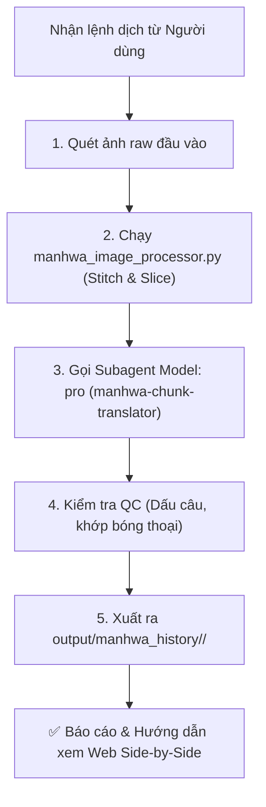

# Manhwa Pipeline Orchestrator

## Purpose
Đóng vai trò là "Nhạc trưởng" điều phối quy trình dịch truyện tranh / manhwa trong Antigravity IDE:
- Tự động tiếp nhận ảnh raw từ thư mục chỉ định (ví dụ: `input/manhwa/<chapter>/` hoặc `manhwa_projects/<slug>/<ch_xxx>/raw/`).
- Kích hoạt bộ tiền xử lý ảnh `scripts/manhwa_image_processor.py` để ghép dải ngắn, cắt dải dài có overlap, và tối ưu cho Vision AI.
- Điều phối subagent chuyên trách **Gemini Pro** (`manhwa-chunk-translator`) dịch từng lát ảnh với năng lực nhận diện người nói `[Người nói/narrator]`.
- Tổng hợp thành file `script.txt` hoàn chỉnh và lưu ngay vào `output/manhwa_history/<chapter>/` để người dùng có thể mở ngay trên Web Streamlit rà soát Side-by-Side hoặc xuất Google Docs.

---

## 🔄 Quy Trình Xử Lý Chi Tiết (Pipeline Flow)



---

## 📂 Cấu Trúc Lưu Trữ & Tương Thích Web

Mỗi chapter được xử lý xong sẽ ghi trực tiếp vào đường dẫn:
```text
trans-tool/output/manhwa_history/<Tên_Chapter>/
├── images/
│   ├── 001_slice.jpg
│   ├── 002_slice.jpg
│   └── ...
└── script.txt
```

Nội dung file `script.txt` theo đúng quy chuẩn:
```text
📄 ẢNH: 001_slice.jpg

[Han Yoojin]
KR: 제 심장의 마석,
Ma thạch trong ngực tôi,

[Narrator]
KR: 그 힘이 요동치기 bắt đầu rung chuyển.
Sức mạnh ấy bắt đầu rung chuyển dữ dội.

📄 ẢNH: 002_slice.jpg

[Sung Hyunjae]
KR: 한유진 군, 무슨 생각이지?
Han Yoojin-gun, cậu đang nghĩ gì thế?
```

---

## 🛠️ Hướng Dẫn Thực Thi

Khi người dùng yêu cầu dịch một chapter manhwa:
1. **Kiểm tra thư mục ảnh**:
   - Xác định thư mục chứa ảnh raw do người dùng cung cấp.
2. **Tiền xử lý ảnh**:
   - Chạy command:
     ```bash
     python scripts/manhwa_image_processor.py --input "<raw_dir>" --output "<dest_images_dir>" --max-height 4500 --overlap 250
     ```
3. **Phân bổ dịch thuật cho Model Pro**:
   - Đọc danh sách ảnh trong `<dest_images_dir>`.
   - Nạp các quy tắc:
     - [`.agents/rules/manhwa_translation.md`](file:///d:/Nhung/trans-tool/.agents/rules/manhwa_translation.md)
     - [`.agents/rules/manhwa_characters_visual.md`](file:///d:/Nhung/trans-tool/.agents/rules/manhwa_characters_visual.md)
     - [`glossary/glossary.txt`](file:///d:/Nhung/trans-tool/glossary/glossary.txt) và [`glossary/personal_notes.md`](file:///d:/Nhung/trans-tool/glossary/personal_notes.md)
   - Sử dụng `invoke_subagent` với `Model: "pro"` hoặc xử lý trực tiếp bằng Gemini Pro Multimodal.
4. **Kiểm tra QC tự động (Automated Audit)**:
   - Rà soát các câu dịch: số lượng dấu `!` và `?` có khớp 100% với dòng `KR:` không.
   - Kiểm tra các từ cấm (ví dụ: xưng `anh` thay vì `Hyung` khi Yoohyun nói).
5. **Ghi file và Thông báo**:
   - Lưu kết quả vào `output/manhwa_history/<chapter>/script.txt`.
   - Báo cáo số lượng ảnh và số câu thoại đã dịch, đồng thời nhắc người dùng có thể mở Web Streamlit (Tab 5) để rà soát Side-by-Side nếu muốn.
