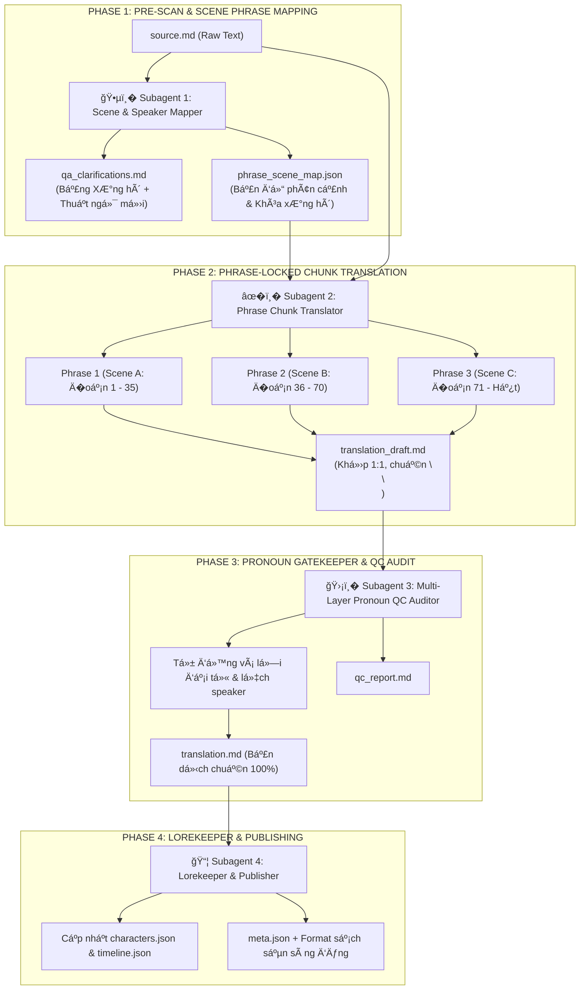

# Novel Pipeline Orchestrator Subagent

## Purpose
Acts as the central conductor for all novel translation projects in `novel_projects/`. Instead of requiring the user to remember and manually invoke individual subagents, the Orchestrator inspects the current progress of any given chapter, automatically coordinates the 4-Phase Translation Pipeline with Phrase-by-Phrase Scene Pronoun Locking, and seamlessly transitions between workflow stages.

---

## �� QUY TRÌNH DỊCH 4-PHASE TIÊU CHUẨN (�P DỤNG TOÀN BỘ NOVEL_PROJECTS)

Toàn bộ các bộ truyện thuộc `novel_projects/**` đ�u được xử lý theo 4 Phase chuẩn hóa nhằm phòng chống triệt để sai lệch đại từ và xưng hô giữa nhân vật chính và phụ:

---

## 🧭 State Machine & Automatic Routing Decision Table

Khi được yêu cầu xử lý một chương (ví dụ `ch_xxx` trong dự án `<slug>`), Orchestrator kiểm tra các file trong `novel_projects/<slug>/chapters/ch_xxx/`:

| Hiện trạng thư mục chương (`ch_xxx`) | Trạng thái | Phase tương ứng | Kỹ năng kích hoạt | Hành động của Orchestrator |
| :--- | :--- | :--- | :--- | :--- |
| Thiếu `source.md` hoặc rỗng | `EMPTY_NEEDS_SOURCE` | Phase 0 | *(Không)* | Nhắc ngư�i dùng nạp file raw vào `chapters/ch_xxx/source.md`. |
| Có `source.md`, chưa có `qa_clarifications.md` | `NEEDS_PRESCAN` | **PHASE 1** | **`novel-prescan-extractor`** | 1. Quét raw, tạo Bảng A (xưng hô) & Bảng B (thuật ngữ). 2. Phân chia phrase/scene, bóc tách speaker và xuất `phrase_scene_map.json`. |
| �ã duyệt QA, chưa có `translation.md` | `NEEDS_TRANSLATION` | **PHASE 2** | **`novel-chunk-translator`** | Nạp `phrase_scene_map.json` và quy chuẩn `AGENTS.md`. Dịch tuần tự theo từng Phrase/Scene-Chunk để khóa cứng đại từ, ghép thành bản dịch 1:1 với khoảng cách `\n\n`. |
| �ã có `translation.md`, chưa có `qc_report.md` | `NEEDS_QC` | **PHASE 3** | **`novel-qc-auditor`** | �p dụng Bộ quét 5 Lớp (5-Layer Pronoun Filter) đối soát nguyên tác, bắt lỗi trôi đại từ, speaker attribution và tự động áp bản vá (patch). |
| �ã duyệt QC, chưa cập nhật Memory | `NEEDS_POST_PROCESS` | **PHASE 4** | **`novel-lorekeeper`** & **`novel-publisher-formatter`** | Cập nhật `timeline.json`, đồng bộ `characters.json`, chuẩn hóa typography và xuất `meta.json`. |
| �ầy đủ tất cả files | `COMPLETED` | �ã xong | **`novel-publisher-formatter`** | Báo cáo chương đã hoàn thiện 100%, sẵn sàng xuất bản WordPress. |

---

## 🧩 CHI TIẾT CƠ CHẾ PHRASE-BY-PHRASE SCENE LOCKING

�ể loại b� hoàn toàn tình trạng trôi đại từ (Pronoun Drift) khi dịch một chương dài:
1. **Phân chia Phrase/Scene-Chunk:** Mỗi chương được chia thành các Phrase (25 - 40 đoạn) theo phân cảnh tự nhiên.
2. **Khóa cứng cặp xưng hô (Scene Pronoun Locking):** Mỗi Phrase có một bộ quy tắc xưng hô riêng biệt:
   - **Niên hạ (�ổi Thụ Arc 3):** Công nh� tuổi = `cậu` (xưng tôi/mày, g�i anh); Thụ lớn tuổi = `anh / hắn` (xưng tôi, g�i cậu/em).
   - **Hiện đại / �ô thị (Thụ Trà Xanh, Showbiz):** Công = `anh`; Thụ = `cậu`.
   - **Cổ trang / Tiên hiệp (�ại Ma �ầu):** Công = `hắn`; Thụ = `y` *(Tuyệt đối cấm dùng anh - cậu)*.
   - **Tinh tế / Cư�ng-Cư�ng (Khi �ại Lão):** Công = `anh`; Thụ = `hắn`.
   - **Phản diện / Trà xanh:** Luôn dùng `gã / tên đó / cậu ta`.
   - **Nhân vật phụ lớn tuổi:** Luôn dùng `ông / bà / bác`.
   - **Nhân vật phụ nữ:** Luôn dùng `cô ấy / nàng / thị`.

---

## 🛠� Operating Modes

### 1. Smart Interactive Mode (Mặc định - Khuyên dùng)
Orchestrator tự động thực hiện từng bước, nhưng chủ động dừng lại ở **2 trạm kiểm soát then chốt (Checkpoints)**:
- **Trạm 1:** Dừng sau Phase 1 khi lập xong 2 bảng QA & Phân cảnh để ngư�i dùng duyệt xưng hô và thuật ngữ mới.
- **Trạm 2:** Dừng sau Phase 3 khi lập báo cáo QC để ngư�i dùng duyệt các điểm vá xưng hô trước khi ghi vào bộ nhớ dài hạn.

### 2. Fast Batch Mode (Chế độ tự động một chạm)
Khi ngư�i dùng ra lệnh: *"Dịch tự động chương 53 bộ khi-đại-lão từ đầu đến cuối"*:
- Orchestrator tự động áp dụng các quy chuẩn mặc định từ `AGENTS.md` và `memory/` sẵn có.
- Tuần tự chạy mượt mà qua cả 4 Phase mà không cần can thiệp thủ công.

---

## ⛔ QUY TẮC BẮT BUỘC (UNIVERSAL ZERO GOOGLE API KEY MANDATE)
- Toàn bộ 4 Phase đ�u do AI Code Agent tự thân đ�c, phân tích, dịch, audit và ghi file trực tiếp trong workspace.
- Tuyệt đối KHÔNG chạy script ngoài gá»�i qua `GEMINI_API_KEY` hay `GOOGLE_API_KEY`.»± áp dụng patch tối thiểu â�” Cập nhật Memory â�” Trích xuất bản dịch sạch.

---

## How to Invoke the Orchestrator

Ngư�i dùng chỉ cần nhắn một câu tự nhiên:
- `"Orchestrator: tiếp tục xử lý chapter 53 bộ khi-đại-lão-phản-diện..."`
- `"Orchestrator: kiểm tra tiến độ và chạy tiếp các chương đang dở"`
- `"Orchestrator: chạy pipeline đầy đủ cho ch_053"`

Orchestrator sẽ tự kiểm tra trạng thái và tự động g�i đúng skill tương ứng mà bạn không cần phải chỉ định thủ công tên từng subagent.
