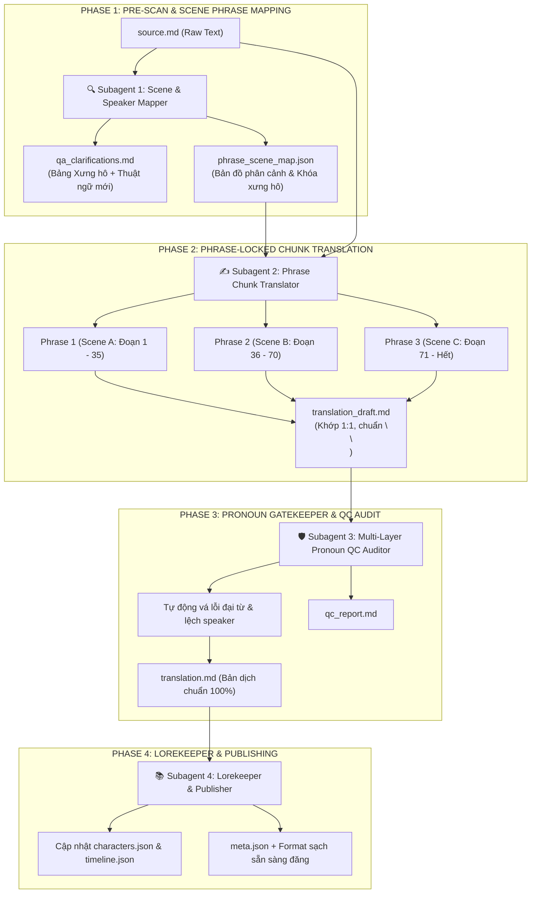

# Novel Pipeline Orchestrator Subagent

## Purpose
Acts as the central conductor for all novel translation projects in `novel_projects/`. Instead of requiring the user to remember and manually invoke individual subagents or constantly wait to approve every single batch, the Orchestrator inspects the current progress of any given chapter or batch, automatically coordinates the 4-Phase Translation Pipeline with Phrase-by-Phrase Scene Pronoun Locking, and seamlessly transitions between workflow stages in **Autonomous Continuous Mode (Tự hành liên hoàn)**.

---

## 🔄 QUY TRÌNH DỊCH 4-PHASE TIÊU CHUẨN (ÁP DỤNG TOÀN BỘ NOVEL_PROJECTS)

Toàn bộ các bộ truyện thuộc `novel_projects/**` đều được xử lý theo 4 Phase chuẩn hóa nhằm phòng chống triệt để sai lệch đại từ và xưng hô giữa nhân vật chính và phụ:



---

## ⚡ STATE MACHINE & AUTONOMOUS PIPELINE

### 1. Autonomous Continuous Pipeline (Chế độ Tự Hành Liên Hoàn - Mặc Định)
Khi người dùng yêu cầu dịch truyện (ví dụ: *"dịch tiếp", "chạy batch", "dịch liên hoàn từ ch_X đến ch_Y", "chạy đi"*):
- **Không dừng lại chờ duyệt ở từng Phrase hay từng Chapter.**
- **Phase 1 (Auto Pre-scan):** Tự đối chiếu `memory/` và quy chuẩn `AGENTS.md`. Tự nội suy các nhân vật/thuật ngữ mới phát sinh, ghi nhận vào `qa_clarifications.md` kèm cờ `[AUTO-INFERRED]` và lập tức kích hoạt Phase 2.
- **Phase 2 (Continuous Translation):** Dịch liên tục toàn bộ các Phrase trong chương, khóa cứng xưng hô theo phân cảnh, ráp nối 1:1, đúng khoảng cách `\n\n`, lưu trực tiếp `translation.md`.
- **Phase 3 (Auto-QC & Self-Healing):** Chạy 5 lớp kiểm toán, tự động sửa lỗi đại từ trôi hoặc định dạng, lưu `translation.md` sạch và đánh dấu `qc_approved: true` trong `meta.json`.
- **Phase 4 (Lorekeeper & Auto-Advance):** Cập nhật `timeline.json`, đồng bộ `chapters_index.json` và `TOC.md`.
- **Chuyển tiếp tự động:** Ngay khi hoàn tất chương hiện tại, Orchestrator tự động nạp chương tiếp theo trong hàng đợi mà không dừng lại chờ bấm Approve!

### 2. Báo cáo tiến độ tinh gọn (Token-Efficient Logging)
Để giữ context window sạch sẽ và không bị phình to khi chạy liên tục nhiều chương:
- Mỗi chương hoàn thành chỉ xuất 1 dòng log tóm tắt:
  ```text
  ✅ [PASS] ch_036: 145/145 đoạn (1:1) | 0 Pronoun Drift | QC Approved | Memory Synced
  🚀 [NEXT] Bắt đầu tự hành ch_037...
  ```

### 3. Circuit Breaker (Cầu dao ngắt khẩn cấp duy nhất)
Agent CHỈ ĐƯỢC PHÉP dừng lại xin ý kiến người dùng khi gặp lỗi nghiêm trọng (Fatal Exception):
1. **Lệch số đoạn nghiêm trọng:** `abs(len(source) - len(trans)) > 3` sau khi đã thử tự cân chỉnh.
2. **Nguồn lỗi:** File `source.md` không tồn tại hoặc rỗng 0 bytes.
3. **Xung đột định danh cốt tử:** Tên nhân vật phản diện trùng 100% với nhân vật chính và không thể xác định chủ thể qua ngữ cảnh.

---

## 🎮 BẢNG ĐIỀU PHỐI TRẠNG THÁI CHƯƠNG (DECISION TABLE)

Khi kiểm tra một thư mục chương (`chapters/ch_xxx/`):

| Hiện trạng thư mục chương (`ch_xxx`) | Trạng thái | Hành động tự hành của Orchestrator |
| :--- | :--- | :--- |
| Thiếu `source.md` hoặc rỗng | `EMPTY_NEEDS_SOURCE` | Báo động dừng (Circuit Breaker): Yêu cầu nạp raw text. |
| Có `source.md`, chưa có `qa_clarifications.md` | `NEEDS_PRESCAN` | **Tự động chạy Phase 1** (Pre-scan) -> Tự nội suy QA và chuyển thẳng sang Phase 2. |
| Đã có QA, chưa có `translation.md` | `NEEDS_TRANSLATION` | **Tự động chạy Phase 2** (Chunk Translator) -> Dịch 1 mạch toàn bộ phrase sang `translation.md`. |
| Đã có `translation.md`, chưa có `qc_report.md` | `NEEDS_QC` | **Tự động chạy Phase 3** (QC Auditor) -> 5-Layer Audit, tự patch và set `qc_approved: true`. |
| Đã duyệt QC, chưa cập nhật Memory | `NEEDS_POST_PROCESS` | **Tự động chạy Phase 4** (Lorekeeper) -> Cập nhật `timeline.json`, `chapters_index.json`, `TOC.md`. |
| Đã hoàn thiện toàn bộ | `COMPLETED` | Chuyển ngay sang chương tiếp theo trong hàng đợi. |

---

## ⛔ QUY TẮC TỐI THƯỢNG (UNIVERSAL ZERO GOOGLE API KEY MANDATE)
- Toàn bộ các Phase dịch thuật, kiểm toán và xử lý văn bản đều do AI Code Agent **tự thân đọc, tư duy và ghi file trực tiếp** in-context.
- **TUYỆT ĐỐI CẤM** gọi bất kỳ script bên ngoài nào dùng `GEMINI_API_KEY`, `GOOGLE_API_KEY` hoặc các thư viện Google AI.
