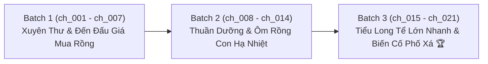

# 📋 KẾ HOẠCH & TIẾN ĐỘ DỊCH THUẬT ARC 1: XUỐNG NÚI MUA RỒNG & NUÔI DƯỠNG TIỂU TUYẾT LONG

> **Bộ truyện:** Ai Nói Mỹ Nhân Sư Tôn Không Thể Làm Công (谁说美人师尊不可以当攻)  
> **Tác giả:** Bát Thập Lục Bút (八十六笔)  
> **Phạm vi Arc 1:** Chương 1 đến Chương 21 (`ch_001` $\rightarrow$ `ch_021`) *(Toàn bộ 21 chương Free)*  
> **Quy chuẩn áp dụng:** [`rules_arc_1.md`](rules_arc_1.md) & [`AGENTS.md`](AGENTS.md)  
> **Chế độ thực thi:** **Fast Batch Mode** (Dịch chuẩn 1:1, Auto QC Audit, Auto Lorekeeper theo từng đợt)  
> **Mục tiêu cốt lõi:** Dịch mượt mà, văn phong cổ phong tiên hiệp hài hước, bảo toàn 1:1 số đoạn văn, khóa chặt ngôi 3 Công (Thiều Liên Cảnh) = "y", Thụ (Yến Trần Phong / Long tể) = "hắn/tiểu long tể", chuẩn thoại `“...”` và cách dòng `\n\n`.

---

## 📊 1. BẢNG TỔNG QUAN TIẾN ĐỘ ARC 1

| Chỉ số | Giá trị | Ghi chú |
| :--- | :---: | :--- |
| **Tổng số chương Arc 1** | **21 chapters** | `ch_001` $\rightarrow$ `ch_021` |
| **Đã cào raw (`source.md`)** | **21 / 21 (100%)** | Toàn bộ 21 chương Free đã sẵn sàng |
| **Đã hoàn thành dịch & QC** | **7 / 21 (33.3%)** | Hoàn tất 100% Batch 1 (`ch_001` $\rightarrow$ `ch_007`) |
| **Phân chia Batch** | **3 Batches** | Batch 1 (7 ch) $\rightarrow$ Batch 2 (7 ch) $\rightarrow$ Batch 3 (7 ch) |
| **Khóa chuẩn đại từ** | **100% Locked** | Công (Thiều Liên Cảnh) = "y" (duy nhất) \| Thụ (Yến Trần Phong) = "hắn/tiểu long tể" |

---

## 📦 2. PHÂN CHIA CÁC BATCH CHI TIẾT

---

### 🔹 BATCH 1: Xuyên Thư & Đến Đấu Giá Mua Rồng (`ch_001` $\rightarrow$ `ch_007`)
* **Trọng tâm nội dung:**
  - Thiều Liên Cảnh xuyên thư thành Linh Tôn mỹ nhân nhưng cự tuyệt làm "0 tôn", từ chối sư đệ trà xanh Tạ Đào Hoa (cá chép gấm béo tròn).
  - Xuống núi đến Táng Hồn Thành, tham gia hội đấu giá mua tiểu long tể Tuyết Long về làm đồ đệ kiêm thuốc giải.

| Mã chương | Tiêu đề chương | Trạng thái raw | Trạng thái dịch & QC | Tóm tắt sự kiện chính |
| :---: | :--- | :---: | :---: | :--- |
| `ch_001` | [Chương 1: Xuyên Thư Cự Tuyệt Làm Thụ](chapters/ch_001/translation.md) | 🟢 Đã có raw (79 đoạn) | 🟢 QC_PASSED (100%) | Thiều Liên Cảnh ngắm hoa ở Phục Linh sơn, xuyên thư cự tuyệt làm thụ, né tránh thính của sư đệ Tạ Đào Hoa. |
| `ch_002` | [Chương 2: Đấu Giá Mua Long Tể](chapters/ch_002/translation.md) | 🟢 Đã có raw (152 đoạn) | 🟢 QC_PASSED (100%) | Đến Táng Hồn Thành, giấu thân phận vào Bảo Lai Các, bỏ 5000 linh thạch tam phẩm đấu giá mua tiểu long tể. |
| `ch_003` | [Chương 3: Bạch Liên Trà Xanh & Thuộc Tính Phong Phê](chapters/ch_003/translation.md) | 🟢 Đã có raw (113 đoạn) | 🟢 QC_PASSED (100%) | Đặt tên Yến Trần Phong; vả mặt bạch liên Quân Ký Tuyết; trừng trị hai tên dâm tặc, long tể lộ tính phong phê. |
| `ch_004` | [Chương 4: Long Tộc Thệ Ngôn & Vả Mặt Đại Sư Huynh](chapters/ch_004/translation.md) | 🟢 Đã có raw (125 đoạn) | 🟢 QC_PASSED (100%) | Gặp nguyên chủ trong mơ; long tể quỳ hôn giày thề trung thành; về Phục Linh sơn vả mặt Cốc chủ Đoạn Niệm. |
| `ch_005` | [Chương 5: Bắt Cá Đi Du Ngoạn & Cái Đồ Mù Chữ](chapters/ch_005/translation.md) | 🟢 Đã có raw (88 đoạn) | 🟢 QC_PASSED (100%) | Ngâm suối nước nóng; gán ghép Hồ Dã x Tạ Đào Hoa; long tể nghe nhầm "tịch cốc" thành "cái mông" tấu hài. |
| `ch_006` | [Chương 6: Uống Thức Ăn & Miếng Sườn Của Ông Lão](chapters/ch_006/translation.md) | 🟢 Đã có raw (91 đoạn) | 🟢 QC_PASSED (100%) | Long tể đến nhà ăn "uống thức ăn"; đặt tên Xuân Lai; gọi Đoạn Niệm là "ông" và mời ăn miếng sườn có dấu răng. |
| `ch_007` | [Chương 7: Đòi Sâm Ba Ngàn Năm & Trừ Khử Danh Tiếng Bạch Liên](chapters/ch_007/translation.md) | 🟢 Đã có raw (84 đoạn) | 🟢 QC_PASSED (100%) | Đấu võ mồm lột sạch sâm 3000 năm của Đoạn Niệm; bóc phốt Quân Ký Tuyết; long tể giả vờ đau chân để được sư tôn bế. |

---

### 🔹 BATCH 2: Thuần Dưỡng & Ôm Rồng Con Hạ Nhiệt (`ch_008` $\rightarrow$ `ch_014`)
* **Trọng tâm nội dung:**
  - Tiểu long tể cảnh giác ban đầu dần tan biến trước sự cưng chiều và bảo bọc của Thiều Liên Cảnh.
  - Thiều Liên Cảnh ôm tiểu long tể ngủ để xoa dịu nhiệt hỏa trong cơ thể, thiết lập tình cảm sư đồ gắn bó.

| Mã chương | Tiêu đề chương | Trạng thái raw | Trạng thái dịch & QC | Tóm tắt sự kiện chính |
| :---: | :--- | :---: | :--- | :--- |
| `ch_008` | Chương 8 | 🟢 Đã có raw (95 đoạn) | ⏳ Chờ dịch | Rồng con gầm gừ đề phòng; sư tôn kiên nhẫn đút thức ăn và dỗ dành nhóc con. |
| `ch_009` | Chương 9 | 🟢 Đã có raw (55 đoạn) | ⏳ Chờ dịch | Thân nhiệt tiểu long tể lạnh buốt; sư tôn ôm vào lòng cảm thấy thoải mái dễ chịu kỳ lạ. |
| `ch_010` | Chương 10 | 🟢 Đã có raw (86 đoạn) | ⏳ Chờ dịch | Dạy dỗ tiểu long tể nhận biết sư tôn, quy củ ăn uống ngủ nghỉ. |
| `ch_011` | Chương 11 | 🟢 Đã có raw (48 đoạn) | ⏳ Chờ dịch | Tương tác ngọt ngào giữa sư tôn lém lỉnh và nhóc rồng ngoan ngoãn bắt đầu dính người. |
| `ch_012` | Chương 12 | 🟢 Đã có raw (83 đoạn) | ⏳ Chờ dịch | Chăm sóc vảy rồng và móng vuốt nhỏ; phát hiện tiềm năng huyết mạch nghịch thiên của đồ đệ. |
| `ch_013` | Chương 13 | 🟢 Đã có raw (80 đoạn) | ⏳ Chờ dịch | Chuẩn bị hành trang rời Táng Hồn Thành trở về Vân Tê Cốc. |
| `ch_014` | Chương 14 | 🟢 Đã có raw (58 đoạn) | ⏳ Chờ dịch | Chặn đứng những kẻ bám đuôi mưu đồ cướp rồng trên đường đi. |

---

### 🔹 BATCH 3: Tiểu Long Tể Lớn Nhanh & Biến Cố Phố Xá (`ch_015` $\rightarrow$ `ch_021`)
* **Trọng tâm nội dung:**
  - Tiểu long tể hấp thu linh khí lớn nhanh vượt bậc, bắt đầu có ý thức chiếm hữu và bảo vệ sư tôn.
  - Biến cố đột ngột trên đường phố Táng Hồn Thành kết thúc chặng mở đầu của Arc 1.

| Mã chương | Tiêu đề chương | Trạng thái raw | Trạng thái dịch & QC | Tóm tắt sự kiện chính |
| :---: | :--- | :---: | :--- | :--- |
| `ch_015` | Chương 15 | 🟢 Đã có raw (92 đoạn) | ⏳ Chờ dịch | Long tể quấn quýt lấy cổ tay sư tôn như chiếc vòng tuyết trắng tinh xảo. |
| `ch_016` | Chương 16 | 🟢 Đã có raw (61 đoạn) | ⏳ Chờ dịch | Sư tôn thử nghiệm năng lực băng hệ của đồ đệ; long tể nỗ lực thể hiện lấy lòng sư tôn. |
| `ch_017` | Chương 17 | 🟢 Đã có raw (52 đoạn) | ⏳ Chờ dịch | Đối mặt với thử thách tâm tính; long tể ghen tị khi có kẻ khác nhìn ngắm sư tôn. |
| `ch_018` | Chương 18 | 🟢 Đã có raw (50 đoạn) | ⏳ Chờ dịch | Dấu hiệu long tể chuẩn bị thăng cấp giai đoạn sinh trưởng đầu tiên. |
| `ch_019` | Chương 19 | 🟢 Đã có raw (75 đoạn) | ⏳ Chờ dịch | Đêm trước biến cố; sư tôn thức canh chừng đồ đệ điều tức linh lực. |
| `ch_020` | Chương 20 | 🟢 Đã có raw (52 đoạn) | ⏳ Chờ dịch | Đi dạo phố đêm mua sắm linh dược cho đồ đệ tẩm bổ. |
| `ch_021` | Chương 21 | 🟢 Đã có raw (132 đoạn) | ⏳ Chờ dịch | Long tể lớn nhanh rõ rệt; biến cố bất ngờ xảy ra giữa phố xá, long tể tạm biến mất để lại tờ tiền giấy bí ẩn. |
