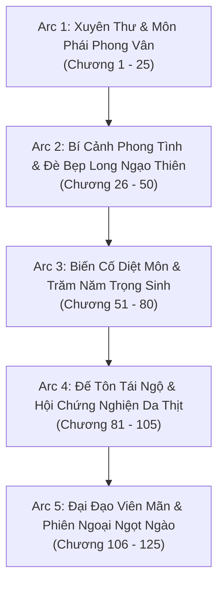

# 🗺️ KẾ HOẠCH TRIỂN KHAI DỊCH THUẬT (PLAN)
## BẺ CONG TÊN TRAI THẲNG LONG NGẠO THIÊN KIA (《攻了那个直男龙傲天》)

> **Tác giả:** Phong Lưu Khách (风流客)  
> **Quy mô dự án:** 125 chương (Chương 1 - Chương 121 Chính văn + Chương 122 - Chương 125 Phiên ngoại)  
> **Độ dài raw:** ~1.45 MB / 125 chương đã phân tách sẵn trong `chapters/ch_001` - `chapters/ch_125`  
> **Chủ đề chính:** Chủ công, xuyên thư, tiên hiệp tu chân, lưu manh ngốc cẩu công x Long Ngạo Thiên ngạo kiều bạo kiều thụ nghiện da thịt, hài hước sảng văn, 1v1, HE.  

---

## 🎯 1. MỤC TIÊU CỐT LÕI

1. **Chất Lượng Văn Phong:**
   - Bảo toàn trọn vẹn nét hài hước, dí dỏm, "lưu manh vô sỉ" duyên dáng của Cố Dương và sự tương phản đáng yêu giữa khí chất kiếm tiên ngạo nghễ với cơ thể "nghiện hơi ấm" của Tạ Ly Thù.
   - Giữ vững nhịp điệu tu chân sảng văn: gay cấn trong các trận đấu kiếm khí bí cảnh, ngọt ngào dính người trong các phân cảnh thân mật.
2. **Kỷ Luật Định Dạng & Kỹ Thuật (Zero Tolerance):**
   - **Zero Google API Key Mandate:** AI Code Agent tự thân đọc raw `source.md`, phân tích và dịch trực tiếp. Tuyệt đối không dùng API ngoài.
   - **1:1 Paragraph Alignment:** 100% số đoạn tiếng Việt khớp chính xác với số đoạn raw trong `source.md`.
   - **Chuẩn Khoảng Cách `\n\n` & Ngoặc Kép `“...”`:** Mọi đoạn văn và lời thoại cách nhau đúng 1 dòng trống, thoại nằm gọn trong ngoặc kép cong.
   - **Không Đá Ngôi:** Ngôi 3 trần thuật tách bạch: Cố Dương là **"hắn"**, Tạ Ly Thù là **"y"**.

---

## 📅 2. PHÂN KỲ TRIỂN KHAI THEO CỐT TRUYỆN (ARCS)

Dự án 125 chương được chia thành 5 giai đoạn mạch truyện chính:

### 🔹 Arc 1: Xuyên Thư & Môn Phái Phong Vân (Chương 1 - Chương 25)
- **Nội dung:** Cố Dương xuyên vào đệ tử phế sài trong chuồng gà, gặp gỡ vị đại sư huynh Long Ngạo Thiên Tạ Ly Thù kiếm khí bức người. Cố Dương phát huy tài mặt dày bám đuôi, gia nhập môn phái, trải qua khảo nghiệm và bắt đầu kế hoạch "bẻ cong" nam chính.
- **Tiêu điểm dịch:** Làm nổi bật sự đối lập giữa một kẻ xuyên thư lươn lẹo với một thiên tài kiếm tu đoan chính, nghiêm khắc tu Vô Tình Đạo.

### 🔹 Arc 2: Bí Cảnh Phong Tình & Đè Bẹp Long Ngạo Thiên (Chương 26 - Chương 50)
- **Nội dung:** Cả hai cùng bước vào bí cảnh môn phái tìm kiếm cơ duyên. Gặp phải bẫy tình niệm và độc tố kỳ lạ, Cố Dương nhân cơ hội đè bẹp Tạ sư huynh, gạo nấu thành cơm. Tạ Ly Thù vừa phẫn nộ vừa rung động trước sự chăm sóc liều mạng của Cố Dương.
- **Tiêu điểm dịch:** Miêu tả tinh tế cảnh thân mật, chuyển biến tâm lý giằng xé của Tạ Ly Thù khi đạo tâm lung lay.

### 🔹 Arc 3: Biến Cố Diệt Môn & Trăm Năm Trọng Sinh (Chương 51 - Chương 80)
- **Nội dung:** Âm mưu của các thế lực ngấm ngầm bùng nổ, môn phái gặp nạn. Cố Dương vì che chở Tạ Ly Thù mà rơi vào hiểm cảnh, giả chết ly khai. Tạ Ly Thù phát điên, một kiếm trảm vạn ma, đoạn tuyệt Vô Tình Đạo để bước lên ngai vị Đế tôn chấn nhiếp tiên giới.
- **Tiêu điểm dịch:** Cảm xúc cao trào, bi tráng, nỗi đau mất đi người thương của Tạ Ly Thù.

### 🔹 Arc 4: Đế Tôn Tái Ngộ & Hội Chứng Nghiện Da Thịt (Chương 81 - Chương 105)
- **Nội dung:** Trăm năm sau Cố Dương trùng sinh trở lại. Tạ Ly Thù giờ đã là Đế tôn chí cao vô thượng nhưng mắc chứng "khát khao da thịt" nghiêm trọng, không cho ai chạm vào người trừ Cố Dương. Tái ngộ trong hoàn cảnh dở khóc dở cười, Đế tôn bề ngoài lạnh lùng nhưng cơ thể liên tục run rẩy cầu ôm ấp.
- **Tiêu điểm dịch:** Tương phản ngạo kiều hài hước cực đại, sủng công sủng thụ đan xen.

### 🔹 Arc 5: Đại Đạo Viên Mãn & Phiên Ngoại Ngọt Ngào (Chương 106 - Chương 125)
- **Nội dung:** Cùng nhau thanh trừng kẻ địch cuối cùng, công khai đạo lữ trước toàn thể Tiên giới. 4 chương phiên ngoại cuộc sống ngọt ngào, thú vị bên nhau.
- **Tiêu điểm dịch:** Hạnh phúc viên mãn, văn phong nhẹ nhàng, giải trí, kết thúc trọn vẹn.

---

## 🚀 3. KẾ HOẠCH BATCH DỊCH TỰ HÀNH (EXECUTION SCHEDULE)

Để đảm bảo hiệu suất và chất lượng QC cao nhất, toàn bộ 125 chương được phân bổ thành các đợt chạy:

| Đợt chạy (Batch) | Phạm vi chương | Trọng tâm nội dung | Thời lượng dự kiến |
| :--- | :--- | :--- | :--- |
| **Batch 1** | Chương 1 - 5 | Mở màn: Xuyên thư, gặp Tạ Ly Thù, chuồng gà, bái nhập môn phái | Khởi động & Test quy chuẩn |
| **Batch 2** | Chương 6 - 15 | Sinh hoạt môn phái, Cố Dương mặt dày bám đại sư huynh | Tăng tốc văn phong |
| **Batch 3** | Chương 16 - 25 | Chuẩn bị vào bí cảnh, khảo hạch môn phái | Kết thúc Arc 1 |
| **Batch 4 - 6** | Chương 26 - 50 | Bí cảnh tranh đoạt & Cao trào tình niệm đè bẹp sư huynh | Hoàn thành Arc 2 |
| **Batch 7 - 9** | Chương 51 - 80 | Biến cố môn phái, Cố Dương chết giả, Tạ Ly Thù hắc hóa | Hoàn thành Arc 3 |
| **Batch 10 - 12**| Chương 81 - 105| Trọng sinh tái ngộ, Đế tôn nghiện da thịt truy phu | Hoàn thành Arc 4 |
| **Batch 13 - 15**| Chương 106 - 125| Đại chiến định càn khôn & 4 chương phiên ngoại | Hoàn tất dự án |

---

## 🔍 4. QUY TRÌNH KIỂM SOÁT CHẤT LƯỢNG (QC CHECKLIST)

Mỗi chương dịch xong phải vượt qua bộ lọc 5 bước:
1. `[ ]` **Paragraph Count Check:** Số đoạn `translation.md` = Số đoạn `source.md` (sai lệch = FAIL).
2. `[ ]` **Spacing Check:** Cách dòng `\n\n` chuẩn mực, không dính dòng.
3. `[ ]` **Pronoun Audit:**
   - Trần thuật: Cố Dương = **"hắn"**, Tạ Ly Thù = **"y"**.
   - Đối thoại: Đúng ma trận xưng hô (đệ/ta - sư huynh; ta - ngươi/sư đệ).
4. `[ ]` **Quote Normalization:** Tất cả lời thoại nằm trong ngoặc kép cong `“...”`.
5. `[ ]` **Sync Memory:** Cập nhật các nhân vật mới xuất hiện vào `memory/characters.json` và sự kiện vào `memory/timeline.json`.
