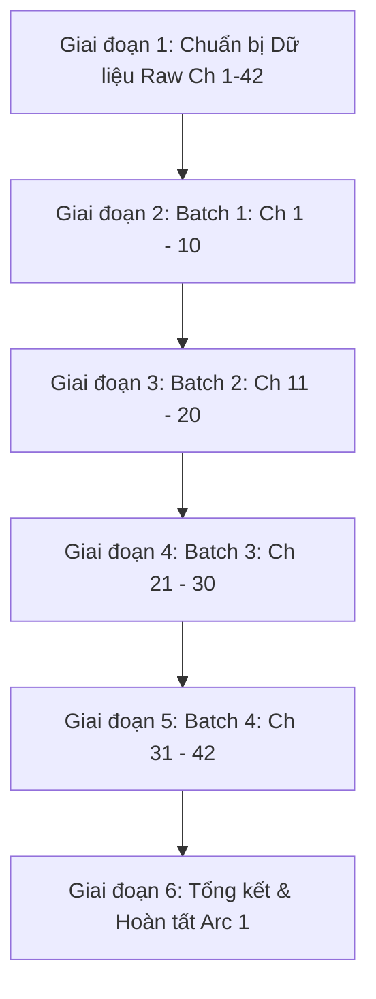

# 🗺️ KẾ HOẠCH TRIỂN KHAI THẾ GIỚI 1 (PLAN ARC 1)
## CÁ MẶN KÝ CHỦ TỔNG ĐỐI VAI ÁC NHẤT KIẾN CHUNG TÌNH?! (《反派不能是双标宿主的老婆！》)

> **Tên đơn nguyên:** Chim Hoàng Yến Thế Thân Lười Nhác × Tổng Tài Boss Phản Diện Giả Dịu Dàng Thật Hiểm Độc  
> **Phạm vi chương:** Chương 1 đến Chương 42 (Tổng cộng: 42 chương)  
> **Chủ đề chính:** Cứu rỗi bằng sự chân thành vô sỉ, tiêu chuẩn kép sủng vợ, vả mặt hào môn, hài hước ngọt sủng.

---

## 🎯 MỤC TIÊU CỐT LÕI

1. **Chất lượng văn phong đỉnh cao:** Giữ trọn sự dí dỏm, phong thái "cá mặn da mặt dày nhưng chiến lực siêu cấp" của Chu Nhàn và nét ngoài nhã nhặn trong thâm sâu hiểm ác của Lục Ninh Sâm.
2. **Tuân thủ quy chuẩn tuyệt đối:**
   - 100% 1:1 Paragraph Alignment giữa `translation.md` và `source.md`.
   - Đúng khoảng cách `\n\n` giữa tất cả các đoạn và lời thoại.
   - Chuẩn hóa ngoặc thoại cong `“...”`.
   - Phân biệt triệt để: Trần thuật Chu Nhàn = **“hắn”**, Lục Ninh Sâm = **“anh”** (hoặc Lục Ninh Sâm, Lục tổng); tuyệt đối **CẤM** dùng “cậu” cho Lục Ninh Sâm trong trần thuật.
3. **Quy tắc không dùng Google API:** AI Agent tự thân thực thi trực tiếp mọi khâu từ đọc raw, dịch, soát QC đến lưu trữ.

---

## 📦 PHÂN CHIA CÁC GIAI ĐOẠN & BATCH DỊCH THUẬT



---

### 🔹 GIAI ĐOẠN 1: CHUẨN BỊ DỮ LIỆU RAW (CHƯƠNG 1 - 42)
- **Mục tiêu:** Thu thập toàn bộ văn bản gốc tiếng Trung sạch từ nguồn free raw (52shuku / czbooks / txtnovel / TYT) và cấu trúc vào thư mục dự án.
- **Cấu trúc thư mục mục tiêu:**
  ```text
  novel_projects/cá-mặn-ký-chủ-tổng-đối-vai-ác-nhất-kiến-chung-tình/chapters/
  ├── ch_001/
  │   └── source.md
  ├── ch_002/
  │   └── source.md
  └── ... (đến ch_042/)
  ```
- **Hành động:** Viết/chạy script cào tự động từ nguồn web miễn phí không cần cookie phức tạp hoặc nhập dữ liệu thô.

---

### 🔹 GIAI ĐOẠN 2: BATCH 1 - KHỞI ĐẦU & NHẤT KIẾN CHUNG TÌNH (CHƯƠNG 1 - 10)
- **Nội dung cốt truyện:**
  - Chu Nhàn xuyên tới, đối đầu với Hệ thống Cải tạo Phản diện.
  - Phá vỡ thân phận chim hoàng yến: Nhuộm tóc vàng, phóng mô tô xông thẳng vào biệt thự Lục gia.
  - Cuộc gặp gỡ định mệnh: Chu Nhàn trúng tiếng sét ái tình với Lục Ninh Sâm, chuyển sang chế độ "mê vợ" và bắt Lục tổng học 24 chữ "Giá trị quan cốt lõi".
  - Lục Ninh Sâm ban đầu đề phòng, nghi hoặc về hành tung kỳ quặc của Chu Nhàn.
- **Nhiệm vụ Agent:**
  - Dịch hoàn thiện 10 chương đầu (`ch_001` -> `ch_010`).
  - Kiểm định QC tầng 1: Kiểm tra danh xưng, đại từ ngôi 3, giữ nhịp gây cười.
  - Cập nhật Lorekeeper tầng 1: Ghi nhận ấn tượng ban đầu, nhân vật phụ trợ lý/quản gia xuất hiện.

---

### 🔹 GIAI ĐOẠN 3: BATCH 2 - CẢI TẠO PHẢN DIỆN & VẢ MẶT NGOẠI CẢNH (CHƯƠNG 11 - 20)
- **Nội dung cốt truyện:**
  - Chu Nhàn chính thức dọn vào biệt thự làm "bạn đời / bảo mẫu độc quyền" của Lục Ninh Sâm.
  - Những màn va chạm nảy lửa giữa vẻ ngoài đạo mạo của Lục tổng và sự da mặt dày của Chu Nhàn.
  - Chu Nhàn ra tay giải quyết các rắc rối công việc và đám người họ hàng cực phẩm của họ Lục, ra mặt bảo vệ Lục Ninh Sâm.
  - Lục Ninh Sâm bắt đầu có những rung động đầu tiên dù vẫn cứng miệng phủ nhận.
- **Nhiệm vụ Agent:**
  - Dịch hoàn thiện `ch_011` -> `ch_020`.
  - Kiểm định QC tầng 2: Đảm bảo độ sắc sảo trong lời thoại đối đáp của Lục tổng và sự dịu dàng sủng ái của Chu Nhàn.
  - Cập nhật Lorekeeper tầng 2: Bổ sung danh tính các nhân vật phản diện phụ họ Lục vào `characters.json`.

---

### 🔹 GIAI ĐOẠN 4: BATCH 3 - KÉO PHẢN DIỆN KHỎI VỰC TỰ HỦY (CHƯƠNG 21 - 30)
- **Nội dung cốt truyện:**
  - Quá khứ đen tối của Lục Ninh Sâm và âm mưu của "bạch nguyệt quang" giả tạo Thẩm Diễm được hé lộ.
  - Kế hoạch tự hủy và trả thù đẫm máu của Lục tổng bị Chu Nhàn từng bước hóa giải bằng tình yêu thương và sự đồng hành kiên định.
  - Những phân cảnh tình cảm đắt giá: Chu Nhàn hôn Lục Ninh Sâm, khẳng định vị thế vợ hợp pháp trong lòng anh.
- **Nhiệm vụ Agent:**
  - Dịch hoàn thiện `ch_021` -> `ch_030`.
  - Kiểm định QC tầng 3: Xử lý mượt mà sự chuyển biến tâm lý từ u ám sang mở lòng của Lục Ninh Sâm.
  - Cập nhật Lorekeeper tầng 3: Ghi nhận timeline bước ngoặt tình cảm vào `timeline.json`.

---

### 🔹 GIAI ĐOẠN 5: BATCH 4 - ĐỈNH ĐIỂM & VIÊN MÃN THẾ GIỚI 1 (CHƯƠNG 31 - 42)
- **Nội dung cốt truyện:**
  - Trận chiến quyết định với các thế lực đối đầu trong gia tộc họ Lục; vả mặt hoàn toàn Thẩm Diễm.
  - Lục Ninh Sâm từ bỏ hoàn toàn ý định tự hủy, giá trị hắc hóa giảm về 0, công khai thừa nhận tình cảm với Chu Nhàn.
  - Kết cục ngọt ngào, ấm áp của Arc 1 trước khi Chu Nhàn cùng Hệ thống chuẩn bị chuyển giao sang Thế giới 2 (Thiên hạ đệ nhất cao thủ × Chân thế tử).
- **Nhiệm vụ Agent:**
  - Dịch hoàn thiện `ch_031` -> `ch_042`.
  - Tổng kiểm định QC toàn bộ Arc 1: Đối chiếu tính nhất quán 42 chương.
  - Đóng gói trọn vẹn Arc 1 và chuẩn bị bàn giao.

---

## 🛠️ MA TRẬN TIÊU CHÍ QC AUDIT DÀNH RIÊNG CHO ARC 1

| Tiêu chí | Điểm chuẩn | Lưu ý đặc thù Arc 1 |
| :--- | :---: | :--- |
| **Paragraph Alignment** | 100% (1:1) | Không được gộp các câu đùa ngắn của Chu Nhàn vào đoạn trần thuật. |
| **Pronoun Binding** | 100% | Chu Nhàn = “hắn”, Lục Ninh Sâm = “anh”. Tuyệt đối CẤM gọi Lục Ninh Sâm là “cậu” trong trần thuật ngôi 3. |
| **Punctuation & Format** | 100% | Thoại dùng `“...”`, các đoạn cách nhau `\n\n`. |
| **Văn phong hài hước** | Sắc nét | Giữ nguyên các thuật ngữ: *Cá mặn*, *Tiêu chuẩn kép*, *Giá trị quan cốt lõi*, *Ánh sáng chính đạo*. |
| **Zero External API** | Tuyệt đối | Tự thân Agent biên dịch, không phát sinh lỗi 429/503. |
