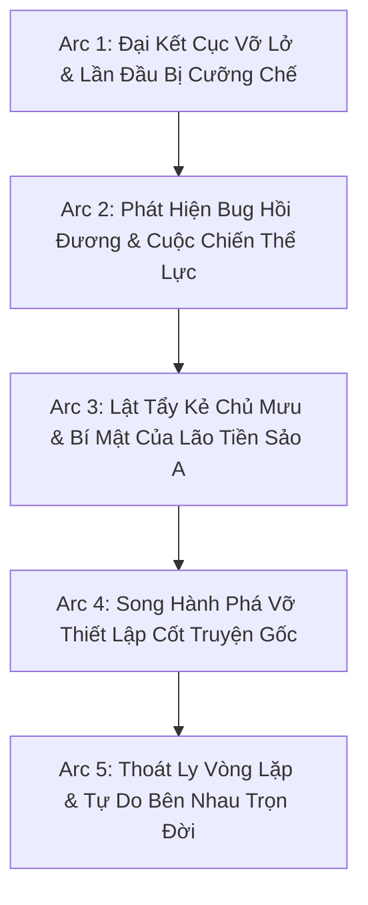

# 🗺️ KẾ HOẠCH TRIỂN KHAI DỊCH THUẬT TOÀN DỰ ÁN (PROJECT TRANSLATION PLAN)
## CƯỜNG CHẾ ÁI HOÀN TỰU HỒI ĐÁNG, THIỂM CẨU CÔNG BỊ ĐÀO KHÔNG LIỄU (《强制爱完就回档，舔狗攻被掏空了》)

> **Tác giả:** Nãi Ca Đạt Nhân (奶咖达人)  
> **Slug:** `cường-chế-ái-hoàn-tựu-hồi-đáng-thiểm-cẩu-công-bị-đào-không-liễu`  
> **Thể loại:** Đam mỹ, Hiện đại, Xuyên thư, ABO, Chủ công, Niên hạ, Hồi đương, Thụ cưỡng chế công, 1v1, HE.  
> **Cặp đôi chính:** Hoa Y Lâu (Công) × Thẩm Kinh Dạng (Thụ)

---

## 🎯 I. MỤC TIÊU CỐT LÕI

1. **Văn phong Hiện đại ABO chuẩn mực:** Duy trì giọng văn hoạt bát, hài hước, châm biếm sâu cay của Hoa Y Lâu cùng sự thâm trầm, nguy hiểm nhưng cuồng si của Thẩm Kinh Dạng.
2. **Kỷ luật định dạng 100%:**
   - 100% khớp đoạn 1:1 (`source.md` ↔ `translation.md`).
   - Đúng khoảng cách `\n\n` giữa tất cả các đoạn văn và lời thoại.
   - Chuẩn hóa ngoặc kép hội thoại `“...”`.
   - Phân biệt tuyệt đối đại từ ngôi 3: Hoa Y Lâu = **“hắn”**, Thẩm Kinh Dạng = **“y”**.
3. **Quy tắc Universal Zero Google API Key:** Agent tự thân xử lý toàn bộ quy trình, không gọi API ngoài, triệt tiêu nguy cơ 429 Resource Exhausted.
4. **Cơ chế vận hành Subagent linh hoạt:** Phân luồng Worker Subagent chạy song song độc lập khi triển khai batch lớn.

---

## 📦 II. LỘ TRÌNH NỘI DUNG CHÍNH (KEY MILESTONES)

---

### 🔹 GIAI ĐOẠN 1: THIẾT LẬP NỀN TẢNG VÀ CHUẨN HÓA MEMORY
- Thiết lập hồ sơ nhân vật, thuật ngữ ABO và pheromone đặc thù.
- Nạp raw `source.md` cho các chương đầu tiên khi có yêu cầu dịch.
- Đảm bảo 100% chuẩn kiểm thử QC ngay từ chương đầu.

### 🔹 GIAI ĐOẠN 2: THỰC THI BATCH DỊCH THUẬT & LIÊN HOÀN
- Áp dụng kỹ thuật liên hoàn không điểm dừng (Zero Conversational Pause).
- Tự động cập nhật `timeline.json` ghi chép các mốc hồi đương (Time Loops) để bảo đảm mạch truyện không bị sai lệch.
