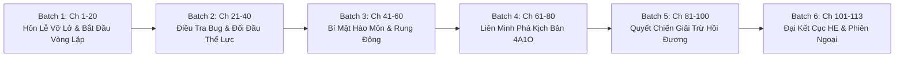

# 🗺️ KẾ HOẠCH TRIỂN KHAI DỊCH THUẬT TOÀN DỰ ÁN (PROJECT TRANSLATION PLAN)
## CƯỜNG CHẾ ÁI HOÀN TỰU HỒI ĐÁNG, THIỂM CẨU CÔNG BỊ ĐÀO KHÔNG LIỄU (《强制爱完就回档，舔狗攻被掏空了》)

> **Tác giả:** Nãi Cà Đạt Nhân (奶咖达人)  
> **Slug:** `cường-chế-ái-hoàn-tựu-hồi-đáng-thiểm-cẩu-công-bị-đào-không-liễu`  
> **Tổng số chương:** 113 chương (Đã nạp đầy đủ raw vào `chapters/ch_001/` – `chapters/ch_113/`)  
> **Thể loại:** Đam mỹ, Hiện đại, Xuyên thư, ABO, Chủ công, Niên hạ, Vòng lặp thời gian (Hồi đương), Thụ cưỡng chế công, Thụ truy công, Hài hước bựa, Sa điêu, 1v1, HE.  
> **Cặp đôi chính:** Hoa Y Lâu (Chủ công / Beta) × Thẩm Kinh Dạng (Thụ chính / S-Class Alpha)

---

## 🎯 I. MỤC TIÊU CỐT LÕI

1. **Văn phong Hiện đại ABO & Sa điêu chuẩn xác:**  
   - Duy trì giọng điệu tưng tửng, cà khịa, bất cần đời của Hoa Y Lâu (thẳng nam bị ép làm liếm cẩu).
   - Tái hiện sự cấm dục, lãnh đạm bên ngoài nhưng biến thái si hán, điên cuồng độc chiếm bên trong của Thẩm Kinh Dạng.
2. **Kỷ luật định dạng 100%:**
   - 100% khớp đoạn 1:1 (`source.md` ↔ `translation.md`). Tuyệt đối không gộp/chẻ đoạn.
   - Bắt buộc khoảng cách `\n\n` (1 dòng trống) giữa mọi đoạn văn và lời thoại.
   - Lời thoại bắt buộc dùng ngoặc kép chuẩn `“...”`.
   - Phân biệt tuyệt đối đại từ ngôi 3: Hoa Y Lâu = **“hắn”**, Thẩm Kinh Dạng = **“y”**.
3. **Quy tắc Universal Zero Google API Key:**  
   - AI Agent tự thân xử lý toàn bộ quy trình đọc raw, dịch thuật, soát lỗi và ghi file. Tuyệt đối không gọi script ngoài dùng API Key.
4. **Quy tắc Tự hành liên hoàn (Zero Conversational Pause):**  
   - Khi chạy batch dịch, Agent chủ động nạp chương kế tiếp, không tự tạo điểm dừng chat xin lệnh nếu chưa hết batch.

---

## 📦 II. LỘ TRÌNH TRIỂN KHAI 113 CHƯƠNG (6 PHÂN ĐOẠN - BATCHES)

### 🔹 BATCH 1: CHƯƠNG 001 - 020 (Arc 1: Hôn Lễ Kết Thúc & Cú Sốc Vòng Lặp Cưỡng Chế)
- **Nội dung:** Hoa Y Lâu ăn mừng vì thoát vai liếm cẩu trong đám cưới 4A1O của Thời Gia Hy. Vừa ra khỏi cửa đã bị Thẩm Kinh Dạng chuốc mê và cưỡng chế yêu. Tỉnh dậy phát hiện thời gian reset về trước đám cưới 1 ngày. Hoa Y Lâu bắt quả tang Thẩm Kinh Dạng hít đồ của mình.
- **Tiêu điểm dịch:** Khắc họa sự tương phản giữa vẻ ngoài cấm dục tài phiệt của Thẩm Kinh Dạng và hành vi si hán biến thái. Giữ nhịp hài hước sa điêu của Hoa Y Lâu.

### 🔹 BATCH 2: CHƯƠNG 021 - 040 (Arc 2: Cuộc Chiến Thể Lực & Tìm Kiếm Cơ Chế Hồi Đương)
- **Nội dung:** Hoa Y Lâu thử mọi cách: bỏ trốn, đổi địa điểm, né tránh đám cưới nhưng đều bị Thẩm Kinh Dạng tóm lại. Mỗi lần "kết thúc" lại bị rút cạn thể lực rồi hồi đương. Hoa Y Lâu bắt đầu nhận ra Thẩm Kinh Dạng giữ nguyên ký ức của tất cả các lần reset.
- **Tiêu điểm dịch:** Thuật ngữ ABO (kỳ mẫn cảm, tin tức tố rượu Whisky, thể lực Alpha vs Beta), tương tác giằng co vừa tức vừa buồn cười giữa công và thụ.

### 🔹 BATCH 3: CHƯƠNG 041 - 060 (Arc 3: Bí Mật Hào Môn Thẩm Gia & Quá Khứ Của Lão Tiền Sảo A)
- **Nội dung:** Hoa Y Lâu đào sâu vào nguyên nhân Thẩm Kinh Dạng phát điên vì mình. Hé lộ ân oán trong gia tộc Thẩm thị, sự ràng buộc của kịch bản truyện tranh gốc lên linh hồn Thẩm Kinh Dạng. Hoa Y Lâu từ chống đối bắt đầu mềm lòng.
- **Tiêu điểm dịch:** Đổi ngôi xưng hô linh hoạt theo cảm xúc (từ "tôi - cậu" bắt đầu xuất hiện những khoảnh khắc dịu dàng "tôi - em" hoặc tên riêng).

### 🔹 BATCH 4: CHƯƠNG 061 - 080 (Arc 4: Song Hành Phá Vỡ Kịch Bản Truyện Gốc 4A1O)
- **Nội dung:** Hoa Y Lâu và Thẩm Kinh Dạng chính thức liên minh. Họ bắt tay phá vỡ các nút thắt định mệnh của 4 anh công Alpha và Thời Gia Hy để cốt truyện gốc không thể ép buộc họ diễn lại vòng lặp.
- **Tiêu điểm dịch:** Đối chiếu quan hệ gia tộc (Thẩm Diệc là cháu Thẩm Kinh Dạng), giữ đúng tính cách ngông cuồng của dàn 4 Alpha.

### 🔹 BATCH 5: CHƯƠNG 081 - 100 (Arc 5: Giải Trừ Vòng Lặp & Bẻ Cong Thẳng Nam Hoàn Toàn)
- **Nội dung:** Vòng lặp hồi đương đi đến giới hạn cuối cùng. Đỉnh điểm cao trào giải trừ cơ chế reset thời gian. Hoa Y Lâu nhận ra mình đã rung động và cam tâm tình nguyện ở bên tên Alpha niên hạ điên tình này.
- **Tiêu điểm dịch:** Cảm xúc bùng nổ, sự gắn kết định mệnh giữa Beta và Alpha (phá vỡ ranh giới pheromone sinh học bằng tình cảm chân thành).

### 🔹 BATCH 6: CHƯƠNG 101 - 113 (Arc 6: Đại Kết Cục HE & Phiên Ngoại Ngọt Ngào)
- **Nội dung:** Thoát khỏi vòng lặp, hai người công khai mối quan hệ, vả mặt gia tộc và dàn nhân vật nguyên tác. Cuộc sống thường nhật ngọt sủng, bù đắp cho những lần bị "rút cạn" trước đây.
- **Tiêu điểm dịch:** Văn phong ngọt ngào, hài hước, viên mãn trọn vẹn.

---

## ⚙️ III. PIPELINE THỰC THI 4 PHA CHO TỪNG CHƯƠNG

Mỗi chương khi dịch sẽ tuần tự trải qua 4 pha tiêu chuẩn:

1. **Pha 1: Khởi tạo & Đồng bộ bộ nhớ (Pre-scan):**  
   - Kiểm tra `chapters/ch_xxx/source.md`.
   - Đối chiếu danh sách nhân vật xuất hiện với `memory/characters.json` và `memory/glossary.json`.

2. **Pha 2: Biên dịch trực tiếp 1:1 (Translation):**  
   - Dịch sang tiếng Việt văn phong sắc sảo, tự nhiên, đậm chất hiện đại đô thị ABO.
   - Bảo đảm 100% khớp đoạn 1:1, ngăn cách bằng `\n\n`, thoại `“...”`.
   - Ghi file vào `chapters/ch_xxx/translation.md`.

3. **Pha 3: Kiểm định chất lượng nghiêm ngặt (QC Audit):**  
   - Soát lỗi rò rỉ đại từ đối thoại vào trần thuật (CẤM "mày", "tao" trong câu kể).
   - Kiểm tra đại từ ngôi 3: Hoa Y Lâu (*hắn*), Thẩm Kinh Dạng (*y*).
   - Ghi biên bản vào `chapters/ch_xxx/qc_report.md`.

4. **Pha 4: Cập nhật Lorekeeper & Mục lục (Lorekeeper & Sync):**  
   - Cập nhật sự kiện vòng lặp vào `memory/timeline.json`.
   - Cập nhật trạng thái `✅ Hoàn thành` trên `chapters_index.json` và `TOC.md`.
