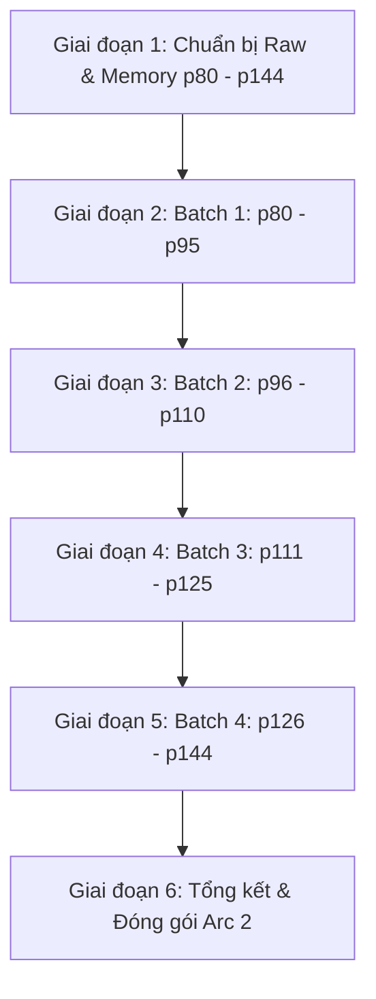

# 🗺️ KẾ HOẠCH TRIỂN KHAI THẾ GIỚI 2 (PLAN ARC 2)
## KIỀU KHÍ ĐIỀM CÔNG LUÔN BỊ PHẢN DIỆN NHẮM VÀO [KHOÁI XUYÊN] (《娇气甜攻总被反派盯上[快穿]》)

> **Tên đơn nguyên:** Tinh Tế ABO: Alpha Đỉnh Cấp Phân Hóa Lần Hai Thành Omega Phản Diện × Alpha Kiều Khí Độ Xứng Đôi 100%  
> **Phạm vi trang/chương:** Trang 80 đến Trang 144 (Tổng cộng: 65 trang, tương ứng trọn vẹn 24 chương ABO nguyên tác: ABO 1 - ABO 24)  
> **Chủ đề chính:** Mỹ điềm công cứu rỗi cường si tình thụ, ngọt sủng, tương thích tin tức tố tuyệt đối, chữa lành, vả mặt pháo hôi học viện.

---

## 🎯 MỤC TIÊU CỐT LÕI

1. **Văn phong chuẩn xác & Ngọt ngào sắc sảo:**
   - Giữ trọn nét kiều khí, mềm mại, xinh đẹp đáng yêu nhưng rất dũng cảm, chân thành của Đồng Tuế (Chủ công).
   - Khắc họa sâu sắc vẻ ngoài lạnh lùng, uy nghiêm, cấm dục ("Dạ Diêm Vương") đối lập với sự đau đớn, quằn quại và dục vọng chiếm hữu điên cuồng khi rơi vào kỳ phát tình của Dạ Lâm Uyên.
2. **Quy chuẩn kỹ thuật nghiêm ngặt:**
   - Bảo toàn chính xác 1:1 Paragraph Alignment giữa `translation.md` và `source.md`.
   - Đúng khoảng cách `\n\n` giữa tất cả các đoạn văn trần thuật và lời thoại.
   - Chuẩn hóa ngoặc thoại cong tiếng Việt `“...”`.
   - Trần thuật ngôi 3: Đồng Tuế = **“cậu”**, Dạ Lâm Uyên = **“hắn”** (hoặc Dạ Lâm Uyên, Viện trưởng Dạ). Tuyệt đối **CẤM** đá ngôi đối thoại vào câu trần thuật.
3. **Tuân thủ quy tắc Zero Google API Key:** Toàn bộ công việc đọc raw, dịch thuật, audit QC và lưu trữ do AI Code Agent trực tiếp thực thi.

---

## 📦 PHÂN CHIA CÁC GIAI ĐOẠN & BATCH DỊCH THUẬT

---

### 🔹 GIAI ĐOẠN 1: CHUẨN BỊ RAW & THIẾT LẬP DỰ ÁN (ĐÃ HOÀN TẤT)
- **Hiện trạng:** Đã cào trọn vẹn 65 trang sạch (từ `p80` đến `p144`) lưu tại `chapters/p80/` ... `chapters/p144/` cùng file tổng [raw_arc2_abo_full.md](file:///d:/Nhung/RIDI/trans-assistant/novel_projects/kieu-khi-diem-cong-luon-bi-phan-dien-nham-vao/raw_arc2_abo_full.md).
- **Hồ sơ thiết lập:** Đã khởi tạo [AGENTS.md](file:///d:/Nhung/RIDI/trans-assistant/novel_projects/kieu-khi-diem-cong-luon-bi-phan-dien-nham-vao/AGENTS.md) và [config.json](file:///d:/Nhung/RIDI/trans-assistant/novel_projects/kieu-khi-diem-cong-luon-bi-phan-dien-nham-vao/config.json).

---

### 🔹 GIAI ĐOẠN 2: BATCH 1 - TẬP TRUNG HỌC VIỆN & TÁI NGỘ "NGƯỜI QUEN" (TRANG 80 - 95) - [x] **HOÀN THÀNH 100% (16/16 TRANG)**
- **Nội dung cốt truyện:**
  - Đồng Tuế xuyên vào thân phận Nhị công tử Tập đoàn Cơ giáp Đế quốc (vốn là một pháo hôi công trong nguyên tác).
  - Tiếp nhận kịch bản thế giới ABO và hình ảnh phản diện: Nhìn thấy Dạ Lâm Uyên có diện mạo y hệt Bạch Tinh Lạc (thụ thế giới trước), Đồng Tuế mừng rỡ và quyết tâm tiếp cận.
  - Nhập học Học viện Quân sự Đế quốc, đối diện với Viện trưởng Dạ uy nghiêm, khó gần ("Dạ Diêm Vương").
  - Gặp gỡ bạn thân Tiểu Béo (Tiểu Bàn), giải quyết các va chạm ban đầu ở bãi tập huấn và lớp học cơ giáp.
  - Kỳ huấn luyện quân sự: Đồng Tuế bị sốc nhiệt/ngất xỉu, được Viện trưởng Dạ Lâm Uyên bế đi trạm xá, cắn vào xương quai xanh lưu lại dấu răng. Dạ Lâm Uyên bắt đầu động tâm và âm thầm che chở, tuần tra trường bắn kèm cặp Đồng Tuế.
- **Kết quả thực hiện:**
  - Dịch hoàn thiện 16/16 trang (`p80` -> `p95`).
  - Khớp chuẩn 1:1 Paragraph Alignment (1610/1610 đoạn văn).
  - Tuân thủ nghiêm ngặt Zero Google API Key, quy chuẩn ngôi kể trần thuật và định dạng `\n\n`, `“...”`.

---

### 🔹 GIAI ĐOẠN 3: BATCH 2 - PHỤ ĐẠO ĐẶC BIỆT & RUNG ĐỘNG NGẦM (TRANG 96 - 110)
- **Nội dung cốt truyện:**
  - Viện trưởng Dạ bề ngoài nghiêm nghị nhưng bắt đầu phá lệ chú ý đến Đồng Tuế, chủ động xuất hiện giải đề, phụ đạo riêng cho cậu.
  - Những màn tiếp xúc gần gũi trong phòng làm việc và ký túc xá: Đồng Tuế dính người, thơm tho ngọt ngào khiến Dạ Lâm Uyên bối rối, nhịp tim loạn xạ.
  - Những nụ hôn trộm, cọ sát vụng về và sự ghen tuông ngấm ngầm của Dạ Lâm Uyên khi thấy người khác dòm ngó Đồng Tuế.
  - Dấu hiệu bất thường về mặt sinh lý của Dạ Lâm Uyên: Cơn sốt kỳ lạ bắt đầu xuất hiện thường xuyên hơn.
- **Nhiệm vụ Agent:**
  - Dịch hoàn thiện 15 trang (`p96` -> `p110`).
  - Kiểm định QC tầng 2: Bắt trọn nhịp tương tác ái muội, sự chuyển biến từ "thầy trò nghiêm khắc" sang dung túng, cưng chiều của Dạ Lâm Uyên.
  - Cập nhật Memory: Ghi nhận các bước tiến tình cảm và mốc thời gian phụ đạo.

---

### 🔹 GIAI ĐOẠN 4: BATCH 3 - BIẾN CỐ PHÂN HÓA LẦN HAI & ĐÁNH DẤU CỨU RỖI (TRANG 111 - 125)
- **Nội dung cốt truyện:**
  - Biến cố lớn bùng nổ: Dạ Lâm Uyên chính thức phân hóa lần hai từ Alpha thành Omega ngay trong đợt kiểm tra cơ giáp.
  - Kỳ phát tình dữ dội ập đến đe dọa thiêu đốt lý trí, Dạ Lâm Uyên bị giam trong phòng cách ly đặc biệt, tự cắn rách cánh tay để giữ tỉnh táo chứ kiên quyết không để kẻ khác chạm vào.
  - Đồng Tuế chạy đua với thời gian đến phòng bệnh: Độ tương thích tin tức tố 100% làm dịu cơn phát tình cuồng loạn.
  - Phân cảnh cao trào: Đồng Tuế dùng răng nanh cọ vào thể tuyến sau gáy Dạ Lâm Uyên, thực hiện cú cắn đánh dấu cứu mạng Viện trưởng.
- **Nhiệm vụ Agent:**
  - Dịch hoàn thiện 15 trang (`p111` -> `p125`).
  - Kiểm định QC tầng 3: Xử lý miêu tả cảm giác ngột ngạt của tin tức tố, sự bùng nổ cảm xúc và ranh giới sinh tử - cứu rỗi.
  - Cập nhật Memory: Xác lập trạng thái quan hệ chính thức và sự kiện đánh dấu.

---

### 🔹 GIAI ĐOẠN 5: BATCH 4 - VẢ MẶT PHÁO HÔI, GẶP GỠ GIA TRƯỞNG & VIÊN MÃN (TRANG 126 - 144)
- **Nội dung cốt truyện:**
  - Dạ Lâm Uyên trở về bên Đồng Tuế, thân phận Omega được bảo vệ tuyệt đối bởi tin tức tố của Đồng Tuế.
  - Lật tẩy âm mưu của kẻ hãm hại (Lục Dật Minh, Chu Nghị), thanh trừng sạch sẽ những hiểm họa trong học viện và nghị viện.
  - Anh trai Đồng Tứ Niên phát hiện bí mật, màn chạm trán "dở khóc dở cười" giữa anh vợ và em rể Viện trưởng.
  - Lễ tốt nghiệp Học viện Quân sự, Đồng Tuế nhận thông báo hoàn thành nhiệm vụ từ hệ thống và quyết định ở lại trọn đời cùng Dạ Lâm Uyên.
- **Nhiệm vụ Agent:**
  - Dịch hoàn thiện 19 trang (`p126` -> `p144`).
  - Tổng kiểm định QC toàn bộ Arc 2: Rà soát tính nhất quán thuật ngữ ABO, đại từ và mạch cảm xúc từ đầu đến cuối thế giới.
  - Đóng gói hoàn chỉnh Arc 2.

---

## 🛠️ MA TRẬN TIÊU CHÍ QC AUDIT DÀNH RIÊNG CHO ARC 2

| STT | Tiêu chí QC | Yêu cầu bắt buộc |
| :--- | :--- | :--- |
| 1 | **Pronoun Fidelity** | Trần thuật Đồng Tuế = **“cậu”**; Trần thuật Dạ Lâm Uyên = **“hắn”** *(CẤM dùng “cậu” cho Dạ Lâm Uyên)*. |
| 2 | **Dialogue Formatting** | 100% lời thoại đặt trong ngoặc cong `“...”`. Xưng hô đối thoại tự nhiên: lúc đầu *“tôi - Viện trưởng”*, sau đó *“tôi - anh”* hoặc *“em - anh”*. |
| 3 | **1:1 Alignment** | Khớp chính xác 100% số đoạn giữa `source.md` và `translation.md`. |
| 4 | **Paragraph Spacing** | Đúng `\n\n` giữa tất cả các đoạn, không dính dòng `\n`. |
| 5 | **ABO Terminology** | Thuật ngữ chuẩn xác: *tin tức tố*, *thể tuyến*, *phân hóa lần hai*, *kỳ phát tình*, *độ tương thích/xứng đôi 100%*, *đánh dấu tạm thời/vĩnh viễn*. |
