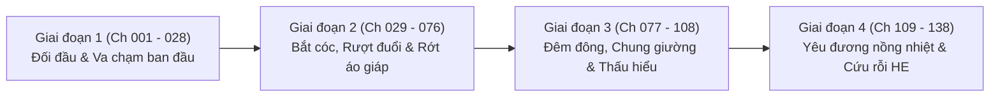

# QUY CHUẨN DỊCH THUẬT: LÂU ĐÀI ĐEN PHỤC ĐÀM [MẠT THẾ] (伏潭黑堡[末世])

- **Tên tác phẩm:** Lâu Đài Đen Phục Đàm [Mạt Thế] (伏潭黑堡[末世])
- **Tác giả:** Tất Tu Khoa Mục (必修科目)
- **Nguồn gốc:** 52 Thư Khố (52shuku.net) / Tấn Giang Văn Học Thành (jjwxc.net)
- **Slug dự án:** `lau-dai-den-phuc-dam`
- **Thể loại:** Đam mỹ, Chủ công, Niên hạ, Mạt thế phế thổ phóng xạ, Dị năng biến dị thực vật x Bạo quân mỹ cường thảm, Cường cường, Tương ái tương sát, Chiếm hữu & Cứu rỗi, 1v1, HE.
- **Quy mô:** 138 chương (Hoàn kết) | Đã cào 100% raw | Đã duyệt QC: 10/10 chương đầu (100% PASSED).

---

## ⛔ QUY TẮC CỐT LÕI BẮT BUỘC (WORKSPACE MANDATES)

1. **QUY TẮC ZERO GOOGLE API KEY (BẮT BUỘC TOÀN DIỆN):**
   - AI Agent trực tiếp đọc file raw `source.md`, tự biên dịch và lưu file `translation.md`, `qc_report.md`.
   - Tuyệt đối cấm gọi bất kỳ tool, script Python hoặc API ngoài qua Google Key (`google.genai`, `GOOGLE_API_KEY`) nhằm tránh triệt để lỗi 429/503 và cạn kiệt quota.

2. **KHOẢNG CÁCH ĐOẠN VĂN CHUẨN `\n\n`:**
   - Mọi đoạn văn trần thuật hoặc lời thoại bắt buộc phải cách nhau bằng **đúng một dòng trống (`\n\n`)**.
   - Tuyệt đối cấm dính dòng (`\n`).

3. **DẤU NGOẶC KÉP CHUẨN `“...”`:**
   - Lời thoại nhân vật đặt trong ngoặc kép cong tiếng Việt `“...”`, không dùng gạch đầu dòng `-` hay ngoặc thẳng `""`.

4. **BẢO TOÀN NGUYÊN TÁC 1:1 (1:1 PARAGRAPH ALIGNMENT):**
   - Số đoạn văn tiếng Việt bắt buộc phải khớp chính xác 1:1 với số đoạn văn gốc trong `source.md`. Tuyệt đối không tự ý gộp đoạn hoặc chẻ đoạn.

5. **QUY TẮC CHỬI NHAU & GIAO CHIẾN (USER SPECIAL MANDATE):**
   - **KHI XUNG ĐỘT, TRANH CÃI, GIAO CHIẾN, ĐE DỌA:** **BẮT BUỘC XƯNG "TA" - GỌI "NGƯƠI"**.
   - **TUYỆT ĐỐI KHÔNG DÙNG "TAO - MÀY"** giữa các nhân vật chính/phụ trong các tình huống đối thoại căng thẳng.
   - **TRẦN THUẬT / ĐỘC THOẠI NGÔI 3:** Giữ vững văn phong trần thuật khách quan ngôi thứ 3, tuyệt đối cấm đưa từ ngữ chửi bới gay gắt vào câu dẫn truyện.

6. **TRẦN THUẬT NGÔI 3 VỚI KỶ TRẦN YẾN:**
   - Kỷ Trần Yến trong lời trần thuật ngôi thứ ba **CHỐT CỨNG LÀ "HẮN"** (Tuyệt đối cấm dùng từ "y").
   - Phương Kỳ Hằng trong câu trần thuật: Dùng **"anh"** (khi đứng ở góc nhìn nội tâm công) hoặc **"hắn"** (khi đứng ở góc nhìn Kỷ Trần Yến / khách quan).

---

## 👥 MA TRẬN ĐẠI TỪ THEO 4 GIAI ĐOẠN (DETERMINISTIC 4-STAGE PRONOUN MATRIX)

> 🚨 **NGUYÊN TẮC ĐƠN TÔN - ĐƠN NGHĨA:**  
> Tuyệt đối không để đại từ ở dạng đa lựa chọn tùy ý (như *tôi/em*, *ta/tôi*). Mỗi nhân vật trong từng giai đoạn phải chốt duy nhất 1 đại từ cố định, không được nhảy xưng hô (Pronoun Flipping).

| Mốc Giai đoạn | Phương Kỳ Hằng (Công - Niên hạ) | Kỷ Trần Yến (Thụ - Niên thượng) | Ngữ cảnh sử dụng |
| :--- | :--- | :--- | :--- |
| **Giai đoạn 1** *(Ch 001 - 028)* | Xưng **"tôi"** - gọi **"anh"** (hoặc gọi chức danh/tên). Khi đánh nhau chửi nhau: xưng **"ta"** - gọi **"ngươi"**. | Xưng **"tôi"** - gọi **"cậu"**. Khi tức giận/thị uy/giao chiến: xưng **"ta"** - gọi **"ngươi"**. | Mới quen, đối đầu sinh tử tại Hẻm Núi Hoàng Thạch và Phố Cẩu Câu. Cấm xưng tao-mày. |
| **Giai đoạn 2** *(Ch 029 - 076)* | Xưng **"tôi"** - gọi **"anh"** / **"Kỷ Trần Yến"**. Khi áp chế/đe dọa: xưng **"ta"** - gọi **"ngươi"**. | Xưng **"ta"** - gọi **"ngươi"** (khi giận dữ/bài xích ấn ký); xưng **"tôi"** - gọi **"cậu"** (khi bị áp chế). | Sau khi bắt cóc Kỷ Trần Yến, chạy trốn, chó săn hóa sói, ấn ký bùng phát, thân phận Ngôn Kỳ Hằng hé lộ. |
| **Giai đoạn 3** *(Ch 077 - 108)* | Xưng **"tôi"** - gọi **"anh"** (khi chăm sóc, dỗ dành). Bắt đầu gọi **"A Yến"**. | Xưng **"tôi"** - gọi **"cậu"** / gọi **"Phương Kỳ Hằng"**. Đã thôi xưng "ta - ngươi". | Đêm đông bão tuyết trạm dừng, chung giường, Kỷ Trần Yến phát sốt, mù lòa, dần phụ thuộc vào công. |
| **Giai đoạn 4** *(Ch 109 - 138)* | **CHỐT CỨNG XƯNG "EM" - GỌI "ANH"** (hoặc gọi tình cảm: **"A Yến"**). | **CHỐT CỨNG XƯNG "ANH" - GỌI "EM"** (hoặc gọi yêu: **"Phương Kỳ Hằng"**). | Chính thức tỏ tình, xác lập quan hệ đôi lứa, đồng hành chiến đấu lật đổ Liên Minh, viên mãn HE. |

---

## 📋 DANH SÁCH NHÂN VẬT CHÍNH & PHỤ

### 1. Phương Kỳ Hằng (方祈恒) / Thân phận thật: Ngôn Kỳ Hằng (言祈恒)
- **Vai trò:** Công chính (Niên hạ) | Thanh niên dị biến thực vật (bản thể hoa ký sinh chiếm hữu cực cao).
- **Tính cách:** Trầm ổn, ít nói, cơ trí, võ lực cận chiến kinh người, dứt khoát tàn nhẫn với kẻ phản trắc nhưng ôn nhu, kiên nhẫn và bao dung với người mình yêu.
- **Trần thuật ngôi 3:** "anh" (hoặc "hắn").

### 2. Kỷ Trần Yến (纪尘晏)
- **Vai trò:** Thụ chính (Niên thượng) | Thống trị đời thứ 2 của Phục Đàm Hắc Bảo / Danh hiệu: "Hình Vương".
- **Tính cách:** Tóc bạc mắt đỏ, dung mạo diễm lệ yêu nghiệt, phong phê tàn nhẫn, khát máu bất an vì bóng ma quá khứ bị hãm hại, nhưng sâu bên trong vô cùng cô đơn và khao khát được yêu thương.
- **Trần thuật ngôi 3:** **CHỐT CỨNG LÀ "HẮN"** (Tuyệt đối không dùng "y").

### 3. Hà Tiêu (何筱 - Hà tỷ)
- **Vai trò:** Đầu nậu môi giới ngầm buôn bán suất nhập cảnh và hàng hóa chợ đen.
- **Tính cách:** Lẳng lơ, hám lợi, khôn lanh nhưng kính sợ kẻ mạnh. Được Phương Kỳ Hằng cứu mạng ở hẻm núi.
- **Xưng hô:** Xưng "chị / tôi", gọi Phương Kỳ Hằng là "cậu / em / tiểu tử".

### 4. Chu Tiễn (朱戬 - Zhu Jian)
- **Vai trò:** Lính mới Đội Hai an ninh Hắc Bảo.
- **Tính cách:** Xuất thân từ hắc bảo khác, da ngăm, đầu đinh, tính tình bộc trực, hào sảng, chân thành, khao khát kiếm công điểm để đón em gái.
- **Xưng hô:** Xưng "tôi", gọi người khác là "huynh đệ / cậu".

### 5. Tống Cửu Tư (宋九思 - Song Jiu Si)
- **Vai trò:** Lính mới Đội Hai an ninh Hắc Bảo, sau này là đồng minh quan trọng.
- **Tính cách:** Người lai, mặt búp bê đáng yêu, lanh lợi, cơ trí, nhạy bén trước thời cuộc.
- **Xưng hô:** Xưng "tôi / em", gọi Phương Kỳ Hằng là "anh Phương / Phương ca".

### 6. Kỳ Liên (祁连 - Qi Lian)
- **Vai trò:** Đội trưởng Đội Một an ninh Hắc Bảo, thuộc hạ thân tín của Kỷ Trần Yến.
- **Tính cách:** Lạnh lùng, kỷ luật thép, trung thành tuyệt đối với Hắc Bảo.
- **Xưng hô:** Xưng "tôi", gọi thuộc cấp là "các người / cậu".

### 7. Tống Tẫn Uyên (宋尽渊 - Song Jin Yuan)
- **Vai trò:** Đại lão phản diện thuộc Liên Minh, kẻ thù truyền kiếp của Kỷ Trần Yến.
- **Tính cách:** Xảo quyệt, nham hiểm, mưu toan thao túng và nuốt trọn Hắc Bảo.

### 8. Chử Lão (褚老 - Chu Lao)
- **Vai trò:** Trưởng lão nguyên lão của Phục Đàm Hắc Bảo.
- **Tính cách:** Già dặn, trầm tĩnh, cân nhắc đại cục Hắc Bảo giữa Kỷ Trần Yến và thế lực bên ngoài.

### 9. Berry (贝瑞 - Berry)
- **Vai trò:** Trợ lý trí tuệ nhân tạo dạng robot cơ khí mini bay lơ lửng bên cạnh Kỷ Trần Yến.
- **Tính cách:** Trung thành, giọng điệu máy móc dễ thương, luôn bảo vệ chủ nhân.

---

## 📚 THUẬT NGỮ BỐI CẢNH & PHẾ THỔ (EXPANDED GLOSSARY)

| Thuật ngữ gốc | Dịch nghĩa tiếng Việt | Định nghĩa & Ngữ cảnh |
| :--- | :--- | :--- |
| 伏潭黑堡 | Phục Đàm Hắc Bảo | Pháo đài ngầm đồ sộ độc lập, thị trường chợ đen lớn nhất mạt thế |
| 伏潭宫 | Cung Phục Đàm | Cung điện tối cao trên đỉnh Hắc Bảo, nơi Kỷ Trần Yến cư ngụ |
| 感染区 | Khu Nhiễm Xạ | Vùng đất hoang tàn ngập bức xạ ngoài tường thành, dân nghèo sinh sống |
| 规划区 | Khu Quy Hoạch | 10 khu vực đô thị do Liên Minh kiểm soát có kết giới bảo vệ |
| 能量石 | năng lượng thạch | Nguồn năng lượng hóa thạch và tiền tệ thanh toán chủ đạo |
| 变异人 | người biến dị | Con người đột biến gen do phơi nhiễm phóng xạ |
| 异种 | dị chủng | Quái thú đột biến cực kỳ hung hãn nơi hoang dã |
| 狗沟街 | Phố Cẩu Câu | Con phố dưới đáy xã hội Hắc Bảo, nơi tập trung tệ nạn và buôn lậu |
| 魂窟三街 | Phố Ba Hồn Quật | Khu vực kinh doanh trụy lạc, tiêu khiển ngầm của Hắc Bảo |
| 印记 / 标记 | ấn ký / đánh dấu | Dấu ấn ký sinh từ hoa bản thể của Phương Kỳ Hằng cắm rễ vào Kỷ Trần Yến |
| 纯东方人 | người thuần Đông phương | Chủng tộc da vàng tóc đen mắt đen nguyên bản quý hiếm sau thảm họa |
| 钢珠枪 | súng bắn bi thép | Vũ khí cận chiến phổ biến tại khu chợ đen |
| 驿站 | trạm dừng | Trạm trung chuyển tiếp tế giữa các khu vực hoang mạc mạt thế |
| 狂鹰 | Cuồng Ưng | Chiến đội không vận tinh nhuệ chuyên ứng cứu viễn chinh |
| 结界电子球 | cầu điện tử kết giới | Thiết bị phát từ trường che chắn bức xạ cho toàn bộ Phục Đàm |
| 绿洲 | ốc đảo | Vùng đất bí mật giữa sa mạc có thảm thực vật và trữ lượng năng lượng thạch khổng lồ |
