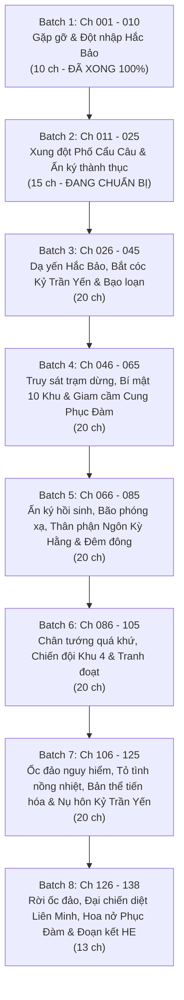

# 🗺️ KẾ HOẠCH TRIỂN KHAI DỊCH THUẬT (PLAN)
## LÂU ĐÀI ĐEN PHỤC ĐÀM [MẠT THẾ] (《伏潭黑堡[末世]》)

> **Tác giả:** Tất Tu Khoa Mục (必修科目)  
> **Quy mô dự án:** 138 chương (Chương 1 - Chương 138, Hoàn kết)  
> **Độ dài raw:** ~13.660 đoạn văn (~420.000 chữ Trung)  
> **Chủ đề chính:** Đam mỹ, Chủ công, Niên hạ, Mạt thế phế thổ, Dị năng biến dị thực vật x Mỹ nhân bạo quân tóc bạc mắt đỏ, Cường cường, Mỹ cường thảm, Tương ái tương sát, Chiếm hữu & Cứu rỗi, 1v1, HE.  
> **Trạng thái hiện tại:** Đã cào 138/138 chương raw (100%). Đã dịch & duyệt QC 65/138 chương (Batch 1, 2, 3, 4: 100% PASSED). Sẵn sàng triển khai Batch 5 (Chương 66 - 85).

---

## 🎯 MỤC TIÊU CỐT LÕI

1. **Văn phong chuẩn xác, sắc sảo & Đậm chất phế thổ mạt thế:**
   - Thể hiện sự trầm tĩnh, dứt khoát, bản lĩnh chiến đấu cận chiến tàn bạo và tính chiếm hữu của công Phương Kỳ Hằng.
   - Thể hiện trọn vẹn nét diễm lệ, khát máu, cuồng nộ (phong phê) nhưng thương tổn, thiếu thốn tình cảm bên trong của bạo quân Kỷ Trần Yến.
2. **Quy chuẩn kỹ thuật nghiêm ngặt (Zero Compromise):**
   - **Zero Google API Key Mandate:** AI Agent tự thân đọc raw, phân tích ngữ cảnh và dịch trực tiếp. Tuyệt đối không dùng API ngoài để bảo vệ quota.
   - **Bảo toàn 1:1 Paragraph Alignment:** Số đoạn văn tiếng Việt phải khớp chính xác 1:1 với nguyên tác trong `source.md`.
   - **Chuẩn khoảng cách & ngoặc thoại:** Cách nhau đúng 1 dòng trống `\n\n`, thoại đặt trong ngoặc kép cong `“...”`.
   - **Đại từ đơn tôn - đơn nghĩa:** Không đổi đại từ tùy tiện trong cùng 1 giai đoạn. Tuân thủ ma trận 4 giai đoạn quan hệ.
   - **Quy tắc chửi nhau / giao tranh:** Xưng **"ta"** - gọi **"ngươi"**, **TUYỆT ĐỐI CẤM "tao - mày"**.
   - **Trần thuật ngôi 3:** Kỷ Trần Yến chốt cứng **"hắn"** (tuyệt đối không dùng "y").
3. **Quản lý ký ức & Tiến độ liên hoàn:**
   - Duy trì `memory/` xuyên suốt qua các chương.
   - Vận hành theo cơ chế tự hành liên hoàn (continuous batch), hoàn thành từng batch và đồng bộ `TOC.md`, `chapters_index.json`, `timeline.json`.

---

## 📦 PHÂN CHIA LỘ TRÌNH DỊCH THUẬT THEO 8 BATCH

---

### 🔹 BATCH 1: GẶP GỠ BAN ĐẦU & BƯỚC VÀO HẮC BẢO (CHƯƠNG 001 - 010) - [x] HOÀN THÀNH 100%
- **Quy mô:** 10 chương (`ch_001` -> `ch_010`) | 722 đoạn văn | ~22.105 từ tiếng Việt.
- **Tiến độ:** 10/10 chương hoàn thành xuất sắc, kiểm toán QC 100/100, đã xuất file EPUB.
- **Tóm tắt cốt truyện:**
  - Phương Kỳ Hằng phát hiện bạn gái Vưu Nhã gian díu với Diêu ca để chiếm đoạt suất vào Khu Quy Hoạch; anh thẳng tay bắn chết đôi gian phu dâm phụ.
  - Nhận sự giúp đỡ của Hà tỷ, Phương Kỳ Hằng lên xe di tản đến Phục Đàm Hắc Bảo; đoàn xe bị trực thăng hắc ám tập kích tại Hẻm Núi Hoàng Thạch.
  - Phương Kỳ Hằng chạm trán bạo quân Kỷ Trần Yến, giao tranh cận chiến ác liệt dẫn đến nụ hôn bất ngờ và ấn ký thực vật đầu tiên.
  - Phương Kỳ Hằng thoát khỏi hẻm núi, đến Phục Đàm Hắc Bảo, vượt qua bài phỏng vấn tuyển dụng an ninh và bắt đầu ca trực tại Phố Cẩu Câu.

---

### 🔹 BATCH 2: XUNG ĐỘT PHỐ CẨU CÂU & DẤU ẤN THÀNH THỤC (CHƯƠNG 011 - 025) - [x] HOÀN THÀNH 100%
- **Quy mô:** 15 chương (`ch_011` -> `ch_025`) | ~1.100 đoạn văn.
- **Nội dung trọng tâm:**
  - `ch_011`: Bùng phát xung đột tại Phố Cẩu Câu.
  - `ch_012` - `ch_014`: Phương Kỳ Hằng trong hiểm tìm thắng, bắt giữ tên buôn lương lậu và phối hợp thẩm vấn Hà Tiêu.
  - `ch_015` - `ch_018`: Phương Kỳ Hằng phẫn nộ, Kỳ Liên Đội Một xuất hiện, Hà Tiêu bị chặt tay, biến cố nổ tung đồn cảnh vụ.
  - `ch_019` - `ch_020`: Môi hở răng lạnh, bí ẩn bên trong Cung Phục Đàm.
  - `ch_021` - `ch_024`: Kẻ đuổi người trốn, ấn ký hoa của Phương Kỳ Hằng bước vào giai đoạn thành thục, tác động thể xác Kỷ Trần Yến trong khoang y tế riêng.
  - `ch_025`: Khảo sát Phố Ba Hồn Quật.

---

### 🔹 BATCH 3: DẠ YẾN HẮC BẢO, BẮT CÓC KỶ TRẦN YẾN & BẠO LOẠN (CHƯƠNG 026 - 045) - [x] HOÀN THÀNH 100%
- **Quy mô:** 20 chương (`ch_026` -> `ch_045`).
- **Nội dung trọng tâm:**
  - Dạ yến xa hoa tại Hắc Bảo, cảm ứng ấn ký giữa hai người bùng phát trong đại sảnh.
  - Mốc cao trào `ch_029` - `ch_032`: Phương Kỳ Hằng táo bạo bắt cóc Kỷ Trần Yến làm con tin, phóng xe trốn chạy giữa làn đạn; thân phận bại lộ; Kỷ Trần Yến cứng rắn đối đầu Liên Minh.
  - `ch_033` - `ch_040`: Bí mật huyết thống cùng cha khác mẹ, mạng lưới buôn lậu lương thực, hợp tác cùng Tống Cửu Tư, vết nứt trong Hắc Bảo và thân thế hé lộ.
  - `ch_041` - `ch_045`: Kẻ địch giăng bẫy ăn thịt người, mâu thuẫn bùng nổ, đêm cuồng hoan hỗn loạn.

---

### 🔹 BATCH 4: TRUY SÁT TRẠM DỪNG & GIAM CẦM NƠI CUNG PHỤC ĐÀM (CHƯƠNG 046 - 065) - [x] HOÀN THÀNH 100%
- **Quy mô:** 20 chương (`ch_046` -> `ch_065`).
- **Nội dung trọng tâm:**
  - Truy sát tại trạm dừng, chiến đội Cuồng Ưng xuất hiện ứng cứu; Khu Mười phơi bày sự thật đen tối.
  - Phản ứng cai nghiện ấn ký của Kỷ Trần Yến, lựa chọn của Chử Lão, tiếng súng lạnh lùng của Kỷ Trần Yến.
  - `ch_056` - `ch_062`: Chó săn hóa sói dữ, lồng giam bất lực, Kỷ Trần Yến trước nguy cơ mù lòa, hồi ức dĩ vãng bi thương và chuỗi ngày bị giam giữ tại Cung Phục Đàm.
  - Phát hiện ốc đảo bí mật ngập tràn năng lượng thạch.

---

### 🔹 BATCH 5: ẤN KÝ HỒI SINH, BÃO PHÓNG XẠ & THÂN PHẬN NGÔN KỲ HẰNG (CHƯƠNG 066 - 085) - [ ] PLANNED
- **Quy mô:** 20 chương (`ch_066` -> `ch_085`).
- **Nội dung trọng tâm:**
  - Phiên tòa công khai, ấn ký thức tỉnh mãnh liệt; cuộc giải cứu tân nương biến mất.
  - Oanh tạc hẻm núi dồn dập, Kỷ Trần Yến phát cuồng giữa bão phóng xạ; Phương Kỳ Hằng kịp thời tóm chặt lấy hắn.
  - Chỉnh sửa gen, truy tìm nguồn gốc ấn ký thực vật, mười ngón đan chặt.
  - Mốc `ch_076`: Bí mật bùng nổ - Phương Kỳ Hằng chính là Ngôn Kỳ Hằng năm xưa!
  - `ch_077` - `ch_085`: Đêm đông lăn tuyết tại trạm dừng, chung chăn chung gối, chăm sóc lúc bệnh tật, mở ra thế giới tình cảm mới.

---

### 🔹 BATCH 6: CHÂN TƯỚNG QUÁ KHỨ, CHIẾN ĐỘI KHU BỐN & TRANH ĐOẠT (CHƯƠNG 086 - 105) - [ ] PLANNED
- **Quy mô:** 20 chương (`ch_086` -> `ch_105`).
- **Nội dung trọng tâm:**
  - Chân tướng quá khứ phơi bày toàn diện, người cũ đã khuất; Phương Kỳ Hằng chủ động xin lỗi và thay đổi thái độ với Kỷ Trần Yến.
  - Đụng độ Chiến đội cấp S của Khu Bốn, giao tranh dữ dội tại trạm dừng; sự hỗ trợ của người máy Berry.
  - Thử thách sinh tồn giữa giá lạnh cực đoan, Phương Kỳ Hằng sốt cao; đại chiến cướp người giữa các phe phái.

---

### 🔹 BATCH 7: ỐC ĐẢO NGUY HIỂM, TỎ TÌNH & TIẾN HÓA BẢN THỂ (CHƯƠNG 106 - 120) - [ ] PLANNED
- **Quy mô:** 20 chương (`ch_106` -> `ch_120`).
- **Nội dung trọng tâm:**
  - Đột nhập ốc đảo nguy hiểm, đối phó trùng biến dị.
  - Mốc `ch_107` - `ch_108`: Tiếng gọi "A Yến" và màn thổ lộ tình cảm đầy xúc động.
  - Thu hoạch lúa nếp, tịch thu quân nhu, tắm nước nóng xua tan giá lạnh.
  - Bản thể thực vật của Phương Kỳ Hằng tiến hóa vượt bậc; thân thể dị biến, mất ngủ và tìm lại sự bình yên bên nhau.
  - Kỷ Trần Yến khôi phục thị lực hoàn toàn; nụ hôn chân thành và sâu đậm của Kỷ Trần Yến.

---

### 🔹 BATCH 8: ĐẠI CHIẾN DIỆT LIÊN MINH, HOA NỞ PHỤC ĐÀM & ĐOẠN KẾT HE (CHƯƠNG 121 - 138) - [ ] PLANNED
- **Quy mô:** 18 chương (`ch_121` -> `ch_138`).
- **Nội dung trọng tâm:**
  - Rời khỏi ốc đảo, Liên Minh rơi vào đại loạn; càn quét qua biển cát vàng.
  - Chặn đứng chiến đội Khu Bốn; Kỷ Trần Yến tàn bạo thị uy; tiến về Khu Mười.
  - Tống Tẫn Uyên đền tội; Kỷ Trần Yến và Phương Kỳ Hằng trở về Phục Đàm.
  - Mốc `ch_134` - `ch_138`: Bản thể của Phương Kỳ Hằng nở hoa rực rỡ khắp Phục Đàm Hắc Bảo; khởi động lại cầu điện tử kết giới; tuyên chiến và đập tan Liên Minh.
  - Toàn văn hoàn kết: Cuộc sống tự do, cùng nhau săn dị thú nơi hoang dã.
