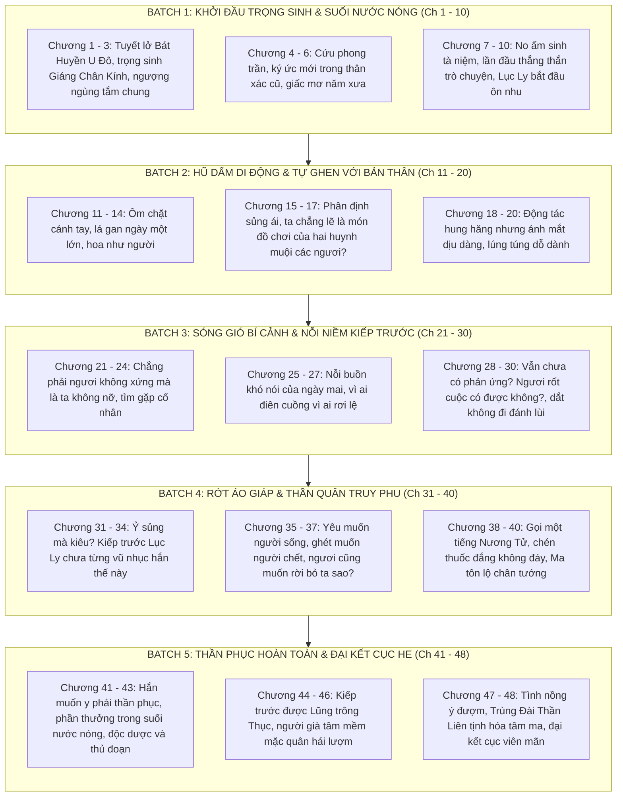

# 📋 KẾ HOẠCH DỊCH THUẬT TOÀN DIỆN & LỘ TRÌNH TIẾN ĐỘ (PLAN)
## MA TÔN TRỌNG SINH ĐƯỢC KẺ THÙ TRUYỀN KIẾP CƯNG CHIỀU (《魔尊重生被宿敌娇养》)

> **Tác phẩm:** Ma Tôn Trọng Sinh Được Kẻ Thù Truyền Kiếp Cưng Chiều  
> **Tên gốc:** 魔尊重生被宿敌娇养  
> **Tác giả:** Yến Tọa Không Sơn Trung (宴坐空山中)  
> **Góc nhìn chính:** Chủ Công 100% (Hoài Ngoan công × Lục Ly thụ)  
> **Tổng số chương:** 48 chương (Chính văn hoàn thành trọn vẹn 100%)  
> **Hiện trạng Raw:** Đã thu thập và thẩm định 48/48 chương trong `chapters/ch_001/source.md` $\rightarrow$ `chapters/ch_048/source.md`, tổng dung lượng ~508 KB (3.945 đoạn văn).  

---

## 🗺️ LỘ TRÌNH THỰC THI 5 BATCH (PIPELINE ROADMAP)

---

## 🎯 CHI TIẾT NỘI DUNG TỪNG BATCH

### 🔹 Batch 1: Chương 1 – Chương 10 (Sống lại nhập xác, Ôn tuyền tắm chung & Khởi đầu diễn kịch) - ✅ [HOÀN THÀNH 100%]
* **Số chương:** 10 chương (`ch_001` – `ch_010`).
* **Trạng thái:** ✅ ĐÃ HOÀN THÀNH TOÀN BỘ 10/10 CHƯƠNG (QC APPROVED 100%, ĐỒNG BỘ TIMELINE, INDEX & TOC).
* **Trọng tâm cốt truyện:**
  * Khởi đầu bi tráng tại tuyết sơn Bát Huyền U Đô: Ma tôn Hoài Ngoan trúng kiếm của Thần quân Lục Ly, kích hoạt cấm phù tuyết lở chôn vùi chính mình.
  * Hồn phách nhập xác vào Giáng Chân Kính: Vừa ngoi lên mặt nước thì phát hiện mình đang tắm chung suối nước nóng với Lục Ly, y phục nửa kín nửa hở.
  * Hoài Ngoan quyết định giấu kín thân phận Ma tôn, cố diễn vai ngoan ngoãn yếu đuối để tự tìm đường chuồn; Lục Ly tưởng y bệnh nặng nên chăm sóc từng chút một.
* **Mục tiêu QC:** Kiểm soát tuyệt đối cặp đại từ ngôi 3: Hoài Ngoan = **`hắn`**, Lục Ly = **`y`**.

---

### 🔹 Batch 2: Chương 11 – Chương 20 (Càng diễn càng sa bẫy dịu dàng & Tự ăn dấm chính mình)
* **Số chương:** 10 chương (`ch_011` – `ch_020`).
* **Trọng tâm cốt truyện:**
  * Lục Ly dành trọn sự cưng chiều, tin tưởng và bảo bọc cho thân xác này — điều mà kiếp trước Hoài Ngoan có mơ cũng không thấy.
  * Hoài Ngoan bắt đầu tức tối, hờn dỗi, biến thành hũ dấm di động tự ghen tị với chính mình: *"Tại sao kiếp trước ngươi đối xử với ta lạnh lùng như thế, mà tên này lại được ngươi nuông chiều đến vậy?!"*
  * Những cử chỉ thân mật, ôm ấp, xoa đầu, lau tóc giữa hai người ngày một dày đặc.

---

### 🔹 Batch 3: Chương 21 – Chương 30 (Sóng gió bí cảnh & Khúc mắc năm xưa dần hé mở)
* **Số chương:** 10 chương (`ch_021` – `ch_030`).
* **Trọng tâm cốt truyện:**
  * Chạm trán cố nhân, những manh mối đằng sau trận chiến Thần - Ma kiếp trước dần lộ diện.
  * Lục Ly không ngần ngại đứng ra bảo vệ Hoài Ngoan trước mặt mọi người, buông lời tuyên bố: *"Không phải ngươi không xứng, mà là ta không nỡ."*
  * Cảnh hai người ở chung phòng, những câu nói trêu chọc dở khóc dở cười: *"Chưa có phản ứng? Ngươi rốt cuộc có được hay không?"*

---

### 🔹 Batch 4: Chương 31 – Chương 40 (Rớt áo giáp & Thần quân truy phu hỏa táng tràng)
* **Số chương:** 10 chương (`ch_031` – `ch_040`).
* **Trọng tâm cốt truyện:**
  * Lớp áo giáp ngụy trang rách toạc. Hoài Ngoan không thèm diễn kịch nữa, bộc lộ hoàn toàn khí chất Ma tôn bá đạo ngông cuồng.
  * Lục Ly bàng hoàng rồi vỡ òa nhận ra: Người thiếu niên y luôn cưng chiều bấy lâu nay chính là người y yêu đến điên dại kiếp trước.
  * Thần quân cao lãnh mở màn chiến dịch truy phu, chấp nhận để Hoài Ngoan trút hết mọi giận hờn, đắng cay lên người mình.

---

### 🔹 Batch 5: Chương 41 – Chương 48 (Thần phục hoàn toàn & Đại kết cục HE viên mãn)
* **Số chương:** 8 chương (`ch_041` – `ch_048`).
* **Trọng tâm cốt truyện:**
  * Hoài Ngoan đè Thần quân ra đòi lại món nợ năm xưa ngay trong suối nước nóng: *"Hắn muốn y, thần phục."*
  * Lục Ly tình nguyện buông bỏ hết sự kiêu hãnh của Thần quân, toàn tâm toàn ý để công muốn làm gì thì làm: *"Người già tâm mềm, mặc quân hái lượm."*
  * Trùng Đài Thần Liên tịnh hóa toàn bộ ma khí và tâm ma, hai người cởi bỏ khúc mắc, chính văn kết thúc viên mãn, ngọt ngào trọn vẹn.

---

## ⚡ NGUYÊN TẮC VẬN HÀNH PIPELINE TỰ HÀNH
1. **Autonomous Continuous Mode (Tự hành liên hoàn):** Main Agent xử lý tuần tự từng chương từ Phase 1 $\rightarrow$ Phase 4, hoàn thành xong chương này tự động gọi nạp chương kế tiếp mà không dừng lại xin lệnh.
2. **Zero Turn Pause Trap:** Không bao giờ chat các câu chờ lệnh như *"bạn hãy nhắn tiếp tục..."* khi batch chưa hoàn thành.
3. **5-Layer QC Audit:** Mỗi chương bắt buộc được kiểm toán 5 lớp trước khi xuất xưởng:
   - Lớp 1: Khớp đoạn 1:1 (`len(src) == len(trans)`).
   - Lớp 2: Chuẩn khoảng cách `\n\n` và ngoặc kép cong `“...”`.
   - Lớp 3: Giữ vững đại từ ngôi 3: Hoài Ngoan (`hắn`), Lục Ly (`y`).
   - Lớp 4: Khóa cứng cặp xưng hô đối thoại `ngươi – ta`.
   - Lớp 5: Dấu câu hỏi `?` cho mọi câu nghi vấn.
