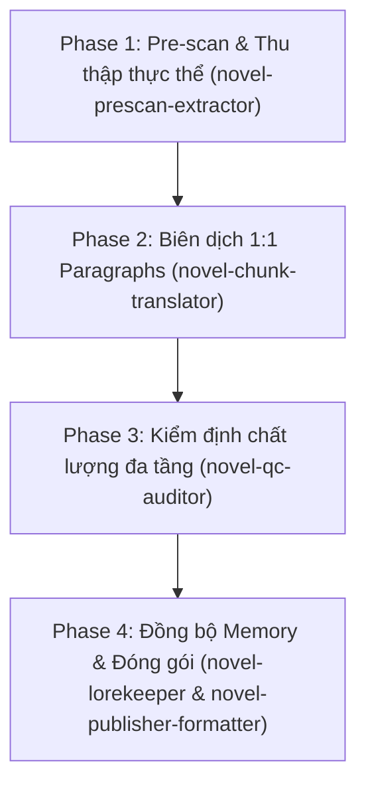

# 📋 KẾ HOẠCH THI CÔNG & BIÊN DỊCH CHI TIẾT (PLAN)
## DỰ ÁN: NGHE NÓI VỢ TÔI LÀ ĐẠI LÃO PHẢN DIỆN (《听说我老婆是反派大佬》)

> **Tác giả:** Đại Bạch Sư (大白狮)  
> **Quy mô:** 122 chương hoàn chỉnh (Chương 1 - Chương 122)  
> **Nguyên tác:** 10.492 đoạn văn, 458.091 ký tự Trung  
> **Mục tiêu:** Bản dịch chuẩn xác 100%, 1:1 paragraph alignment, bảo toàn văn phong hài hước sa điêu, tương phản manh cực mạnh giữa cún con ngây thơ x đại lão phản diện.

---

## 🏗️ 1. LỘ TRÌNH THI CÔNG 4 GIAI ĐOẠN (PIPELINE PHASES)

### 🔹 Phase 1: Pre-scan & Đối chiếu Bộ Nhớ (`novel-prescan-extractor`)
- Đọc raw `source.md` của từng chương.
- Trích xuất nhân vật mới, địa danh, thuật ngữ tinh thần lực và lời thoại.
- Đối chiếu với `memory/` (characters, glossary, relationships, timeline) để đảm bảo không bị trôi dạt danh xưng.

### 🔹 Phase 2: Biên dịch Trực Tiếp Không Qua API Ngoài (`novel-chunk-translator`)
- **Tuân thủ triệt để Zero Google API Key Mandate.**
- Agent tự thân đọc raw và biên dịch tiếng Việt tự nhiên, chuẩn văn phong tinh tế cơ giáp kết hợp hài hước.
- Khóa chặt đại từ ngôi 3: Cố Kiêu = **cậu**, Thẩm Nguyệt Khanh = **hắn**.
- Bảo toàn tuyệt đối 1:1 số đoạn văn và cách dòng `\n\n`.

### 🔹 Phase 3: Kiểm Định Chất Lượng Đa Tầng (`novel-qc-auditor`)
- **Layer 1:** Kiểm tra số đoạn văn bản dịch so với nguyên tác (sai lệch = 0).
- **Layer 2:** Kiểm tra khoảng cách dòng `\n\n` và dấu ngoặc thoại `“...”`.
- **Layer 3:** Quét lỗi đá ngôi: Không để từ đối thoại (`mày`, `tao`, `tôi`, `anh`) xuất hiện trong câu kể ngôi 3.
- **Layer 4:** Kiểm tra độ mượt mà ngữ nghĩa và thuật ngữ tinh thần lực.

### 🔹 Phase 4: Cập Nhật Tiến Độ & Bộ Nhớ (`novel-lorekeeper`)
- Cập nhật `chapters_index.json` và `TOC.md`.
- Ghi nhận diễn biến mới vào `memory/timeline.json` và cập nhật quan hệ vào `memory/relationships.json`.

---

## 📦 2. PHÂN BỔ BATCH THI CÔNG (BATCH ALLOCATION)

Dự án gồm 122 chương, được chia thành 13 đợt (batches) tự hành:

| Đợt (Batch) | Dải chương | Trọng tâm nội dung | Mục tiêu kiểm soát |
| :---: | :---: | :--- | :--- |
| **Batch 1** | ch_001 - ch_010 (10 ch) | Gặp gỡ tại Ám Vực, bắt đầu sơ đạo tinh thần lực | Thiết lập vững chắc xưng hô "Ôn tiên sinh - Cố đồng học" |
| **Batch 2** | ch_011 - ch_020 (10 ch) | Cố Kiêu nhập học Học viện Liên Bang, làm quen bạn học | Kiểm soát tương phản: Bạn học sợ Cố Kiêu x Cố Kiêu tự ti |
| **Batch 3** | ch_021 - ch_030 (10 ch) | Nuôi dưỡng tình cảm, cún con thường xuyên đến Ám Vực | Xưng hô dần chuyển sang thân mật, sủng vợ |
| **Batch 4** | ch_031 - ch_040 (10 ch) | Huấn luyện quân sự, khảo hạch thực chiến | Thuật ngữ cơ giáp, dị thú khu ô nhiễm |
| **Batch 5** | ch_041 - ch_050 (10 ch) | Thẩm Nguyệt Khanh ngầm bảo vệ Cố Kiêu | Thụ âm thầm giải quyết đối thủ sau lưng công |
| **Batch 6** | ch_051 - ch_060 (10 ch) | Tình cảm chín muồi, chính thức xác định quan hệ | Ngọt sủng, xưng hô "anh - em / vợ" |
| **Batch 7** | ch_061 - ch_070 (10 ch) | Biến cố nổ ra, âm mưu chống lại Ám Vực | Tiết tấu căng thẳng, hành động |
| **Batch 8** | ch_071 - ch_080 (10 ch) | Rớt áo giáp phản diện, Cố Kiêu biết thân phận thật | Giữ vững tâm lý cún con không đổi: Vẫn là vợ mình |
| **Batch 9** | ch_081 - ch_090 (10 ch) | Cố Kiêu bộc phát toàn bộ tinh thần lực SSS bảo vệ vợ | Tinh thần lực cấp SSS uy áp toàn trường |
| **Batch 10** | ch_091 - ch_100 (10 ch) | Đại chiến dẹp yên các thế lực thù địch | Chiến đấu tinh tế, đồng tâm hiệp lực |
| **Batch 11** | ch_101 - ch_110 (10 ch) | Tái thiết hòa bình Liên Bang & Ám Vực | Đón nhận vinh quang, xử lý hậu quả |
| **Batch 12** | ch_111 - ch_120 (10 ch) | Ra mắt gia đình Cố gia tại Cổ Võ Tinh | Hài hước ấm áp, đại lão hòa nhập gia đình |
| **Batch 13** | ch_121 - ch_122 (2 ch) | Đại kết cục hoàn mãn | Hoàn tất dự án, khóa sổ memory |

---

## ⚡ 3. CIRCUIT BREAKER & QUY CHUẨN DỪNG KHẨN CẤP

Agent lập tức dừng và yêu cầu phản hồi từ người dùng khi:
1. **Lệch đoạn văn:** Số đoạn dịch chênh lệch > 0 đoạn so với `source.md`.
2. **Lẫn lộn ngôi 3:** Xuất hiện tình trạng dùng "hắn" cho Cố Kiêu hoặc "cậu" cho Thẩm Nguyệt Khanh trong trần thuật.
3. **Phát hiện lỗi đá ngôi:** Có đại từ đối thoại lọt vào văn kể chuyện ngoài ngoặc kép.
