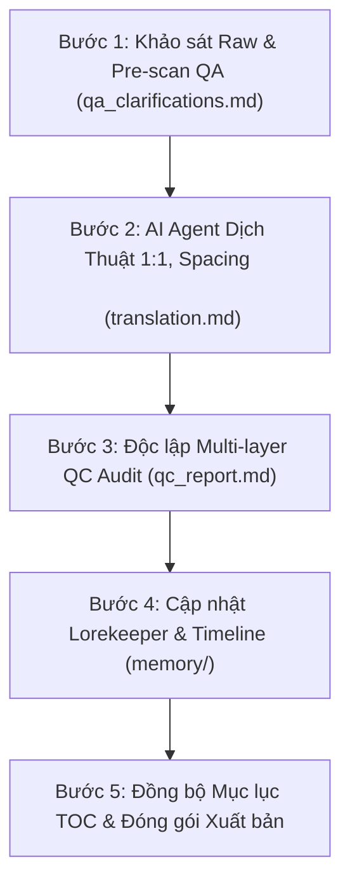

# 📋 KẾ HOẠCH DỊCH THUẬT: NGHỊCH TẬP NHÂN VẬT THỤ! [KHOÁI XUYÊN]
# (《攻成伪受[快穿]》 / 《逆袭反攻！》)

> **Tác phẩm:** Nghịch Tập Nhân Vật Thụ! [Khoái Xuyên]  
> **Tác giả:** 七果茶 (Thất Quả Trà)  
> **Tổng quy mô:** 104 chương (7 Thế giới lớn + Phiên ngoại)  
> **Slug dự án:** `nghịch-tập-nhân-vật-thụ`  
> **Vị thế:** Chủ công tuyệt đối x Cường thụ / Nhân vật ngạo mạn bị phản công (1v1)  
> **Quy chuẩn tuân thủ:** [RULES.md](RULES.md) & [AGENTS.md](../../AGENTS.md)

---

## 🗺️ TỔNG QUAN LỘ TRÌNH 7 THẾ GIỚI (ARC ROADMAP)

Bộ truyện được kết cấu theo mô hình khoái xuyên độc đáo: Nhân vật chính **Quân Dã** luôn bị hệ thống gài bẫy vào các thân phận vốn bị định vị là "thụ" hoặc "kẻ phục tùng", nhưng bằng bản lĩnh tổng công đỉnh cao, hắn liên tục lật ngược ván cờ, áp chế ngược lại đối tượng công lược.

| STT | Tên Thế Giới (Arc) | Thiết lập Thân phận CP | Trọng tâm & Điểm nhấn cốt truyện | Dự kiến số chương |
|:---:|:---|:---|:---|:---:|
| **Arc 1** | **［Tinh tế Trùng tộc］** | **Thư trùng tướng quân công (Quân Dã) × Hùng trùng thiếu gia thụ (Phi Tu)** | Xã hội trùng tộc đảo ngược (Hùng tôn Thư ti), Quân Dã dùng khí thế quân nhân và tinh thần lực áp chế tiểu thiếu gia kiêu ngạo; có chi tiết công sinh đản độc đáo. | ~16 - 18 chương |
| **Arc 2** | **［Tinh tế Nhân ngư］** | **Nhân ngư công (Quân Dã) × Bạn đời sợ nước thụ** | Thân phận nhân ngư bị coi là sủng vật, Quân Dã trừng trị và chinh phục kẻ nuôi dưỡng ngạo mạn dưới đại dương xanh. | ~15 chương |
| **Arc 3** | **［Tinh tế Hướng Tiêu］** | **Hướng dẫn giả công (Quân Dã) × Hắc ám lính gác thụ** | Bề ngoài là Hướng dẫn giả ốm yếu cần được bảo hộ, thực chất sở hữu tinh thần hải cuồng bạo áp chế toàn bộ lính gác. | ~15 chương |
| **Arc 4** | **［Tinh tế ABO］** | **Omega công (Quân Dã) × Alpha ngạo mạn thụ** | Vả mặt thiết lập AO thông thường; Omega dã tính lạnh lùng thuần phục Alpha quyền quý. | ~14 chương |
| **Arc 5** | **［Nguyên thủy Thú nhân］** | **Giao nhân công (Quân Dã) × Sa điêu thú nhân dưỡng thành thụ** | Bối cảnh hồng hoang nguyên thủy, sức mạnh tuyệt đối nghiền ép bộ lạc. | ~14 chương |
| **Arc 6** | **［Linh khí khôi phục］** | **Đội trưởng quản lý đô thị công (Quân Dã) × Toàn hệ dị năng giả thụ** | Hiện đại dị năng thức tỉnh, áp chế các phần tử nguy hiểm bằng uy áp tối thượng. | ~14 chương |
| **Arc 7** | **［Tinh tế Tu chân & Phiên ngoại］** | **Đế quân vô tình công (Quân Dã) × Đại lão truy công hỏa táng tràng thụ** | Truy công đỉnh cao, thân phận chân thực của Quân Dã được hé lộ, khép lại hành trình 104 chương viên mãn HE. | ~12 chương |

---

## ⚙️ QUY TRÌNH THỰC THI 5 BƯỚC CHUẨN HÓA

### 1. Bước 1: Khảo sát Raw & Pre-scan QA (`qa_clarifications.md`)
- Rà soát văn bản gốc trong `chapters/ch_xxx/source.md`.
- Lập bảng QA làm rõ danh xưng, đại từ ngôi 3, các thuật ngữ đặc thù của từng thế giới trước khi bấm máy.

### 2. Bước 2: AI Code Agent Trực Tiếp Biên Dịch 1:1 (`translation.md`)
- **Nguyên tắc Zero API Key:** AI Agent đọc trực tiếp và sinh bản dịch tiếng Việt chất lượng cao.
- **Bảo toàn 1:1 số đoạn văn:** Tuyệt đối không nhảy cóc, không gộp đoạn, không thêm bớt.
- **Quy chuẩn hình thức:** Cách dòng `\n\n` chuẩn mực, lời thoại đặt trong ngoặc kép cong `“...”`.
- **Giữ vững phong thái Chủ Công:** Khí thế bá đạo, dã tính, trầm ổn của Quân Dã.

### 3. Bước 3: Soát lỗi Chuyên sâu Multi-layer QC (`qc_report.md`)
- Kiểm tra tính nhất quán của đại từ (Công: hắn; Thụ: cậu/y).
- Quét sạch các lỗi cấm: dính dòng `\n`, thiếu dấu thoại, đá ngôi mày/tao vào trần thuật.

### 4. Bước 4: Đồng bộ Lorekeeper & Timeline (`memory/`)
- Cập nhật tiến trình và biến cố quan trọng vào `memory/timeline.json`.
- Bổ sung nhân vật mới vào `memory/characters.json` và thuật ngữ vào `memory/glossary.json`.

### 5. Bước 5: Hoàn tất & Đóng gói
- Đồng bộ `chapters_index.json` và `TOC.md`.
- Sẵn sàng xuất file định dạng EPUB/HTML/Markdown khi hoàn thành từng Arc.

---

## 🚀 KẾ HOẠCH TRIỂN KHAI ĐỢT 1: THẾ GIỚI 1 - TINH TẾ TRÙNG TỘC

### Mục tiêu Đợt 1:
- Khởi động **Thế giới 1: Tinh tế Trùng tộc** (Chương 1 trở đi).
- Nhân vật trọng tâm:
  - **Quân Dã (君也):** Thư trùng thiếu tướng Đệ nhất Quân đoàn, vừa hồi hương chuẩn bị kết hôn theo lệnh sắp đặt.
  - **Phi Tu (斐修):** Tiểu thiếu gia Hùng trùng của đại gia tộc Lindsay (林赛家族), kiêu kỳ, tóc vàng mắt biếc, tính khí bướng bỉnh quen thói bề trên.
  - **Mục tiêu then chốt:** Thể hiện rõ nét cú va chạm đầu tiên giữa hai cá tính mạnh, khi tiểu thiếu gia muốn thị uy nhưng lập tức bị Quân Dã phản khách vi chủ, toát lên thần thái tổng công áp đảo.

### Kế hoạch hành động kế tiếp:
1. Nạp nội dung thô `source.md` cho các chương ban đầu (`chapters/ch_001`, `chapters/ch_002`,...).
2. Khởi chạy Pre-scan QA và tiến hành biên dịch theo đúng [RULES.md](RULES.md).
3. Hoàn tất từng chương với báo cáo QC minh bạch.
