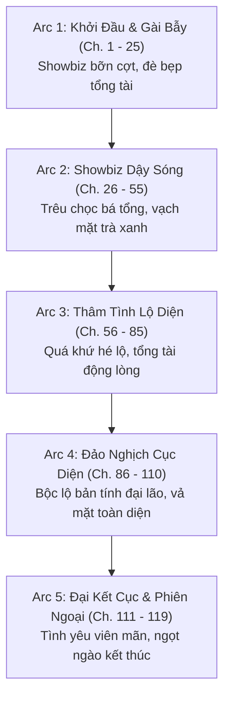
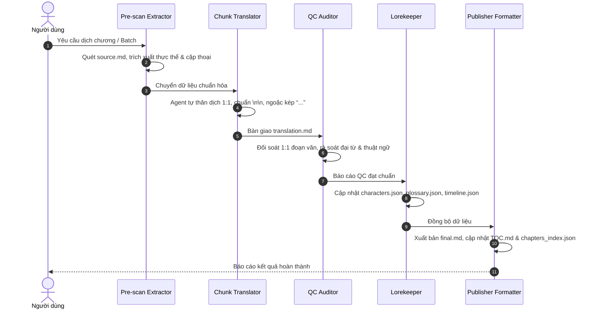

# KẾ HOẠCH TRIỂN KHAI DỊCH THUẬT (TRANSLATION MASTER PLAN)
## DỰ ÁN: NGƯỜI QUA ĐƯỜNG GIÁP ĐÈ BẸP TỔNG TÀI CÔ NGẠO (路人甲压倒孤傲总裁)

> **Cập nhật ngày:** 02/11/2026  
> **Tổng quy mô:** 119 chương chính văn (100% Raw đã sẵn sàng tại `chapters/ch_001` đến `chapters/ch_119`).  
> **Mục tiêu:** Bản dịch tiếng Việt mượt mà, văn phong sắc sảo hài hước, bảo toàn tuyệt đối 1:1 đoạn văn, chuẩn format `\n\n`, đúng ma trận xưng hô và không phụ thuộc Google API Key ngoài.

---

## 🎯 1. MỤC TIÊU & CHỈ SỐ ĐO LƯỜNG (KPIs)

- **Tiến độ:** Hoàn thiện toàn bộ 119 chương theo từng Sprint/Batch.
- **Độ chính xác cấu trúc (Alignment):** 100% chương có số đoạn văn tiếng Việt trùng khớp 1:1 với nguyên tác Trung.
- **Chất lượng xưng hô (Pronoun Consistency):** 0% lỗi lệch ngôi kể (Thẩm Khinh Vân: *anh*, Tần Tư Niên: *hắn*, Tô Thiếu Âm: *cậu ta*).
- **Trải nghiệm đọc (Typography):** 100% đoạn cách nhau `\n\n`, 100% lời thoại dùng ngoặc kép cong `“...”`.
- **An toàn hệ thống (Zero API Key):** Agent tự thân xử lý trực tiếp, không gọi script ngoài dính hạn mức rate limit 429/503.

---

## 🗺️ 2. PHÂN KỲ CỐT TRUYỆN (ARCS BREAKDOWN)

Dự án 119 chương được chia thành 5 phân kỳ nội dung cốt lõi:

### Chi tiết các phân kỳ:
1. **Phân kỳ 1: Gài Bẫy & Đè Bẹp Bá Tổng (Chương 001 - 025):**
   - Thẩm Khinh Vân làm nhiệm vụ cuối cùng trong Cục Xuyên Thư, bề ngoài làm pháo hôi người qua đường Giáp bám đuôi Tô Thiếu Âm để kiếm tiền bồi thường từ hệ thống.
   - Cơ duyên tái ngộ Tần Tư Niên, bộc lộ sở thích trêu ghẹo và đè bẹp vị tổng tài ngoài lạnh trong nóng.
2. **Phân kỳ 2: Showbiz Dậy Sóng & Vả Mặt Trà Xanh (Chương 026 - 055):**
   - Sự nghiệp diễn xuất của Thẩm Khinh Vân bất ngờ bùng nổ nhờ visual đỉnh cao và năng lực thực tế.
   - Tô Thiếu Âm liên tục tính kế nhưng vô tình biến thành "máy rút tiền" cho Thẩm Khinh Vân.
3. **Phân kỳ 3: Gương Vỡ Lại Lành & Quá Khứ Rung Động (Chương 056 - 085):**
   - Hé lộ mối dây liên kết thực sự giữa Thẩm Khinh Vân và Tần Tư Niên trước khi cốt truyện bắt đầu.
   - Tần Tư Niên từng bước tháo gỡ phòng bị, chuyển từ chống cự kiêu ngạo sang quyến luyến, thâm tình.
4. **Phân kỳ 4: Đại Lão Bộc Lộ Thực Lực (Chương 086 - 110):**
   - Thẩm Khinh Vân không còn che giấu năng lực, cùng Tần Tư Niên đồng hành trên thương trường và đỉnh cao danh vọng showbiz.
   - Trà xanh Tô Thiếu Âm và những kẻ hãm hại sụp đổ toàn bộ danh tiếng.
5. **Phân kỳ 5: Đại Kết Cục & Phiên Ngoại (Chương 111 - 119):**
   - Nhiệm vụ Cục Xuyên Thư hoàn tất, Thẩm Khinh Vân lựa chọn ở lại trọn đời bên Tần Tư Niên.
   - Cuộc sống thường nhật ngọt ngào, hài hước, chiều chuộng lẫn nhau.

---

## ⚡ 3. LỘ TRÌNH THỰC HIỆN THEO ĐỢT (BATCH SPRINT PLAN)

Quy trình triển khai chia làm **12 đợt (Sprints)**, mỗi đợt xử lý 10 chương (đợt cuối 9 chương):

| Đợt (Batch) | Phạm vi chương | Nội dung trọng tâm | Trạng thái dự kiến |
| :---: | :---: | :--- | :---: |
| **Batch 1** | Chương 001 – 010 | Mở màn: Thiết lập người qua đường Giáp, gặp lại Tần tổng, mở đầu màn tương tác | Sẵn sàng chạy |
| **Batch 2** | Chương 011 – 020 | Đua ngựa, hợp đồng tình nhân, người đại diện Tiêu Nghiệp xuất hiện | Chờ thực hiện |
| **Batch 3** | Chương 021 – 030 | Đêm định mệnh, xe đông, phản kích đầu tiên trong showbiz | Chờ thực hiện |
| **Batch 4** | Chương 031 – 040 | Cưỡi ngựa, dầm mưa, phỏng vấn, chiếc đuôi nhỏ | Chờ thực hiện |
| **Batch 5** | Chương 041 – 050 | Bữa tiệc rượu, ghen tuông, Tần tổng bắt đầu mất kiểm soát cảm xúc | Chờ thực hiện |
| **Batch 6** | Chương 051 – 060 | Lên Hot search, Tô Thiếu Âm tức tối, Thẩm Khinh Vân ra tay bảo vệ Tần Tư Niên | Chờ thực hiện |
| **Batch 7** | Chương 061 – 070 | Chuyến công tác, phòng khách sạn, sự rung động không thể chối từ | Chờ thực hiện |
| **Batch 8** | Chương 071 – 080 | Biến cố gia tộc Tần thị, Thẩm Khinh Vân bộc lộ thực lực hậu thuẫn | Chờ thực hiện |
| **Batch 9** | Chương 081 – 090 | Đối đầu trực diện hào môn, vả mặt tra nam và trà xanh | Chờ thực hiện |
| **Batch 10** | Chương 091 – 100 | Công khai quan hệ, mạng xã hội nổ tung, ngọt sủng vô bờ | Chờ thực hiện |
| **Batch 11** | Chương 101 – 110 | Trận chiến danh vọng cuối cùng, nhận giải thưởng điện ảnh, cầu hôn | Chờ thực hiện |
| **Batch 12** | Chương 111 – 119 | Kết thúc chính văn & Hoàn thành trọn vẹn toàn bộ dự án | Chờ thực hiện |

---

## 🔄 4. PIPELINE QUY TRÌNH DỊCH THUẬT 5 BƯỚC KHÉP KÍN

Mỗi chương đều tuân thủ nghiêm ngặt chu trình 5 bước:

### Các bước cụ thể:
1. **Bước 1 - Pre-scan (`novel-prescan-extractor`):**  
   Quét nhanh `source.md` để phát hiện nhân vật mới, từ ngữ mạng showbiz hoặc danh xưng gia tộc, đảm bảo không có bất kỳ tên riêng nào bị phiên âm sai.
2. **Bước 2 - Dịch Thuật 1:1 (`novel-chunk-translator`):**  
   Agent tự đọc file gốc và viết bản dịch trực tiếp sang `translation.md`. Số đoạn dịch chuẩn xác 1:1 với số đoạn gốc, giữ đúng sắc thái giảo hoạt của Thẩm Khinh Vân và vẻ kiêu ngạo của Tần Tư Niên.
3. **Bước 3 - Kiểm Định QC Đa Tầng (`novel-qc-auditor`):**  
   Soát lỗi tự động: đếm số đoạn văn, kiểm tra đại từ (`anh` - `hắn` - `cậu ta`), kiểm tra ngoặc kép `“...”` và khoảng cách `\n\n`.
4. **Bước 4 - Cập Nhật Tri Thức (`novel-lorekeeper`):**  
   Ghi nhận các diễn biến mới vào `memory/timeline.json` và cập nhật quan hệ vào `memory/relationships.json`.
5. **Bước 5 - Chuẩn Hóa & Mục Lục (`novel-publisher-formatter`):**  
   Đánh dấu trạng thái `qc_approved` trên `chapters_index.json` và cập nhật tiến độ phần trăm trên `TOC.md`.

---

## 🚀 5. BƯỚC TIẾP THEO SẴN SÀNG KÍCH HOẠT

Hiện tại hệ thống đã sẵn sàng:
- **Tài liệu Rules:** Đã được thiết lập chuẩn xác tại [AGENTS.md](file:///d:/Nhung/RIDI/trans-assistant/novel_projects/người-qua-đường-giáp-đè-bẹp-tổng-tài-cô-ngạo/AGENTS.md).
- **Kế hoạch Master Plan:** Đã hoàn chỉnh tại [PLAN.md](file:///d:/Nhung/RIDI/trans-assistant/novel_projects/người-qua-đường-giáp-đè-bẹp-tổng-tài-cô-ngạo/PLAN.md).
- **Dữ liệu nguồn:** Đầy đủ 119 chương file raw `source.md`.

👉 **Hành động đề xuất:** Có thể bắt đầu dịch ngay **Batch 1 (Chương 001 đến 010)** hoặc chạy thử nghiệm mẫu **Chương 001** để nghiệm thu phong văn và độ chuẩn mực 1:1!
