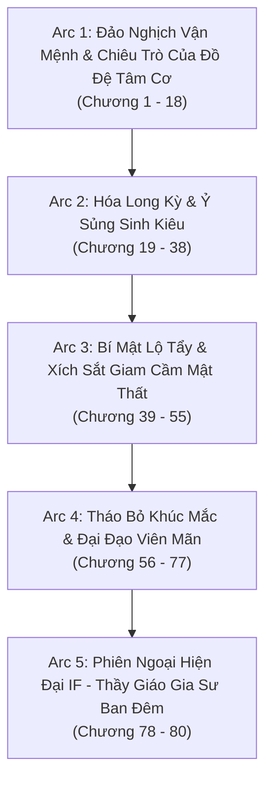

# 🗺️ KẾ HOẠCH TRIỂN KHAI DỊCH THUẬT (PLAN)
## NHỮNG NĂM THÁNG TA LÀM LÔ ĐỈNH CHO SƯ TÔN (《成为反派师尊炉鼎后》)

> **Tác giả:** Phong Lưu Khách (风流客)  
> **Quy mô dự án:** 80 chương (Chương 1 - Chương 77 Chính văn + Chương 78 - Chương 80 Ngoại truyện Hiện đại IF)  
> **Độ dài nguyên tác:** 281.907 chữ (~28.2 vạn chữ) đã phân tách sẵn trong `chapters/ch_001` - `chapters/ch_080`  
> **Chủ đề chính:** Chủ công, xuyên thư hệ thống, tiên hiệp tu chân, âm u hắc liên hoa đồ đệ công × sư tôn mỹ nhân mềm lòng cưng chiều thụ, giam cầm mật thất, 1v1, HE.  

---

## 🎯 1. MỤC TIÊU CỐT LÕI

1. **Chất Lượng Văn Phong:**
   - Lột tả trọn vẹn nét tương phản đắt giá: Sự nguy hiểm, tâm cơ toan tính giả vờ ngoan hiền của đồ đệ Thẩm Vân Tẫn và sự dịu dàng, mềm lòng, dễ xấu hổ nhưng hết mực bảo bọc của sư tôn Tạ Vi Viễn.
   - Chuyển ngữ mượt mà những màn "trêu chọc, giả bệnh, nuốt độc" đòi ôm ấp của công và những màn "dở khóc dở cười" của thụ khi cố thuần hóa con sói hoang thành chú chó nhà.
2. **Kỷ Luật Định Dạng & Kỹ Thuật Tuyệt Đối (Zero Tolerance):**
   - **Zero Google API Key Mandate:** AI Code Agent tự thân đọc raw `source.md`, phân tích ngữ cảnh và dịch trực tiếp. Tuyệt đối không dùng API ngoài để loại trừ triệt để lỗi 429 Resource Exhausted và 503 High Demand.
   - **1:1 Paragraph Alignment:** 100% số đoạn tiếng Việt khớp chính xác 1:1 với số đoạn raw trong `source.md`.
   - **Khoảng Cách `\n\n` & Dấu Ngoặc Kép `“...”`:** Mọi đoạn văn và lời thoại cách nhau đúng 1 dòng trống, thoại nằm gọn trong ngoặc kép cong.
   - **Ngôi Kể Thứ Ba Tách Bạch:** Thẩm Vân Tẫn là **"hắn"**, Tạ Vi Viễn là **"y"**.

---

## 📅 2. PHÂN KỲ TRIỂN KHAI THEO CỐT TRUYỆN (ARCS)

Dự án 80 chương được chia thành 5 giai đoạn mạch truyện chính:

### 🔹 Arc 1: Đảo Nghịch Vận Mệnh & Chiêu Trò Của Đồ Đệ Tâm Cơ (Chương 1 - Chương 18)
- **Nội dung:** Thẩm Vân Tẫn chịu đủ khổ hình, hắc hóa toan giết sư tôn báo thù. Đúng lúc đó, Tạ Vi Viễn mang theo hệ thống xuyên vào thân xác sư tôn ác độc, lập tức xoay chuyển cục diện bằng một cái ôm che chở. Thẩm Vân Tẫn ôm mối hoài nghi, mặt ngoài ngoan ngoãn nhưng ngấm ngầm nuốt Hợp Hoan Tán, giả yếu đuối để dò xét giới hạn của sư tôn. Tạ Vi Viễn vì hệ thống và bản tính thiện lương nên đỏ mặt tận tình chăm sóc.
- **Tiêu điểm dịch:** Khắc họa sự tương phản giữa vẻ ngoài đáng thương của Thẩm Vân Tẫn với nội tâm toan tính thử thách lòng người; nét lúng túng, đỏ bừng tai của sư tôn khi phải "giải độc" cho đồ đệ.

### 🔹 Arc 2: Hóa Long Kỳ & Ỷ Sủng Sinh Kiêu (Chương 19 - Chương 38)
- **Nội dung:** Thẩm Vân Tẫn bước vào giai đoạn biến đổi huyết mạch (Hóa Long Kỳ), tính tình nóng nảy, thân thể sốt cao và khát khao hơi ấm từ sư tôn. Hắn bắt đầu "ỷ sủng sinh kiêu", liên tục tạo ra các tình huống nguy hiểm giả để sư tôn đến cứu và ôm ấp dỗ dành. Tạ Vi Viễn từng bước thuần hóa được con sói hung dữ, tưởng rằng đã sắp sửa hoàn thành nhiệm vụ cảm hóa.
- **Tiêu điểm dịch:** Nâng cao độ dính người, ngọt ngào và những chi tiết tiếp xúc thân mật nóng bỏng, thể hiện Thẩm Vân Tẫn từng bước chiếm trọn trái tim sư tôn.

### 🔹 Arc 3: Bí Mật Lộ Tẩy & Xích Sắt Giam Cầm Mật Thất (Chương 39 - Chương 55)
- **Nội dung:** Thẩm Vân Tẫn phát hiện mọi sự dịu dàng của Tạ Vi Viễn thực chất chỉ là một "nhiệm vụ" nhằm hoàn thành chỉ tiêu hệ thống. Nỗi căm hờn và cảm giác bị phản bội khiến bản tính bệnh kiều trong hắn bùng nổ. Khi Tạ Vi Viễn chuẩn bị rút lui, Thẩm Vân Tẫn dùng xích huyền thiết khóa chặt chân sư tôn, nhốt y vào mật thất ("tiểu hắc ốc"). Bắt đầu chuỗi ngày giằng xé tâm lý dữ dội và truy thê cực độ.
- **Tiêu điểm dịch:** Chuyển đổi sắc thái xưng hô từ ngoan ngoãn sang lạnh lùng, chiếm hữu; lột tả nỗi đau giằng xé của Thẩm Vân Tẫn cùng sự nỗ lực chân thành chứng minh "tình yêu là có thật" của Tạ Vi Viễn.

### 🔹 Arc 4: Tháo Bỏ Khúc Mắc & Đại Đạo Viên Mãn (Chương 56 - Chương 77)
- **Nội dung:** Tạ Vi Viễn vượt qua ràng buộc của hệ thống, thổ lộ tình cảm chân thật từ tận đáy lòng. Thẩm Vân Tẫn triệt để giải tỏa khúc mắc, cùng sư tôn dẹp yên hiểm họa môn phái và những kẻ từng lăng nhục mình năm xưa, chính thức bái đường kết làm đạo lữ trước toàn thể tu chân giới.
- **Tiêu điểm dịch:** Không khí hào sảng, viên mãn, ngọt ngào thăng hoa, khẳng định tình yêu vượt qua định mệnh và không gian thời gian.

### 🔹 Arc 5: Phiên Ngoại Hiện Đại IF - Thầy Giáo Gia Sư Ban Đêm (Chương 78 - Chương 80)
- **Nội dung:** Câu chuyện thế giới song song thời hiện đại: Thẩm Vân Tẫn là cậu học trò ngỗ nghịch, bá đạo, thích trêu chọc thầy giáo; Tạ Vi Viễn là gia sư ban đêm đoan chính, thanh lịch. Những màn "giải đề nhận thưởng" ngọt ngào, thú vị và đầy hấp dẫn.
- **Tiêu điểm dịch:** Chuyển đổi ngôn từ sang văn phong hiện đại trẻ trung, tự nhiên (xưng "thầy - em"), giữ nguyên chemistry quyến rũ giữa hai nhân vật.

---

## 🚀 3. KẾ HOẠCH BATCH DỊCH TỰ HÀNH (EXECUTION SCHEDULE)

Toàn bộ 80 chương được phân bổ thành 8 đợt chạy (Batch) khoa học, trung bình 10 chương mỗi batch:

| Đợt chạy (Batch) | Phạm vi chương | Trọng tâm nội dung | Mục tiêu kiểm định |
| :--- | :--- | :--- | :--- |
| **Batch 1** | Chương 1 - 10 | Sư tôn xuyên thư, cái ôm định mệnh, Hợp Hoan Tán | Thẩm định quy chuẩn xưng hô & phong cách |
| **Batch 2** | Chương 11 - 20 | Âm thầm câu dẫn, Hóa Long Kỳ bắt đầu | Kiểm tra sự mượt mà cảnh thân mật |
| **Batch 3** | Chương 21 - 30 | Ỷ sủng sinh kiêu, độc chiếm sư tôn | Giữ nhịp độ ngọt ngào hài hước |
| **Batch 4** | Chương 31 - 40 | Đỉnh điểm ngọt ngào & Phát hiện sự thật hệ thống | Bản lề chuyển giao tâm lý |
| **Batch 5** | Chương 41 - 50 | Hắc hóa bùng nổ, xích sắt giam cầm mật thất | Đậm chất bệnh kiều, giằng xé cảm xúc |
| **Batch 6** | Chương 51 - 60 | Hóa giải hiểu lầm, chân ái vượt trên hệ thống | Cao trào cảm xúc tháo gỡ nút thắt |
| **Batch 7** | Chương 61 - 70 | Dẹp yên tông môn, sóng gió tu chân giới | Hào hùng, khí thế tiên hiệp |
| **Batch 8** | Chương 71 - 80 | Đại kết cục chính văn & 3 chương Phiên ngoại hiện đại | Hoàn tất 100% dự án & Đóng gói EPUB |

---

## 🔍 4. QUY TRÌNH KIỂM SOÁT CHẤT LƯỢNG (QC CHECKLIST)

Mỗi chương dịch xong phải vượt qua bộ lọc 5 bước nghiêm ngặt:
1. `[ ]` **Paragraph Count Check:** Số đoạn `translation.md` = Số đoạn `source.md` (sai lệch dù chỉ 1 đoạn = FAIL, bắt buộc căn chỉnh lại ngay).
2. `[ ]` **Spacing Check:** Cách dòng `\n\n` chuẩn mực giữa mọi đoạn văn và lời thoại, tuyệt đối không dính dòng.
3. `[ ]` **Pronoun Audit:**
   - Trần thuật: Thẩm Vân Tẫn = **"hắn"**, Tạ Vi Viễn = **"y"**.
   - Đối thoại: Tuân thủ ma trận xưng hô theo từng giai đoạn (ngoan ngoãn: con - sư tôn; giam cầm: ta - người/sư tôn/Tạ Vi Viễn; ngoại truyện: em - thầy).
4. `[ ]` **Punctuation Check:**
   - Tất cả lời thoại nằm trong ngoặc kép cong `“...”`.
   - Mọi câu nghi vấn tiếng Việt kết thúc bằng dấu `?` (hoặc `?!`), không để dấu chấm cụt lủn.
5. **Sync Memory:** Cập nhật ngay các thông tin mới vào `memory/characters.json`, `memory/relationships.json` và mốc thời gian vào `memory/timeline.json`.
