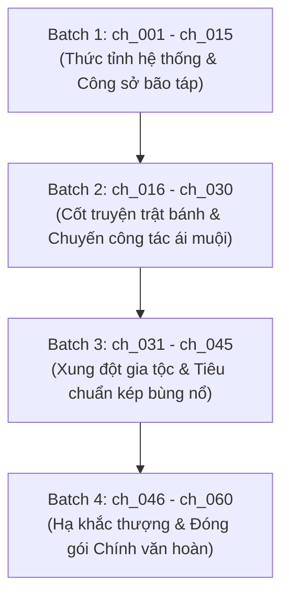

# 🗺️ KẾ HOẠCH TRIỂN KHAI DỊCH THUẬT (TRANSLATION PLAN)
## PHÁO HÔI ĐẶC TRỢ CHÍCH TƯỞNG NÃ TIỀN BÀO LỘ (《炮灰特助只想拿钱跑路》)

> **Quy mô:** Trọn bộ 60 chương chính văn hoàn thành (`ch_001` → `ch_060`).  
> **Tổng dung lượng raw:** 4.472 đoạn văn, 203.850 ký tự tiếng Trung.  
> **Chế độ thực thi:** Hỗ trợ song song (Parallel Subagents) và Tự hành liên hoàn (Continuous Autonomous Pipeline) tuân thủ Zero Google API Key.

---

## 🎯 MỤC TIÊU CỐT LÕI

1. **Chất lượng văn phong đỉnh cao:**
   - Thể hiện trọn vẹn nét hài hước ngầm, thông minh và phong thái lý trí "nhã nhặn bại hoại" của Tùy Ứng (Chủ công).
   - Tái hiện sự chuyển biến tâm lý từ bạo quân lạnh lùng, khó chiều sang người đàn ông tiêu chuẩn kép, chiếm hữu và nuông chiều cấp dưới của Phó Dận An.
2. **Kỷ luật định dạng tuyệt đối:**
   - 100% khớp 1:1 Paragraph Alignment giữa `source.md` và `translation.md`.
   - Đúng chuẩn khoảng cách dòng `\n\n`, thoại cong tiếng Việt `“...”`.
   - Trần thuật ngôi 3: Tùy Ứng = **"hắn"**, Phó Dận An = **"anh"**.
3. **Quy trình 4 Phase khép kín:** Mỗi chương đi qua đầy đủ Pre-scan QA → Dịch 1:1 → QC 5 lớp → Lorekeeper & Đồng bộ TOC/timeline.

---

## 📦 PHÂN BỔ 4 BATCH DỊCH THUẬT LOGIC

---

### 🔹 BATCH 1: THỨC TỈNH HỆ THỐNG & ĐỜI SỐNG CÔNG SỞ BÃO TÁP (CHƯƠNG 1 - 15)
- **Dải chương:** `ch_001` đến `ch_015` (15 chương, ~1.100 đoạn văn).
- **Trọng tâm cốt truyện:**
  - Tùy Ứng đang chăm sóc ly cà phê lúc nửa đêm cho sếp thì hệ thống "Thế giới tu chính" đột ngột kích hoạt.
  - Hắn phát hiện mình là pháo hôi đặc trợ trong cuốn tiểu thuyết cẩu huyết, được giao việc gây khó dễ cho bạch liên hoa thụ Tô Thanh Từ.
  - Tùy Ứng quyết định: Cứ làm việc kiếm tiền, tích lũy tiền phạt vi phạm hợp đồng để nhảy việc chuồn lẹ, không dính líu drama ái tình.
  - Sự chuyên nghiệp tuyệt đối của Tùy Ứng khiến Phó Dận An bắt đầu chú ý khác thường.
- **Mục tiêu kỹ thuật:** Thiết lập vững chắc ma trận đại từ công sở giai đoạn 1, khóa chặt thuật ngữ tập đoàn Quân Chính và bối cảnh Thủ đô tinh.

---

### 🔹 BATCH 2: CỐT TRUYỆN TRẬT BÁNH & CHUYẾN CÔNG TÁC ÁI MUỘI (CHƯƠNG 16 - 30)
- **Dải chương:** `ch_016` đến `ch_030` (15 chương, ~1.100 đoạn văn).
- **Trọng tâm cốt truyện:**
  - Cốt truyện gốc hoàn toàn chệch hướng: Thay vì yêu Tô Thanh Từ, ánh mắt Phó Dận An chỉ hướng về phía đặc trợ Tùy.
  - Chuyến công tác dài ngày của hai người: Những va chạm thể xác ngoài ý muốn, tình huống kẹt phòng, tin tức tố Alpha đỉnh cấp quấn quýt.
  - Tùy Ứng vừa đếm tiền vừa đau đầu vì boss có biểu hiện ngày càng "lạ lùng", tiêu chuẩn kép với mình đến mức lộ liễu.
- **Mục tiêu kỹ thuật:** Chuyển giao mượt mà giọng thoại từ công việc thuần túy sang ái muội thăm dò (Giai đoạn 2), ghi nhận các mốc sự kiện vào `timeline.json`.

---

### 🔹 BATCH 3: XUNG ĐỘT GIA TỘC & TIÊU CHUẨN KÉP BÙNG NỔ (CHƯƠNG 31 - 45)
- **Dải chương:** `ch_031` đến `ch_045` (15 chương, ~1.150 đoạn văn).
- **Trọng tâm cốt truyện:**
  - Người nhà Tùy gia (Tùy Văn Hàn, Tùy Thịnh) và thiếu gia Cố Thiên Diệp tìm cách gây sức ép, dùng quá khứ để bôi nhọ hoặc thao túng Tùy Ứng.
  - Tùy Ứng ra tay phản đòn sắc bén, lý trí; Phó Dận An công khai đứng ra che chở, nghiền ép đối thủ để bảo vệ đặc trợ của mình.
  - Ranh giới giữa cấp trên - cấp dưới chính thức bị phá vỡ, sự tương thuộc và tin tưởng tuyệt đối giữa hai người Alpha mạnh mẽ.
- **Mục tiêu kỹ thuật:** Kiểm soát chặt chẽ xưng hô phức tạp giữa Tùy Ứng với gia tộc (giữ khoảng cách lạnh lùng, không gọi cha/em thân mật), cập nhật hồ sơ các nhân vật phản diện phụ vào `characters.json`.

---

### 🔹 BATCH 4: HẠ KHẮC THƯỢNG & ĐÓNG GÓI CHÍNH VĂN HOÀN (CHƯƠNG 46 - 60)
- **Dải chương:** `ch_046` đến `ch_060` (15 chương, ~1.120 đoạn văn).
- **Trọng tâm cốt truyện:**
  - Tùy Ứng hoàn tất mục tiêu tài chính, chính thức nộp đơn xin từ chức và chuẩn bị dọn nhà.
  - Phó tổng bá đạo bất đắc dĩ hạ mình, đến tận nơi dọn nhà và tìm mọi cách "giữ chân" trợ lý thân cận làm bạn đời trọn đời.
  - Màn kết ngọt ngào, hài hước, khẳng định vị thế "hạ khắc thượng": đặc trợ quản lý túi tiền lẫn con người của tổng tài.
  - Chính văn hoàn thành (`-正文完-`).
- **Mục tiêu kỹ thuật:** Đồng bộ toàn diện `timeline.json`, kiểm tra chéo 100% 60 chương qua `verify_literary_qc.py`, hoàn thiện `TOC.md` và `chapters_index.json`.

---

## ⚡ PHƯƠNG PHÁP THỰC THI (WORKFLOW EXECUTION)

* **Autonomous Continuous Mode (Tự hành liên hoàn):** Khi người dùng ra lệnh bắt đầu dịch (hoặc chạy batch), Orchestrator sẽ tự động chạy liên tục qua các chương, không tạo điểm dừng giả tạo giữa chừng, tự động chuyển tiếp qua từng batch.
* **Quy trình 4 Phase mỗi chương:**
  1. `Phase 1: Pre-scan` → Kiểm tra nhân vật mới, quan hệ, lập `qa_clarifications.md`.
  2. `Phase 2: Translation` → Agent tự dịch in-context, khớp 1:1, đúng `\n\n`, thoại cong `“...”`.
  3. `Phase 3: QC Audit` → Kiểm tra 5 lớp (đại từ, rớt dòng, nhầm lẫn người nói), sinh `qc_report.md`.
  4. `Phase 4: Lorekeeper Sync` → Ghi nhận sự kiện vào `timeline.json`, cập nhật `chapters_index.json` và `TOC.md`.
