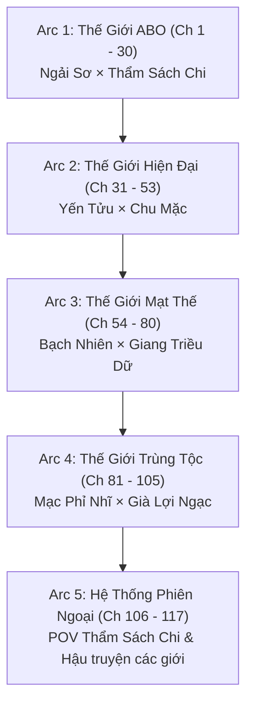
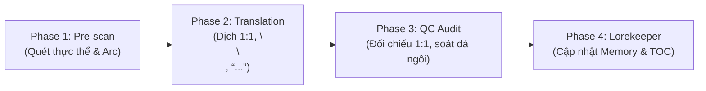

# 🗺️ KẾ HOẠCH TRIỂN KHAI DỊCH THUẬT TOÀN DỰ ÁN (PROJECT TRANSLATION PLAN)
## PHÁO HÔI CÔNG DÃ HỘI BỊ CƯỜNG THỦ HÀO ĐOẠT MA (《炮灰攻也会被强取豪夺吗》)

> **Tên tác phẩm:** Pháo Hôi Công Dã Hội Bị Cường Thủ Hào Đoạt Ma (炮灰攻也会被强取豪夺吗)  
> **Tên khác:** Hỏa Táng Trường Tra Công, Đãn Bị Phong Phê Cường Chế (火葬场渣攻，但被疯批强制)  
> **Tác giả:** 梦里还花呗 (Mộng Lí Hoàn Hoa Bái)  
> **Quy mô dự án:** **117 chương** (105 chương Chính văn + 12 chương Ngoại truyện)  
> **Slug:** `pháo-hôi-công-dã-hội-bị-cường-thủ-hào-đoạt-ma`  
> **Thể loại:** Đam mỹ, Xuyên thư, Khoái xuyên / Đơn nguyên văn, Chủ công, Cường thủ hào đoạt, Cưỡng chế ái (Thụ cưỡng chế công), Điên phê thụ, Hài hước bựa xen lẫn cẩu huyết kích thích, 1v1 song khiết, HE.  
> **Tình trạng hiện tại:** **100% Raw (117/117 chương)** đã được cào và làm sạch sẵn trong workspace tại `chapters/ch_001/` đến `chapters/ch_117/`.

---

## 🎯 I. MỤC TIÊU CỐT LÕI

1. **Văn phong Sắc sảo & Biến hóa theo Đơn nguyên văn:** Thể hiện trọn vẹn đặc trưng của 4 thế giới khác nhau (ABO, Đô thị, Mạt thế, Trùng tộc), tái hiện rõ nét sự tương phản giữa vẻ bất cần/tính toán của các công và tính chiếm hữu điên cuồng của các thụ phản diện.
2. **Kỷ luật định dạng 100%:**
   - 100% khớp đoạn 1:1 (`source.md` ↔ `translation.md`).
   - Đúng khoảng cách `\n\n` giữa tất cả các đoạn văn và lời thoại.
   - Chuẩn hóa ngoặc kép hội thoại `“...”`.
   - Phân biệt tuyệt đối đại từ ngôi 3: Nhân vật Công chính = **“hắn”**, Nhân vật Thụ phản diện = **“y”**. Không dùng lẫn lộn, không để xảy ra hiện tượng "đá ngôi".
3. **Quy tắc Universal Zero Google API Key:** Agent tự thân xử lý toàn bộ quy trình, không gọi API ngoài, loại trừ triệt để nguy cơ lỗi 429 Resource Exhausted.
4. **Cơ chế vận hành Subagent linh hoạt:** Sẵn sàng phân luồng Worker Subagent chạy song song độc lập khi triển khai các batch lớn.

---

## 📦 II. LỘ TRÌNH 4 THẾ GIỚI CHÍNH & PHIÊN NGOẠI (117 CHƯƠNG)

---

### 🔹 ARC 1: THẾ GIỚI ABO (CHƯƠNG 1 - 30)
- **Quy mô:** 30 chương
- **Cặp đôi:** Ngải Sơ (Alpha trà xanh tâm cơ) × Thẩm Sách Chi (Alpha phản diện quyền lực)
- **Tiêu điểm cốt truyện:**
  - Ngải Sơ đóng vai mối tình đầu tệ bạc của Cố Lãnh Ngôn (Omega thụ chính nguyên tác), giả vờ hoàn mỹ để đào mỏ.
  - Nhận thấy công chính giàu hơn, Ngải Sơ chuyển mục tiêu câu dẫn nhưng lại nhận nhầm Boss phản diện Thẩm Sách Chi thành công chính.
  - Bị Thẩm Sách Chi bắt tại trận, cưỡng ép giam lỏng và đánh dấu áp bức.
  - Quá trình đấu trí, giãy giụa và tình cảm biến chuyển từ lợi dụng thành gắn kết sâu sắc.
- **Kế hoạch Batch:**
  - **Batch 1.1 (Ch 1 – 10):** Tiếp cận, nhận nhầm đối tượng, lần đầu bị ép lên giường phản diện.
  - **Batch 1.2 (Ch 11 – 20):** Giam giữ tại biệt viện, đấu tranh tâm lý, sự kiểm soát ngột ngạt của Thẩm Sách Chi.
  - **Batch 1.3 (Ch 21 – 30):** Tháo gỡ hiểu lầm, phá vỡ cốt truyện cũ, đại kết cục ngọt ngào của Arc 1.

---

### 🔹 ARC 2: THẾ GIỚI HIỆN ĐẠI ĐÔ THỊ (CHƯƠNG 31 - 53)
- **Quy mô:** 23 chương
- **Cặp đôi:** Yến Tửu (Thiếu gia bạo kiều ngạo kiều) × Chu Mặc (Tử địch cố chấp thâm trầm)
- **Tiêu điểm cốt truyện:**
  - Yến Tửu thức tỉnh kịch bản "tra công hỏa táng trường", lập tức đá phăng thụ chính để né kiếp nạn theo đuổi vợ sml.
  - Chu Mặc – đối thủ không đội trời chung, người vốn bị đồn là ghét đồng tính – bất ngờ về nước và đưa ra đề nghị bao dưỡng Yến Tửu.
  - Mối quan hệ "oan gia ngõ hẹp" đảo chiều thành trói buộc tình cảm mãnh liệt.
- **Kế hoạch Batch:**
  - **Batch 2.1 (Ch 31 – 40):** Đá văng kịch bản hỏa táng trường, tái ngộ tử địch Chu Mặc.
  - **Batch 2.2 (Ch 41 – 53):** Giao kèo bao dưỡng, lộ diện bộ mặt thật của Chu Mặc, HE Arc 2.

---

### 🔹 ARC 3: THẾ GIỚI MẠT THẾ SINH TỒN (CHƯƠNG 54 - 80)
- **Quy mô:** 27 chương
- **Cặp đôi:** Bạch Nhiên (Vô tâm vô phế thực dụng) × Giang Triều Dữ (Bạn thân hắc hóa âm trầm)
- **Tiêu điểm cốt truyện:**
  - Bạch Nhiên biết mình là pháo hôi sẽ phản bội và giết chết nam chính Giang Triều Dữ. Hắn quyết đoán ra tay trước rồi trốn chạy.
  - Giang Triều Dữ nhờ hào quang nhân vật chính không chết mà tiến hóa dị năng đỉnh cấp, hắc hóa hoàn toàn.
  - Ba năm sau, Giang Triều Dữ tóm sống Bạch Nhiên, bắt đầu màn "thanh toán nợ cũ" đầy căng thẳng và cấm kỵ.
- **Kế hoạch Batch:**
  - **Batch 3.1 (Ch 54 – 65):** Tái ngộ sau 3 năm, bị áp giải về căn cứ, màn trả thù kỳ quái.
  - **Batch 3.2 (Ch 66 – 80):** Hợp tác sinh tồn nơi mạt thế, tâm lý biến chuyển, hòa giải và gắn kết.

---

### 🔹 ARC 4: THẾ GIỚI TRÙNG TỘC TINH TẾ (CHƯƠNG 81 - 105)
- **Quy mô:** 25 chương
- **Cặp đôi:** Mạc Phỉ Nhĩ (Hùng trùng kiêu kỳ bản địa) × Già Lợi Ngạc (Thư trùng tinh đạo phản diện)
- **Tiêu điểm cốt truyện:**
  - Mạc Phỉ Nhĩ là quý tộc hùng tử nuông chiều, trong chuyến bay bị tinh đạo tập kích và bắt cóc.
  - Thủ lĩnh tinh đạo Già Lợi Ngạc – kẻ thù nguy hiểm nhất của Đế quốc – giam giữ Mạc Phỉ Nhĩ trên chiến hạm.
  - Nghịch lý đảo ngược giữa vị thế thống trị của Hùng trùng và sức mạnh cơ bắp của Thư trùng phản diện.
  - Kết thúc chính văn toàn bộ truyện tại Chương 105.
- **Kế hoạch Batch:**
  - **Batch 4.1 (Ch 81 – 92):** Bị bắt lên chiến hạm, đụng độ thủ lĩnh tinh đạo.
  - **Batch 4.2 (Ch 93 – 105):** Thuần phục ngược lại, đối đầu hạm đội đế quốc, chính văn hoàn thành.

---

### 🔹 ARC 5: HỆ THỐNG PHIÊN NGOẠI (CHƯƠNG 106 - 117)
- **Quy mô:** 12 chương
- **Nội dung:**
  - **Chương 106:** Ngoại truyện đặc biệt — Góc nhìn độc quyền của Thẩm Sách Chi (Thế giới ABO).
  - **Chương 107 – 108:** Ngoại truyện ABO — Cuộc sống hôn nhân ngọt ngào của Ngải Sơ và Thẩm Sách Chi.
  - **Chương 109 – 111:** Ngoại truyện Hiện đại — Cuộc sống chung của Yến Tửu và Chu Mặc.
  - **Chương 112 – 114:** Ngoại truyện Mạt thế — Xây dựng lại thế giới sau đại nạn.
  - **Chương 115 – 117:** Ngoại truyện Trùng tộc — Hậu truyện ấm áp giữa hai vì sao.

---

## ⚡ III. QUY TRÌNH THỰC THI 4 PHA (4-PHASE ENGINE)

1. **Phase 1: Pre-scan & Tra cứu Thực thể:**
   - Xác định chương thuộc Arc nào, đọc `source.md`, quét nhân vật mới, thuật ngữ thế giới tương ứng.
   - Đối chiếu với `memory/characters.json` và `glossary.json`.
2. **Phase 2: Translation (Biên dịch chính thức):**
   - Đọc trực tiếp nội dung từ `source.md`.
   - Áp dụng ma trận đại từ: Công chính = **hắn**, Thụ phản diện = **y**.
   - Chuẩn hóa ngoặc kép `“...”`, khoảng cách `\n\n`, bảo đảm chính xác 1:1 số đoạn văn.
3. **Phase 3: Strict QC Audit (Kiểm thử đa tầng):**
   - Kiểm tra đoạn văn: `len(translation.paragraphs) == len(source.paragraphs)`.
   - Quét sạch lỗi đá ngôi, cấm dùng từ cấm ("anh/cậu" trong trần thuật, "mày/tao" tùy tiện).
   - Xuất file báo cáo `qc_report.md`.
4. **Phase 4: Lorekeeper & Đồng bộ:**
   - Ghi nhận tiến độ vào `chapters_index.json` và đánh dấu `[x]` tại `TOC.md`.
   - Cập nhật thêm các tình tiết quan trọng vào `timeline.json`.
