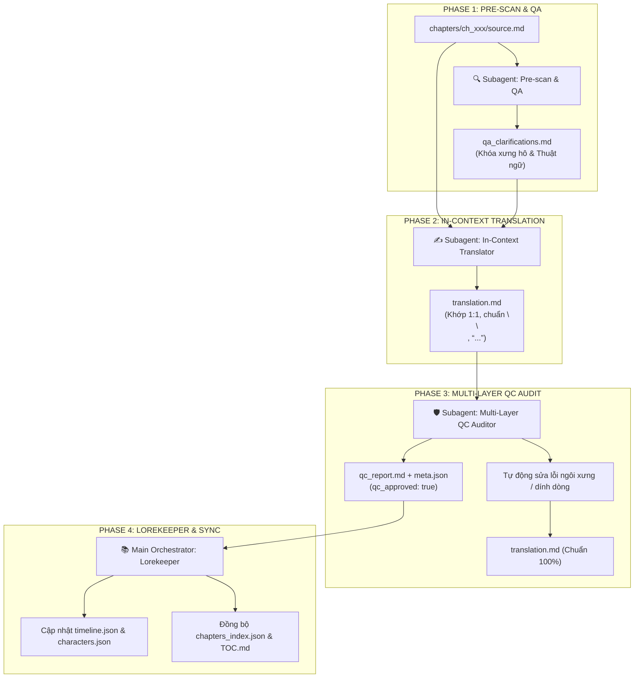
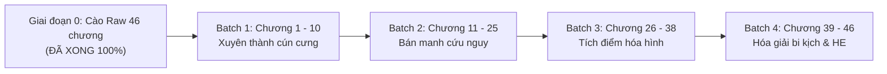

# 🗺️ KẾ HOẠCH TRIỂN KHAI DỊCH THUẬT CHI TIẾT (PLAN)
## PHẢN PHÁI TIỂU CẨU KHÁO MẠI MANH CÔNG LƯỢC SỞ HỮU NHÂN (《反派小狗靠卖萌攻略所有人》)

> **Tác giả:** Nhất Vĩ Hồ Li (一尾狐狸)  
> **Quy mô dự án:** 46 chương chính văn hoàn kết  
> **Độ dài raw:** ~169.905 ký tự / 4.177 dòng văn bản sạch  
> **Chủ đề chính:** Chủ công, cún con tưng tửng vui vẻ mỹ công × trùm phản diện điên phê cuồng dã soái thụ, xuyên thư, hệ thống manh sủng, sa điêu hài hước ngọt sủng, 1v1, HE.  
> **Thư mục dự án:** `novel_projects/phản-phái-tiểu-cẩu-kháo-mại-manh-công-lược-sở-hữu-nhân`

---

## 🎯 MỤC TIÊU CỐT LÕI

1. **Văn phong chuẩn xác, hóm hỉnh & Sủng ngọt tinh tế:**
   - Khắc họa sinh động biểu cảm dễ thương, tưng tửng nhưng dũng cảm của chú cún con Nguyễn Nguyên Bạch khi dùng tuyệt chiêu "bán manh", cắn ống quần, tát móng vuốt để ngăn chặn bi kịch cẩu huyết.
   - Thể hiện sự biến chuyển tâm lý đặc sắc của Tịch Ninh Dụ: Từ đại lão phản diện điên phê khét tiếng, lòng dạ tàn độc dần bị chú cún con làm tan chảy, biến thành kẻ cuồng cưng chiều người yêu và lộ rõ tiếng lòng "muốn hôn chết cậu".
2. **Quy chuẩn kỹ thuật nghiêm ngặt (Zero Compromise):**
   - **Zero Google API Key Mandate:** AI Code Agent tự thân đọc raw, phân tích ngữ cảnh và dịch trực tiếp. Tuyệt đối không dùng API ngoài.
   - **Khớp 1:1 Paragraph Alignment:** Giữ nguyên vẹn 100% từng đoạn văn bản dịch khớp với `source.md`.
   - **Chuẩn định dạng:** Khoảng cách đoạn văn `\n\n`, ngoặc kép cong tiếng Việt `“...”`.
   - **Đại từ ngôi 3:** Nguyễn Nguyên Bạch = **“cậu / chú cún”**, Tịch Ninh Dụ = **“hắn”**.

---

## 🔄 QUY TRÌNH DỊCH 4-PHASE TIÊU CHUẨN

---

## 📦 PHÂN CHIA LỘ TRÌNH DỊCH THUẬT THEO BATCH

---

### 🔹 GIAI ĐOẠN 0: CHUẨN BỊ RAW & HỒ SƠ DỰ ÁN (ĐÃ HOÀN THÀNH 100%)
- [x] Đã cào sạch và phân tách toàn bộ 46 chương tại [`chapters/ch_001/`](file:///d:/Nhung/trans-tool/novel_projects/phản-phái-tiểu-cẩu-kháo-mại-manh-công-lược-sở-hữu-nhân/chapters/ch_001) đến [`chapters/ch_046/`](file:///d:/Nhung/trans-tool/novel_projects/phản-phái-tiểu-cẩu-kháo-mại-manh-công-lược-sở-hữu-nhân/chapters/ch_046).
- [x] Đã tạo file tổng hợp [`raw_full.md`](file:///d:/Nhung/trans-tool/novel_projects/phản-phái-tiểu-cẩu-kháo-mại-manh-công-lược-sở-hữu-nhân/raw_full.md) và [`raw_full.txt`](file:///d:/Nhung/trans-tool/novel_projects/phản-phái-tiểu-cẩu-kháo-mại-manh-công-lược-sở-hữu-nhân/raw_full.txt).
- [x] Đã thiết lập cấu hình [`config.json`](file:///d:/Nhung/trans-tool/novel_projects/phản-phái-tiểu-cẩu-kháo-mại-manh-công-lược-sở-hữu-nhân/config.json), nguyên tắc [`RULES.md`](file:///d:/Nhung/trans-tool/novel_projects/phản-phái-tiểu-cẩu-kháo-mại-manh-công-lược-sở-hữu-nhân/RULES.md) và bộ nhớ [`memory/`](file:///d:/Nhung/trans-tool/novel_projects/phản-phái-tiểu-cẩu-kháo-mại-manh-công-lược-sở-hữu-nhân/memory).
- [x] Đã tạo và đồng bộ [`TOC.md`](file:///d:/Nhung/trans-tool/novel_projects/phản-phái-tiểu-cẩu-kháo-mại-manh-công-lược-sở-hữu-nhân/TOC.md) và [`chapters_index.json`](file:///d:/Nhung/trans-tool/novel_projects/phản-phái-tiểu-cẩu-kháo-mại-manh-công-lược-sở-hữu-nhân/chapters_index.json).

---

### 🔹 BATCH 1: KHỞI ĐẦU CUỘC SỐNG CÚN CƯNG (CHƯƠNG 1 - 10)
- **Quy mô:** 10 chương (`ch_001` -> `ch_010`).
- **Nội dung cốt truyện:** Nguyễn Nguyên Bạch xuyên vào thân xác cún con rơi vào thùng hàng nhà kho đêm mưa, chạm trán đại lão phản diện Tịch Ninh Dụ. Trói định với Hệ Thống Cải Tạo Nhân Vật Cổ Tảo để bảo vệ tính mạng cún, bắt đầu dùng móng vuốt và sự đáng yêu để ngăn cản Tịch Ninh Dụ ra tay tàn sát.
- **Trọng tâm dịch thuật:**
  - Thiết lập chuẩn ngôi 3: Nguyễn Nguyên Bạch = **"cậu / chú cún"**, Tịch Ninh Dụ = **"hắn"**.
  - Khắc họa giọng văn hóm hỉnh, lời thoại bên ngoài lạnh lùng của Tịch Ninh Dụ đối lập với sự nuông chiều khi ôm cún.
- **Trạng thái:** ⚪ Sẵn sàng chạy.

---

### 🔹 BATCH 2: BÁN MANH CẢM HÓA & NÉ BI KỊCH NGUYÊN TÁC (CHƯƠNG 11 - 25)
- **Quy mô:** 15 chương (`ch_011` -> `ch_025`).
- **Nội dung cốt truyện:** Cún con trở thành bảo bối không thể tách rời của đại lão. Liên tục can ngăn các vụ đụng độ giương cung bạt kiếm giữa Tịch Ninh Dụ và nhân vật chính, phá vỡ kế hoạch bắt cóc phạm pháp bằng chiêu "cắn ống quần nức nở". Điểm yêu thích tăng vọt, các nhân vật bắt đầu tranh nhau cướp cún.
- **Trọng tâm dịch thuật:**
  - Xử lý mượt mà các đoạn đối thoại kịch tính chuyển sang hài hước sa điêu.
  - Chuẩn hóa ngoặc kép `“...”` và các thông báo tăng điểm của hệ thống.
- **Trạng thái:** ⚪ Chờ Batch 1.

---

### 🔹 BATCH 3: TÍCH ĐIỂM HÓA HÌNH & TIẾNG LÒNG ĐẠI LÃO (CHƯƠNG 26 - 38)
- **Quy mô:** 13 chương (`ch_026` -> `ch_038`).
- **Nội dung cốt truyện:** Điểm số yêu thích tràn trề, cún con biến hình thành người mỹ mạo. Mở khóa phần thưởng đọc tâm, Nguyễn Nguyên Bạch bất ngờ nghe thấy toàn bộ tiếng lòng ngượng ngùng và cuồng nhiệt muốn "hôn chết cậu" của Tịch Ninh Dụ. Mối quan hệ từ thú cưng - chủ nhân chính thức chuyển sang giai đoạn tình cảm đôi lứa.
- **Trọng tâm dịch thuật:**
  - Chuyển đổi xưng hô khi hóa người: Nguyễn Nguyên Bạch xưng **"tôi / em"** - gọi **"anh / Tịch tổng"**; Tịch Ninh Dụ xưng **"tôi / anh"** - gọi **"cậu / em / Tiểu Bạch"**.
  - Giữ nguyên ranh giới trần thuật ngôi 3: Tuyệt đối không lẫn lộn giữa tiếng lòng, lời thoại và văn kể.
- **Trạng thái:** ⚪ Chờ Batch 2.

---

### 🔹 BATCH 4: HÓA GIẢI ĐỊNH MỆNH NGUYÊN TÁC & ĐẠI ĐOÀN VIÊN (CHƯƠNG 39 - 46)
- **Quy mô:** 8 chương (`ch_039` -> `ch_046`).
- **Nội dung cốt truyện:** Tịch Ninh Dụ phát hiện ra chân tướng thế giới tiểu thuyết và nhiệm vụ cải tạo của Nguyễn Nguyên Bạch. Cả hai cùng vượt qua sự điều khiển của kịch bản gốc, hòa giải mọi mâu thuẫn và cùng nhau hướng tới một tương lai bình yên, hạnh phúc viên mãn.
- **Trọng tâm dịch thuật:**
  - Hoàn thiện cảm xúc cao trào, giải tỏa các nút thắt cẩu huyết.
  - Tổng kết dòng thời gian vào `timeline.json`, đồng bộ `chapters_index.json` và `TOC.md` đạt 100% hoàn thành.
- **Trạng thái:** ⚪ Chờ Batch 3.

---

## ⚡ HƯỚNG DẪN THỰC THI (HOW TO RUN)

Khi người dùng ra lệnh dịch:
1. **Lệnh đơn chương:** `"dịch chương 1"`, `"dịch ch_001"`.
2. **Lệnh batch tự hành (Continuous Mode):** `"dịch batch 1"`, `"dịch tiếp"`, `"chạy liên hoàn batch 1"`.
3. **Lệnh phân luồng song song (Parallel Subagent Mode):** Orchestrator tự chia 2-3 worker subagent chạy song song độc lập từng chương, sau đó Orchestrator gom kết quả đồng bộ vào `memory/` và `TOC.md`.
