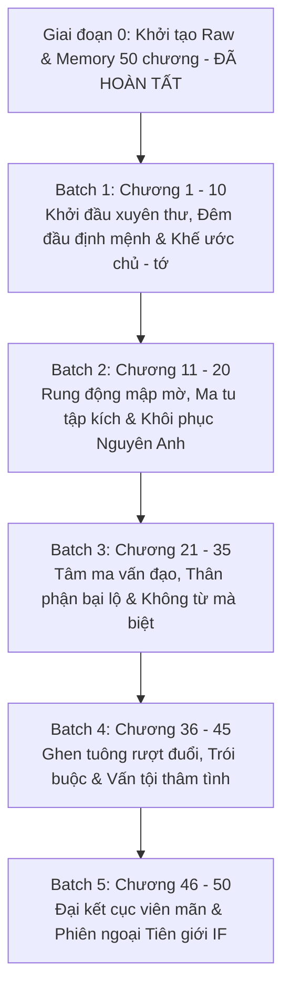

# 🗺️ KẾ HOẠCH TRIỂN KHAI DỊCH THUẬT (PLAN)
## SAU KHI PHẢN DIỆN VẠN NGƯỜI GHÉT TRA XONG LONG NGẠO THIÊN (《当万人嫌反派渣了龙傲天后[穿书]》)

> **Tác giả:** Yến Hân Không (晏昕空)  
> **Quy mô dự án:** 50 chương (Chương 1 - Chương 49 Chính văn + Chương 50 Phiên ngoại Tuyến IF)  
> **Độ dài raw:** ~214.307 ký tự / 6.194 dòng  
> **Chủ đề chính:** Chủ công, mỹ nhân bệnh nhược xà tinh bệnh x Long Ngạo Thiên da ngăm tuấn lãng trung khuyển, tiên hiệp tu chân, xuyên thư, sảng văn hài hước ngọt sủng, phản sáo lộ, 1v1, HE.  

---

## 🎯 MỤC TIÊU CỐT LÕI

1. **Văn phong chuẩn xác, sắc sảo & Duyên dáng hài hước:**
   - Thể hiện trọn vẹn phong thái của Mạnh Thời Thù: Một "xà tinh bệnh" kiêu ngạo, lười biếng, tính khí thất thường, mỹ mạo như tiên nhưng ra tay độc địa, thích trêu chọc và khống chế người khác theo kiểu "điếu hệ" (vừa đấm vừa xoa).
   - Thể hiện sự chuyển biến tâm lý tinh tế của Kim Dịch Chi: Từ một Long Ngạo Thiên kiêu ngạo, đầy thù hận khi bị hạ nhục và ép buộc bởi khế ước chủ - tớ, dần dần nhận ra sự trợ giúp ngấm ngầm của phản diện, để rồi rơi vào lưới tình sâu đậm, hóa thân thành trung khuyển si tình sẵn sàng dâng hiến tất cả.
2. **Quy chuẩn kỹ thuật nghiêm ngặt (Zero Compromise):**
   - **Zero Google API Key Mandate:** AI Code Agent tự thân đọc raw, phân tích và dịch trực tiếp. Tuyệt đối không dùng API ngoài để tránh lỗi quota và đảm bảo chất lượng văn phong cao nhất.
   - **Khớp 1:1 Paragraph Alignment:** Đảm bảo chính xác từng đoạn văn tiếng Việt khớp với nguyên tác trong `source.md`.
   - **Chuẩn định dạng:** Khoảng cách đoạn văn `\n\n`, ngoặc thoại tiếng Việt `“...”`.
   - **Đại từ ngôi 3:** Mạnh Thời Thù = **“hắn”**, Kim Dịch Chi = **“y”**. Phân định rõ ràng tuyệt đối, không đá ngôi.
3. **Quản lý ký ức & Đồng bộ hệ thống:**
   - Cập nhật định kỳ các mốc quan hệ và thuật ngữ vào `memory/`.
   - Đồng bộ trạng thái tiến độ chương tự động qua `scripts/sync_novel_toc.py`.

---

## 📦 PHÂN CHIA LỘ TRÌNH DỊCH THUẬT THEO BATCH

---

### 🔹 GIAI ĐOẠN 0: CHUẨN BỊ RAW & HỒ SƠ DỰ ÁN (ĐÃ HOÀN THÀNH 100%)
- [x] Đã cào sạch và phân tách toàn bộ 50 chương tại [`chapters/ch_001/`](file:///d:/Nhung/RIDI/trans-assistant/novel_projects/sau-khi-phản-diện-vạn-người-ghét-tra-xong-long-ngạo-thiên/chapters/ch_001) đến [`chapters/ch_050/`](file:///d:/Nhung/RIDI/trans-assistant/novel_projects/sau-khi-phản-diện-vạn-người-ghét-tra-xong-long-ngạo-thiên/chapters/ch_050).
- [x] Đã tạo file tổng hợp [`raw_full.md`](file:///d:/Nhung/RIDI/trans-assistant/novel_projects/sau-khi-phản-diện-vạn-người-ghét-tra-xong-long-ngạo-thiên/raw_full.md).
- [x] Đã thiết lập cấu hình [`config.json`](file:///d:/Nhung/RIDI/trans-assistant/novel_projects/sau-khi-phản-diện-vạn-người-ghét-tra-xong-long-ngạo-thiên/config.json), nguyên tắc [`AGENTS.md`](file:///d:/Nhung/RIDI/trans-assistant/novel_projects/sau-khi-phản-diện-vạn-người-ghét-tra-xong-long-ngạo-thiên/AGENTS.md), quy chuẩn [`RULES.md`](file:///d:/Nhung/RIDI/trans-assistant/novel_projects/sau-khi-phản-diện-vạn-người-ghét-tra-xong-long-ngạo-thiên/RULES.md) và bộ nhớ [`memory/`](file:///d:/Nhung/RIDI/trans-assistant/novel_projects/sau-khi-phản-diện-vạn-người-ghét-tra-xong-long-ngạo-thiên/memory).
- [x] Đã tạo và đồng bộ [`TOC.md`](file:///d:/Nhung/RIDI/trans-assistant/novel_projects/sau-khi-phản-diện-vạn-người-ghét-tra-xong-long-ngạo-thiên/TOC.md) và [`chapters_index.json`](file:///d:/Nhung/RIDI/trans-assistant/novel_projects/sau-khi-phản-diện-vạn-người-ghét-tra-xong-long-ngạo-thiên/chapters_index.json).

---

### 🔹 BATCH 1: KHỞI ĐẦU XUYÊN THƯ & KHẾ ƯỚC CHỦ - TỚ (CHƯƠNG 1 - 10) - [x] HOÀN THÀNH 100%
- **Quy mô:** 10 chương (`ch_001` -> `ch_010`).
- **Nội dung cốt truyện:**
  - Mạnh Thời Thù độ kiếp thất bại, xuyên thành phản diện ốm yếu cặn bã trong tiểu thuyết tu tiên.
  - Vừa xuyên đến đã gặp cảnh hạ nhân sắp làm nhục Long Ngạo Thiên Kim Dịch Chi; Mạnh Thời Thù xông vào đuổi đám người xấu đi, Kim Dịch Chi trúng dược lao vào ôm lấy hắn, phát sinh quan hệ đêm đầu.
  - Sáng hôm sau, Kim Dịch Chi uất ức muốn giết Mạnh Thời Thù rửa hận. Mạnh Thời Thù ra lệnh "Quỳ xuống", cơ thể Kim Dịch Chi bất giác phục tùng; Mạnh Thời Thù tiết lộ đã ký khế ước chủ - tớ.
  - Bắt đầu chuỗi ngày "bắt nạt" Long Ngạo Thiên: đeo vòng cổ, bắt gọi chủ nhân, nhưng đồng thời lại lén chữa căn cốt, ban thưởng công pháp và linh thạch.
  - Xuất hiện dàn bóng hồng hậu cung theo nguyên tác nhưng Kim Dịch Chi hoàn toàn không có cảm xúc; thử thách ảo cảnh tâm ma.
- **Tiến độ chi tiết (10/10 chapters PASS 1:1):**
  - [x] `ch_001`: 第1章 穿越 (Chương 1: Xuyên thư) - 125/125 đoạn (PASS)
  - [x] `ch_002`: 第2章 契约 (Chương 2: Khế ước) - 163/163 đoạn (PASS)
  - [x] `ch_003`: 第3章 惩罚 (Chương 3: Trừng phạt) - 113/113 đoạn (PASS)
  - [x] `ch_004`: 第4章 颈圈 (Chương 4: Vòng cổ) - 114/114 đoạn (PASS)
  - [x] `ch_005`: 第5章 主人 (Chương 5: Chủ nhân) - 107/107 đoạn (PASS)
  - [x] `ch_006`: 第6章 雪融 (Chương 6: Tuyết tan) - 82/82 đoạn (PASS)
  - [x] `ch_007`: 第7章 功法 (Chương 7: Công pháp) - 88/88 đoạn (PASS)
  - [x] `ch_008`: 第8章 后宫 (Chương 8: Hậu cung) - 95/95 đoạn (PASS)
  - [x] `ch_009`: 第9章 灵石 (Chương 9: Linh thạch) - 100/100 đoạn (PASS)
  - [x] `ch_010`: 第10章 幻境 (Chương 10: Ảo cảnh) - 114/114 đoạn (PASS)

---

### 🔹 BATCH 2: RUNG ĐỘNG MẬP MỜ & KHÔI PHỤC NGUYÊN ANH (CHƯƠNG 11 - 20) - [x] HOÀN THÀNH 100%
- **Quy mô:** 10 chương (`ch_011` -> `ch_020`).
- **Nội dung cốt truyện:**
  - Nụ hôn đầu tiên đầy kích thích giữa hai người; Kim Dịch Chi bắt đầu có những phản ứng sinh lý và tâm lý khác lạ đối với Mạnh Thời Thù.
  - Chạm trán Ma tu; Mạnh Thời Thù tìm được Kim Hà Quả giúp Kim Dịch Chi tái tạo đan điền, trùng kích cảnh giới Nguyên Anh.
  - Song tu nguyên thần thần thức giao hòa cực kỳ thân mật; Mạnh Thời Thù nhận thấy Kim Dịch Chi đã đủ mạnh nên chủ động giải trừ khế ước chủ - tớ.
  - Khi được giải trừ tự do, Kim Dịch Chi chẳng những không giết phản diện mà trái lại còn rơi vào trạng thái mất kiểm soát vì khao khát được tiếp tục ở bên Mạnh Thời Thù.
- **Tiến độ chi tiết (10/10 chapters PASS 1:1):**
  - [x] `ch_011`: 第11章 亲吻 (Chương 11: Nụ hôn) - 109/109 đoạn (PASS)
  - [x] `ch_012`: 第12章 异样 (Chương 12: Khác lạ) - 131/131 đoạn (PASS)
  - [x] `ch_013`: 第13章 魔修 (Chương 13: Ma tu) - 121/121 đoạn (PASS)
  - [x] `ch_014`: 第14章 试试 (Chương 14: Thử xem) - 100/100 đoạn (PASS)
  - [x] `ch_015`: 第15章 金霞果 (Chương 15: Kim Hà Quả) - 103/103 đoạn (PASS)
  - [x] `ch_016`: 第16章 重回元婴 (Chương 16: Trở lại Nguyên Anh) - 112/112 đoạn (PASS)
  - [x] `ch_017`: 第17章 元神交融 (Chương 17: Nguyên thần giao hòa) - 95/95 đoạn (PASS)
  - [x] `ch_018`: 第18章 契约解 (Chương 18: Giải trừ khế ước) - 344/344 đoạn (PASS)
  - [x] `ch_019`: 第19章 不能自己 (Chương 19: Không kìm lòng được) - 120/120 đoạn (PASS)
  - [x] `ch_020`: 第20章 分神 (Chương 20: Phân thần) - 106/106 đoạn (PASS)

---

### 🔹 BATCH 3: TÂM MA VẤN ĐẠO & KHÔNG TỪ MÀ BIỆT (CHƯƠNG 21 - 35) - [ ] CHỜ THỰC HIỆN
- **Quy mô:** 15 chương (`ch_021` -> `ch_035`).
- **Nội dung cốt truyện:**
  - Tâm ma xuất hiện trong quá trình tu luyện của Kim Dịch Chi, bóng hình tràn ngập tâm trí y chính là Mạnh Thời Thù.
  - Thân phận và bí mật của Mạnh Thời Thù dần hé lộ; hai người cùng xuống núi rèn luyện, tương tác ngày càng ngọt ngào và mập mờ (tặng khuyên tai, dạo phố, vào mộng).
  - Kim Dịch Chi hoàn toàn trầm luân vào tình cảm; trong khi đó Mạnh Thời Thù nghĩ rằng nhiệm vụ phản diện sắp xong, chuẩn bị kịch bản "chết dưới tay nam chính" để phi thăng nên đã lẳng lặng không từ mà biệt, giả vờ gia nhập Ma giáo.
- **Danh sách chương:**
  - [ ] `ch_021`: 第21章 心魔 (Chương 21: Tâm ma) - 123 đoạn
  - [ ] `ch_022`: 第22章 熟悉 (Chương 22: Quen thuộc) - 133 đoạn
  - [ ] `ch_023`: 第23章 揭穿身份 (Chương 23: Vạch trần thân phận) - 109 đoạn
  - [ ] `ch_024`: 第24章 破魔 (Chương 24: Phá ma) - 101 đoạn
  - [ ] `ch_025`: 第25章 下山 (Chương 25: Xuống núi) - 118 đoạn
  - [ ] `ch_026`: 第26章 太上长老 (Chương 26: Thái thượng trưởng lão) - 110 đoạn
  - [ ] `ch_027`: 第27章 温柔 (Chương 27: Dịu dàng) - 92 đoạn
  - [ ] `ch_028`: 第28章 入梦 (Chương 28: Vào mộng) - 112 đoạn
  - [ ] `ch_029`: 第29章 耳饰 (Chương 29: Khuyên tai) - 146 đoạn
  - [ ] `ch_030`: 第30章 心乱 (Chương 30: Tâm loạn) - 135 đoạn
  - [ ] `ch_031`: 第31章 试探 (Chương 31: Thăm dò) - 131 đoạn
  - [ ] `ch_032`: 第32章 沦陷 (Chương 32: Trầm luân) - 139 đoạn
  - [ ] `ch_033`: 第33章 止水 (Chương 33: Chỉ thủy) - 125 đoạn
  - [ ] `ch_034`: 第34章 不告而别 (Chương 34: Không từ mà biệt) - 127 đoạn
  - [ ] `ch_035`: 第35章 入魔教 (Chương 35: Vào Ma giáo) - 112 đoạn

---

### 🔹 BATCH 4: GHEN TUÔNG RƯỢT ĐUỔI & THỔ LỘ THÂM TÌNH (CHƯƠNG 36 - 45) - [ ] CHỜ THỰC HIỆN
- **Quy mô:** 10 chương (`ch_036` -> `ch_045`).
- **Nội dung cốt truyện:**
  - Kim Dịch Chi phát điên lùng sục khắp nơi tìm Mạnh Thời Thù; ghen tuông điên cuồng khi thấy có kẻ tiếp cận Mạnh Thời Thù.
  - Cuộc đụng độ nghẹt thở giữa Ma giáo và Long Ngạo Thiên; Kim Dịch Chi bắt giữ và trói buộc Mạnh Thời Thù, chất vấn trong nước mắt: “Ngươi hành hạ ta nhưng lại trợ giúp ta tu hành; chà đạp tôn nghiêm của ta, rồi lại khiến ta chìm đắm trong dịu dàng... Rốt cuộc ngươi muốn làm gì hả?”.
  - Mạnh Thời Thù ngơ ngác khi hệ thống báo nguy cơ "Nhiệm vụ thất bại" vì kẻ thù không hề muốn trả thù mà lại muốn cưới mình làm bạn đời.
- **Danh sách chương:**
  - [ ] `ch_036`: 第36章 勤修炼 (Chương 36: Chăm chỉ tu luyện) - 99 đoạn
  - [ ] `ch_037`: 第37章 伪装者 (Chương 37: Kẻ ngụy trang) - 106 đoạn
  - [ ] `ch_038`: 第38章 交换 (Chương 38: Trao đổi) - 111 đoạn
  - [ ] `ch_039`: 第39章 如梦初醒 (Chương 39: Như mộng mới tỉnh) - 110 đoạn
  - [ ] `ch_040`: 第40章 吃味 (Chương 40: Ghen tuông) - 120 đoạn
  - [ ] `ch_041`: 第41章 诘问 (Chương 41: Chất vấn) - 125 đoạn
  - [ ] `ch_042`: 第42章 我来就青山 (Chương 42: Ta đến bên núi biếc) - 110 đoạn
  - [ ] `ch_043`: 第43章 束缚 (Chương 43: Trói buộc) - 256 đoạn
  - [ ] `ch_044`: 第44章 动摇 (Chương 44: Dao động) - 127 đoạn
  - [ ] `ch_045`: 第45章 任务失败？ (Chương 45: Nhiệm vụ thất bại?) - 128 đoạn

---

### 🔹 BATCH 5: ĐẠI KẾT CỤC VIÊN MÃN & PHIÊN NGOẠI IF (CHƯƠNG 46 - 50) - [ ] CHỜ THỰC HIỆN
- **Quy mô:** 5 chương (`ch_046` -> `ch_050`).
- **Nội dung cốt truyện:**
  - Mạnh Thời Thù chấp nhận tình cảm của Kim Dịch Chi; hai người cùng nhau vấn đỉnh thiên hạ, phá vỡ định kiến chính tà.
  - Kim Dịch Chi đạt cảnh giới Đại Thừa viên mãn, trở thành tu sĩ mạnh nhất thiên hạ nhưng chỉ cam tâm làm "người của Mạnh Thời Thù".
  - Mạnh Thời Thù độ kiếp phi thăng thành công nhưng từ chối rời đi, lựa chọn ở lại nhân gian cùng Long Ngạo Thiên ("Đại đạo đồng hành").
  - Phiên ngoại Tuyến IF: Nếu Mạnh Thời Thù phi thăng Tiên giới, bước vào thính Tuyết Hiên, tham dự yến tiệc Dao Trì và gặp lại Thiên Đế tôn quý - người sở hữu đôi mắt vàng kim rực lửa Kim Dịch Chi.
- **Danh sách chương:**
  - [ ] `ch_046`: 第46章 庄周梦蝶 (Chương 46: Trang Chu mộng điệp) - 109 đoạn
  - [ ] `ch_047`: 第47章 蝶梦庄周 (Chương 47: Điệp mộng Trang Chu) - 105 đoạn
  - [ ] `ch_048`: 第48章 帝君 (Chương 48: Đế Quân) - 93 đoạn
  - [ ] `ch_049`: 第49章 大道同行 (Chương 49: Đại đạo đồng hành - Chính văn hoàn kết) - 230 đoạn
  - [ ] `ch_050`: 第50章 飞升if线（1） (Chương 50: Phiên ngoại Tuyến IF Phi Thăng 1) - 104 đoạn
