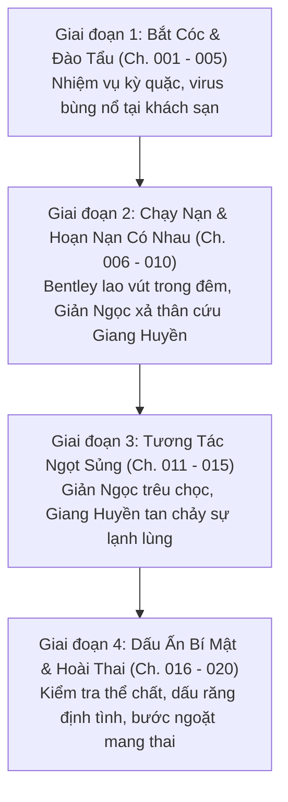
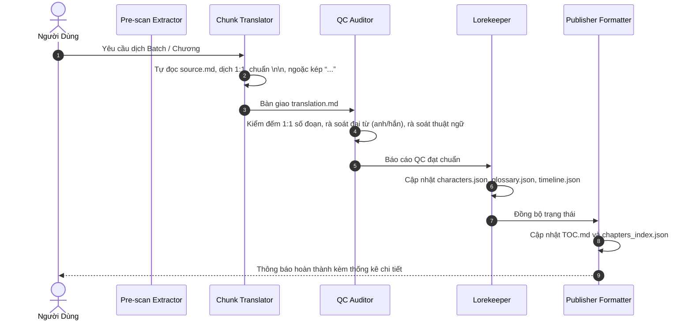

# KẾ HOẠCH TRIỂN KHAI DỊCH THUẬT (TRANSLATION MASTER PLAN)
## DỰ ÁN: THIÊN CHI KIÊU TỬ LẠI MANG THAI CON CỦA NPC RỒI (天之骄子又怀了NPC的崽[快穿])

> **Cập nhật ngày:** 02/11/2026  
> **Tác giả:** Thập Ma A Lộ (什么阿路)  
> **Thể loại:** Đam mỹ, khoái xuyên, hệ thống, sinh tử văn, phản sáo lộ, hài hước ngọt sủng, chủ công, mỹ công cường thụ, HE.  
> **Quy mô Thế giới 1 (Mạt thế):** 20 chương chính văn (100% Raw đã sẵn sàng tại `chapters/ch_001` đến `chapters/ch_020`).  
> **Mục tiêu:** Bản dịch tiếng Việt mượt mà, văn phong sắc bén, hóm hỉnh duyên dáng, bảo toàn tuyệt đối 1:1 đoạn văn, chuẩn định dạng khoảng cách `\n\n`, đúng ma trận xưng hô và 100% Zero Google API Key.

---

## 🎯 1. MỤC TIÊU & CHỈ SỐ ĐO LƯỜNG CHẤT LƯỢNG (KPIS)

| Chỉ số (Metric) | Tiêu chuẩn chất lượng (Target Standard) | Phương pháp kiểm soát |
| :--- | :--- | :--- |
| **Cấu trúc đoạn văn (1:1 Alignment)** | 100% chương dịch có số đoạn văn khớp chính xác 1:1 với `source.md`. | Script kiểm đếm số dòng tự động, cấm gộp/chẻ đoạn. |
| **Khoảng cách dòng (Typography)** | Bắt buộc đúng 1 dòng trống (`\n\n`) ngăn cách giữa mọi đoạn trần thuật và lời thoại. | Tuyệt đối cấm dính dòng (`\n`). |
| **Dấu ngoặc thoại** | 100% lời thoại dùng ngoặc kép cong tiếng Việt `“...”`. | Chuẩn hóa regex, không dùng gạch đầu dòng `-`. |
| **Độ nhất quán đại từ (Pronoun Fidelity)** | 0% lỗi lệch ngôi kể (Giản Ngọc: **anh**, Giang Huyền: **hắn**). | Ma trận đại từ nghiêm ngặt trong `AGENTS.md`. |
| **An toàn hệ thống (Zero API Key Mandate)** | Agent tự thân trực tiếp thực thi, không dùng external API key. | Bảo toàn 100% quota, triệt tiêu hoàn toàn rủi ro lỗi 429/503. |

---

## 🗺️ 2. PHÂN KỲ CỐT TRUYỆN THẾ GIỚI 1 (ARC 1 BREAKDOWN)

Thế giới 1 (Mạt thế tang thi bùng nổ) gồm 20 chương được chia làm 4 phân đoạn mạch lạc:

### Chi tiết các giai đoạn:
1. **Giai đoạn 1: Màn Bắt Cóc & Đại Náo Khách Sạn (Chương 001 – 005):**
   - Giản Ngọc xuyên thành phú nhị đại biến thái bắt cóc Giang Huyền trói trên giường, chuẩn bị chờ bị "thiêu chết" để hết vai.
   - Bất ngờ nhận nhiệm vụ mới từ Hệ thống Điệp Điệp: *Khiến thiên chi kiêu tử tự nguyện mang thai con của NPC*.
   - Virus tang thi số 1 bùng nổ, hai người cùng thoát khỏi khách sạn ngập tràn nguy hiểm.
2. **Giai đoạn 2: Chạy Nạn Bão Táp & Hoạn Nạn Sinh Chân Tình (Chương 006 – 010):**
   - Xe Bentley phóng trên cao tốc hướng về Khu tị nạn công nghiệp, đối mặt tang thi mai phục trong xe.
   - Giản Ngọc liều mình che chắn cho Giang Huyền, cả hai trải qua ranh giới sinh tử, tim đập rộn ràng.
3. **Giai đoạn 3: Khiêu Khích Đáng Yêu & Nhiệt Độ Tình Cảm Tăng Vọt (Chương 011 – 015):**
   - Giản Ngọc đóng vai thiếu gia yếu đuối nhưng ranh mãnh, liên tục trêu chọc khiến vị đội trưởng nghiêm cẩn đỏ bừng vành tai.
   - Giang Huyền từng bước tháo gỡ phòng bị, từ cảnh giác chuyển sang che chở, nuông chiều Giản Ngọc.
4. **Giai đoạn 4: Đột Phá Thể Chất & Bước Ngoặt Hoài Thai (Chương 016 – 020):**
   - Phát hiện dấu răng bí mật và dấu hiệu sinh học đặc thù, kiểm tra thể chất tại tiền tuyến.
   - Nhiệt kế tình cảm chạm ngưỡng thăng hoa, nhiệm vụ khiến thiên chi kiêu tử mang bầu chính thức thành công.

---

## ⚡ 3. LỘ TRÌNH THỰC HIỆN THEO BATCH (BATCH SPRINT PLAN)

Toàn bộ 20 chương được chia làm **2 Đợt (Batches)**, mỗi đợt 10 chương:

| Đợt (Batch) | Phạm vi chương | Nội dung trọng tâm | Trạng thái hiện tại |
| :---: | :---: | :--- | :---: |
| **Batch 1** | Chương 001 – 010 | Khởi đầu nhiệm vụ, trốn chạy khỏi khách sạn Z, xe Bentley vượt bão tuyết, sự cố tang thi trên xe | ⚪ Sẵn sàng chạy |
| **Batch 2** | Chương 011 – 020 | Tương tác ngọt sủng trên đường tị nạn, dấu răng thân mật, kiểm tra thể chất, kích hoạt hoài thai | ⚪ Chờ thực hiện |

---

## 🔄 4. PIPELINE QUY TRÌNH 5 BƯỚC KHÉP KÍN

Mỗi chương đều tuân thủ chu trình 5 bước nghiêm ngặt của Antigravity IDE:

---

## 📌 5. BƯỚC TIẾP THEO (NEXT STEPS)

- **Sẵn sàng thực thi:** Hạ tầng dữ liệu (`AGENTS.md`, `PLAN.md`, `memory/`, `TOC.md`) đã được thiết lập hoàn chỉnh.
- **Lệnh kích hoạt:** Người dùng có thể ra lệnh bất kỳ lúc nào để bắt đầu dịch:
  - Dịch từng chương: `Dịch chương 1`
  - Dịch trọn gói đợt: `Dịch Batch 1 (Chương 1 đến 10)`
