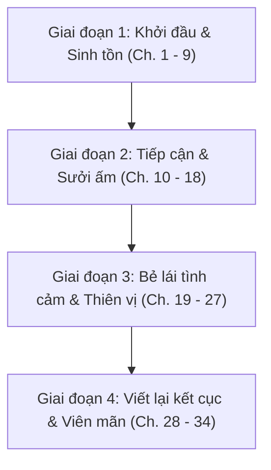

# 📋 KẾ HOẠCH DỊCH THUẬT & TRIỂN KHAI THẾ GIỚI 1 (PLAN ARC 1)
## TIẾN HÀNH CỨU RỖI PHẢN DIỆN BI TÌNH [KHOÁI XUYÊN]
> **Đơn nguyên 1:** Tác Giả Viết Truyện Cẩu Huyết × Đại Thiếu Gia Phản Diện Hào Môn Mỹ Cường Thảm  
> **Tổng số chương:** 34 chương (Chương 1 đến chương 33 chính văn + Chương 34 phiên ngoại)  
> **Tiến độ hiện tại:** ✅ Đã hoàn thành 10/34 chương (Chương 1 - 10: 100% 1:1 Alignment & QC Passed)  
> **Nhân vật trung tâm:** Thẩm Lương (Chủ công) × Thiệu Khâm Hàn (Thụ chính)  
> **Nguyên tắc cốt lõi:** Universal Zero Google API Key Mandate (Agent tự thân xử lý 100%, bảo toàn 1:1, chuẩn `\n\n`)  

---

## 🗺️ LỘ TRÌNH 4 GIAI ĐOẠN CHIẾN LƯỢC (ROADMAP)

---

## 🎯 DANH SÁCH CHI TIẾT 34 CHƯƠNG & MỐC NỘI DUNG (CHAPTER BREAKDOWN)

### 阶段一: GIAI ĐOẠN 1 – KHỞI ĐẦU & SINH TỒN TRONG BÃO CẨU HUYẾT (CHƯƠNG 1 – 9)
*Mục tiêu: Thiết lập bối cảnh xuyên thư, giữ vững tính mạng trước sự phẫn nộ của Thiệu Khâm Hàn, từng bước thể hiện sự vô hại và lòng chân thành.*

- **Chương 1:** 壮士请干了这碗狗血！ (Tráng sĩ, xin hãy cạn chén cẩu huyết này!)  
  *Nội dung:* Thẩm Lương vừa hoàn thành kết cục ngược tâm của 《Bạc Tình Thác Ái》 thì đột tử vì oán niệm độc giả. Tỉnh dậy phát hiện mình đã xuyên thành pháo hôi hạ thuốc Thiệu Khâm Hàn và vừa trải qua một đêm "tai nạn".
- **Chương 2:** 我爱狗血 (Tôi yêu cẩu huyết)  
  *Nội dung:* Thẩm Lương mặt dày ứng phó với cơn thịnh nộ của phản diện, phát huy bản lĩnh tác giả để né tránh lưỡi hái tử thần.
- **Chương 3:** 围观狗血现场 (Vây xem hiện trường cẩu huyết)  
  *Nội dung:* Đối mặt với các tình huống éo le và sự nghi ngờ gay gắt từ cấp dưới và gia đình họ Thiệu.
- **Chương 4:** 狗血噎死人了 (Cẩu huyết nghẹn chết người)  
  *Nội dung:* Thẩm Lương than thở với hệ thống, bắt đầu lập kế hoạch "gỡ mìn" kịch bản do chính tay mình tạo ra.
- **Chương 5:** 狗血洒多了是会遭报应 (Rắc cẩu huyết quá nhiều sẽ gặp báo ứng)  
  *Nội dung:* Bị người của Thiệu Khâm Hàn giám sát nghiêm ngặt, nhận ra tình trạng sức khỏe tồi tệ và căn bệnh dạ dày hành hạ phản diện.
- **Chương 6:** 狗血翻车预备备 (Chuẩn bị lật xe cẩu huyết)  
  *Nội dung:* Thẩm Lương tiếp cận Thiệu Khâm Hàn với đồ ăn ấm nóng, nhen nhóm cảm giác lạ lùng trong lòng phản diện.
- **Chương 7:** 大型狗血翻车现场 (Hiện trường lật xe cẩu huyết quy mô lớn)  
  *Nội dung:* Những va chạm dở khóc dở cười giữa một tác giả vô sỉ miệng lưỡi dẻo quẹo và một tổng tài tàn tật u ám.
- **Chương 8:** 洗一个狗血澡 (Tắm trong cẩu huyết)  
  *Nội dung:* Thẩm Lương giúp đỡ chăm sóc sinh hoạt của Thiệu Khâm Hàn, xoa dịu sự tự ti về đôi chân yếu ớt của hắn.
- **Chương 9:** 喝狗血养生 (Uống cẩu huyết dưỡng sinh)  
  *Nội dung:* Ép Thiệu tổng ăn uống đúng giờ, uống thuốc dưỡng thân, phản diện bắt đầu quen với sự hiện diện ồn ào nhưng ấm áp của cậu.

---

### 阶段二: GIAI ĐOẠN 2 – TIẾP CẬN & SƯỞI ẤM CON TIM BĂNG GIÁ (CHƯƠNG 10 – 18)
*Mục tiêu: Đập tan sự cố chấp với "bạch nguyệt quang" giả dối Thẩm Viên, phơi bày quá khứ đau thương của Thiệu Khâm Hàn, dạy hắn cách được yêu.*

- **Chương 10:** 第二波狗血即将泼来 (Làn sóng cẩu huyết thứ hai sắp hắt tới)  
  *Nội dung:* Tình tiết nguyên tác bắt đầu ập tới, thử thách lòng tin non nớt giữa hai người.
- **Chương 11:** 饭桌上的狗血 (Cẩu huyết trên bàn ăn)  
  *Nội dung:* Thẩm Lương kiên trì bầu bạn bên bàn ăn, tìm cách dò hỏi bóng ma tâm lý thời thơ ấu của Thiệu Khâm Hàn.
- **Chương 12:** 喝错了狗血 (Uống nhầm cẩu huyết)  
  *Nội dung:* Hiểu lầm hài hước nảy sinh, Thẩm Lương nhận ra phản diện bề ngoài hung dữ nhưng thực chất rất dễ dỗ.
- **Chương 13:** 狗血你要把持住 (Cẩu huyết, ngươi phải giữ mình đấy)  
  *Nội dung:* Ánh mắt Thiệu Khâm Hàn nhìn Thẩm Lương bắt đầu biến chuyển sâu sắc, nảy sinh mầm mống độc chiếm.
- **Chương 14:** 又一个狗血配角 (Lại thêm một vai phụ cẩu huyết)  
  *Nội dung:* Sự xuất hiện của Thẩm Viên và đám người nhà họ Thẩm; Thẩm Lương dứt khoát che chắn trước mặt Thiệu Khâm Hàn.
- **Chương 15:** 邵衾寒，我教你 (Thiệu Khâm Hàn, tôi dạy anh)  
  *Nội dung:* Mốc chuyển giao then chốt: Thẩm Lương nghiêm túc bảo Thiệu Khâm Hàn rằng hắn xứng đáng được yêu thương chân thật.
- **Chương 16:** 投我以小碗，报之以大 (Ném cho tôi bát nhỏ, đền lại bằng chén lớn)  
  *Nội dung:* Sự đáp lại vụng về nhưng xúc động từ Thiệu Khâm Hàn dành cho Thẩm Lương.
- **Chương 17:** 恋爱日程 (Lịch trình yêu đương)  
  *Nội dung:* Lên kế hoạch hẹn hò, kéo Thiệu Khâm Hàn rời khỏi căn phòng giam cầm u tối để bước ra thế giới rực rỡ.
- **Chương 18:** 旧年往事 (Chuyện cũ năm xưa)  
  *Nội dung:* Hé lộ góc khuất bi thảm về tai nạn giao thông tàn phế chân và cái chết của cha mẹ Thiệu Khâm Hàn; Thẩm Lương ôm hắn vào lòng xót xa.

---

### 阶段三: GIAI ĐOẠN 3 – BẺ LÁI TÌNH CẢM & SỰ THIÊN VỊ TUYỆT ĐỐI (CHƯƠNG 19 – 27)
*Mục tiêu: Xác nhận tình cảm, Thiệu Khâm Hàn hoàn toàn thoát khỏi chấp niệm cũ, biến Thẩm Lương thành ánh sáng và giải dược duy nhất đời mình.*

- **Chương 19:** 约会 (Hẹn hò)  
  *Nội dung:* Buổi hẹn hò đầu tiên ngọt ngào, xua tan mọi bóng ma ám ảnh trong lòng Thiệu tổng.
- **Chương 20:** 解药 (Thuốc giải)  
  *Nội dung:* Thiệu Khâm Hàn nhận ra sự cứu rỗi duy nhất cho linh hồn mình không phải bất kỳ ai khác, mà chính là Thẩm Lương.
- **Chương 21:** 救赎 (Cứu rỗi)  
  *Nội dung:* Phản diện bộc bạch nỗi sợ bị bỏ rơi, Thẩm Lương cam kết sẽ mãi ở bên che chở.
- **Chương 22:** 疼 (Đau)  
  *Nội dung:* Cơn đau bệnh tật tái phát; Thẩm Lương thức trắng đêm chăm sóc, làm tan chảy tầng băng cuối cùng.
- **Chương 23:** 区别对待 (Đối xử khác biệt)  
  *Nội dung:* Thiệu Khâm Hàn đối xử tàn nhẫn với kẻ thù nhưng ngoan ngoãn như chú cún nhỏ trước mặt Thẩm Lương.
- **Chương 24:** 换个人喜欢吧 (Đổi người mà thích đi)  
  *Nội dung:* Thẩm Lương khuyên Thiệu Khâm Hàn đừng cố chấp với Thẩm Viên nữa, phản diện thẳng thắn: "Tôi đã đổi rồi".
- **Chương 25:** 喜欢的是你，沈凉 (Người tôi thích là cậu, Thẩm Lương)  
  *Nội dung:* Lời tỏ tình bùng nổ, xác lập mối quan hệ chính thức giữa hai người.
- **Chương 26:** 偏爱 (Thiên ái / Thiên vị)  
  *Nội dung:* Thẩm Lương công khai bảo vệ Thiệu Khâm Hàn trước mặt mọi người, vả mặt đám người họ Thẩm và họ Thiệu.
- **Chương 27:** 千万锁死 (Tuyệt đối khóa chặt)  
  *Nội dung:* Hai người quấn quýt ngọt ngào, hệ thống thông báo chỉ số hắc hóa của phản diện sụt giảm thần tốc.

---

### 阶段四: GIAI ĐOẠN 4 – VIẾT LẠI KẾT CỤC & HẠNH PHÚC VIÊN MÃN (CHƯƠNG 28 – 34)
*Mục tiêu: Đập tan âm mưu của phản phái phụ, chữa lành hoàn toàn tâm lý, hoàn thành nhiệm vụ cứu rỗi và tận hưởng phiên ngoại ngọt ngào.*

- **Chương 28:** 邵总每天都在告白 (Thiệu tổng mỗi ngày đều tỏ tình)  
  *Nội dung:* Tổng tài lạnh lùng hóa thành "kẻ nghiện người yêu", ngày nào cũng tìm cớ làm nũng với Thẩm Lương.
- **Chương 29:** 你当我的药 (Cậu làm thuốc của tôi)  
  *Nội dung:* Mối liên kết tâm linh sâu sắc; bệnh mất ngủ và ác mộng của Thiệu Khâm Hàn hoàn toàn biến mất khi có cậu.
- **Chương 30:** 我，对这个世界已经没有任何怨恨了 (Tôi đối với thế giới này không còn bất kỳ oán hận nào nữa)  
  *Nội dung:* Khoảnh khắc đắt giá nhất của Arc 1: Phản diện buông bỏ thù hận, mỉm cười đón nhận thế giới vì thế giới đã có Thẩm Lương.
- **Chương 31:** 改写结局 (Viết lại kết cục)  
  *Nội dung:* Kết cục bi thảm trong nguyên tác chính thức bị xóa sổ, vận mệnh mới tươi sáng mở ra.
- **Chương 32:** 想死你了 (Nhớ cậu muốn chết)  
  *Nội dung:* Những khoảnh khắc ngọt ngào đời thường, khẳng định tình yêu bền chặt bất chấp không gian.
- **Chương 33:** 回来了 (Trở về rồi)  
  *Nội dung:* Kết thúc trọn vẹn chính văn của Thế giới 1, nhiệm vụ giải cứu phản diện thành công xuất sắc.
- **Chương 34:** 邵衾寒番外 (Phiên ngoại Thiệu Khâm Hàn)  
  *Nội dung:* Góc nhìn nội tâm của Thiệu Khâm Hàn về cuộc đời từ tăm tối tuyệt vọng đến khi tìm thấy mặt trời nhỏ Thẩm Lương.

---

## 🛠️ QUY TRÌNH THỰC THI CHUẨN CHO TỪNG CHƯƠNG (ZERO GOOGLE API KEY)

Mỗi chương khi dịch sẽ tuân thủ tuyệt đối quy trình nội tại của AI Agent:

1. **Bước 1: Chuẩn bị Source:** Lưu văn bản gốc chữ Hán vào `chapters/c<STT>/source.md`.
2. **Bước 2: Phân tích & Pre-scan nội tại:**
   - Agent tự đọc `source.md` bằng `view_file`.
   - Đối chiếu nhân vật, đại từ xưng hô với `RULES_ARC_1.md` và `memory/characters.json`.
3. **Bước 3: Biên dịch trực tiếp 1:1:**
   - Dịch trôi chảy, giàu cảm xúc, chuẩn văn phong hài hước pha trộn cứu rỗi ngọt ngào.
   - Bảo đảm 100% tỷ lệ đoạn văn 1:1, khoảng cách `\n\n`, thoại đặt trong `“...”`.
   - Lưu vào `chapters/c<STT>/translation.md`.
4. **Bước 4: Tự kiểm toán QC:**
   - Rà soát lỗi đá ngôi (cậu vs hắn, thoại vs trần thuật), kiểm tra sót đoạn.
   - Xuất báo cáo `chapters/c<STT>/qc_report.md` (nếu cần).
5. **Bước 5: Cập nhật Lorekeeper & Đồng bộ Web:**
   - Cập nhật tiến độ vào `memory/timeline.json`.
   - Đồng bộ hiển thị lên giao diện đọc truyện.
