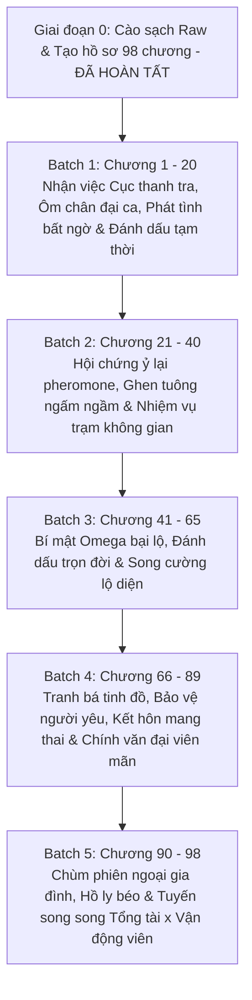

# 🗺️ KẾ HOẠCH TRIỂN KHAI DỊCH THUẬT (PLAN)
## LÀ TRAI THẲNG NHƯNG LẠI ĐÁNH DẤU ANH EM TỐT LONG NGẠO THIÊN (《直男，但标记龙傲天好兄弟》)

> **Tác giả:** Nãi Sa (奶鲨)  
> **Quy mô dự án:** 98 chương (Chương 1 - Chương 89 Chính văn + Chương 90 - 98 Chùm Phiên ngoại)  
> **Độ dài raw:** ~580.230 ký tự / 18.779 dòng  
> **Chủ đề chính:** Chủ công, Tinh tế ABO, ngụy Alpha x Alpha (Mỹ nhân công tóc dài hồ ly x Long Ngạo Thiên thụ giả Alpha thực chất là Omega hổ), hỗ sủng, hài hước sa điêu, sảng văn ngọt ngào, 1v1, HE.  

---

## 🎯 MỤC TIÊU CỐT LÕI

1. **Văn phong chuẩn xác, dí dỏm & Bùng nổ phản sai manh:**
   - Thể hiện sinh động tính cách của Bạch Phong Tinh: Một "kẻ thích xem trò vui", thông minh phúc hắc, sở hữu thực lực kinh người nhưng thích giả làm gà con yếu đuối ôm chân đại ca, mở miệng là tự nhận "trai thẳng bằng sắt" để trêu chọc đối phương.
   - Làm nổi bật tâm lý vừa ấm ức vừa lụy tình của Hoắc Dịch Xuyên: Một Long Ngạo Thiên cấp 3S bá đạo nghênh ngang trên chiến trường nhưng đứng trước người mình yêu lại cam tâm làm Omega, ghen tuông điên cuồng vì mấy câu "anh em tốt" của công, mở ra hiệp ước mập mờ *"xuống giường vẫn là anh em tốt"*.
2. **Quy chuẩn kỹ thuật nghiêm ngặt (Zero Compromise):**
   - **Zero Google API Key Mandate:** AI Code Agent tự thân đọc raw, phân tích ngữ cảnh và dịch trực tiếp. Tuyệt đối không dùng API ngoài để bảo toàn quota và giữ chất lượng ổn định.
   - **Khớp 1:1 Paragraph Alignment:** Đảm bảo chính xác từng đoạn văn tiếng Việt khớp 1:1 với nguyên tác trong `source.md`.
   - **Chuẩn định dạng:** Khoảng cách đoạn văn `\n\n`, ngoặc thoại tiếng Việt `“...”`.
   - **Đại từ ngôi 3:** Bạch Phong Tinh = **“anh”**, Hoắc Dịch Xuyên = **“hắn”** (hoặc **“y”**). Phân định rạch ròi, tuyệt đối không đá ngôi.
3. **Quản lý ký ức & Đồng bộ hệ thống:**
   - Cập nhật định kỳ các sự kiện tiến triển tình cảm và thuật ngữ vào `memory/`.
   - Đồng bộ trạng thái tiến độ chương tự động qua `scripts/sync_novel_toc.py`.

---

## 📦 PHÂN CHIA LỘ TRÌNH DỊCH THUẬT THEO BATCH

---

### 🔹 GIAI ĐOẠN 0: CHUẨN BỊ RAW & HỒ SƠ DỰ ÁN (ĐÃ HOÀN THÀNH 100%)
- [x] Đã cào sạch và phân tách toàn bộ 98 chương tại [`chapters/ch_001/`](file:///d:/Nhung/RIDI/trans-assistant/novel_projects/trai-thang-danh-dau-anh-em-tot-long-ngao-thien/chapters/ch_001) đến [`chapters/ch_098/`](file:///d:/Nhung/RIDI/trans-assistant/novel_projects/trai-thang-danh-dau-anh-em-tot-long-ngao-thien/chapters/ch_098).
- [x] Đã tạo file tổng hợp [`raw_full.md`](file:///d:/Nhung/RIDI/trans-assistant/novel_projects/trai-thang-danh-dau-anh-em-tot-long-ngao-thien/raw_full.md).
- [x] Đã thiết lập cấu hình [`config.json`](file:///d:/Nhung/RIDI/trans-assistant/novel_projects/trai-thang-danh-dau-anh-em-tot-long-ngao-thien/config.json), nguyên tắc [`AGENTS.md`](file:///d:/Nhung/RIDI/trans-assistant/novel_projects/trai-thang-danh-dau-anh-em-tot-long-ngao-thien/AGENTS.md), quy chuẩn [`RULES.md`](file:///d:/Nhung/RIDI/trans-assistant/novel_projects/trai-thang-danh-dau-anh-em-tot-long-ngao-thien/RULES.md) và bộ nhớ [`memory/`](file:///d:/Nhung/RIDI/trans-assistant/novel_projects/trai-thang-danh-dau-anh-em-tot-long-ngao-thien/memory).
- [x] Đã tạo và đồng bộ [`TOC.md`](file:///d:/Nhung/RIDI/trans-assistant/novel_projects/trai-thang-danh-dau-anh-em-tot-long-ngao-thien/TOC.md) và [`chapters_index.json`](file:///d:/Nhung/RIDI/trans-assistant/novel_projects/trai-thang-danh-dau-anh-em-tot-long-ngao-thien/chapters_index.json).

---

### 🔹 BATCH 1: NHẬN VIỆC CỤC THANH TRA & ĐÁNH DẤU TẠM THỜI (CHƯƠNG 1 - 20) - [x] HOÀN THÀNH 100%
- **Quy mô:** 20 chương (`ch_001` -> `ch_020`).
- **Nội dung cốt truyện:**
  - Bạch Phong Tinh xuyên thư, vào làm việc tại Cục Thanh tra dưới trướng nam chính Hoắc Dịch Xuyên.
  - Bạch Phong Tinh bắt đầu chiến lược "ôm đùi đại ca", miệng ngọt gọi "đại ca cứu em", khẳng định mình là trai thẳng 100%.
  - Hoắc Dịch Xuyên bất ngờ phát tình; Bạch Phong Tinh xông vào phòng và bị Hoắc Dịch Xuyên kéo lại ép đánh dấu tạm thời với lý do "giúp anh em một phen, xuống giường vẫn là huynh đệ".
  - Mối quan hệ "huynh đệ tốt" bắt đầu biến tướng: giả vờ làm tình nhân, da thịt kề sát, cùng tắm suối nước nóng và nụ hôn mập mờ đầu tiên.
- **Danh sách chương:**
  - [x] `ch_001`: 第1章 入职 (Chương 1: Nhận việc) - 108/108 đoạn (PASS 1:1)
  - [x] `ch_002`: 第2章 喜欢霍弈川？ (Chương 2: Thích Hoắc Dịch Xuyên?) - 183/183 đoạn (PASS 1:1)
  - [x] `ch_003`: 第3章 发热期 (Chương 3: Kỳ phát tình) - 132/132 đoạn (PASS 1:1)
  - [x] `ch_004`: 第4章 霍大哥 (Chương 4: Hoắc đại ca) - 156/156 đoạn (PASS 1:1)
  - [x] `ch_005`: 第5章 看了他身子 (Chương 5: Nhìn thấy thân thể hắn) - 125/125 đoạn (PASS 1:1)
  - [x] `ch_006`: 第6章 喜欢的东西 (Chương 6: Thứ yêu thích) - 168/168 đoạn (PASS 1:1)
  - [x] `ch_007`: 第7章 假扮情人 (Chương 7: Giả làm người tình) - 171/171 đoạn (PASS 1:1)
  - [x] `ch_008`: 第8章 肌肤相贴 (Chương 8: Da thịt kề sát) - 151/151 đoạn (PASS 1:1)
  - [x] `ch_009`: 第9章 伪装情侣不用什么都学吧！ (Chương 9: Giả vờ yêu nhau không cần học mọi thứ chứ!) - 111/111 đoạn (PASS 1:1)
  - [x] `ch_010`: 第10章 做好兄弟的必备技巧 (Chương 10: Kỹ năng tất yếu của anh em tốt) - 131/131 đoạn (PASS 1:1)
  - [x] `ch_011`: 第11章 同床共枕 (Chương 11: Chung giường chung gối) - 131/131 đoạn (PASS 1:1)
  - [x] `ch_012`: 第12章 你们是情侣吧？ (Chương 12: Hai người là người yêu hả?) - 146/146 đoạn (PASS 1:1)
  - [x] `ch_013`: 第13章 我的兄弟，我来照顾 (Chương 13: Anh em của tôi, để tôi chăm sóc) - 132/132 đoạn (PASS 1:1)
  - [x] `ch_014`: 第14章 突发易感期 (Chương 14: Đột phát kỳ mẫn cảm) - 99/99 đoạn (PASS 1:1)
  - [x] `ch_015`: 第15章 热吻 (Chương 15: Nụ hôn nóng bỏng) - 342/342 đoạn (PASS 1:1)
  - [x] `ch_016`: 第16章 兄弟的占有欲 (Chương 16: Chiếm hữu dục của anh em) - 217/217 đoạn (PASS 1:1)
  - [x] `ch_017`: 第17章 温泉坦诚相见 (Chương 17: Suối nước nóng thành thật với nhau) - 116/116 đoạn (PASS 1:1)
  - [x] `ch_018`: 第18章 兄弟的互帮互助 (Chương 18: Huynh đệ giúp đỡ lẫn nhau) - 199/199 đoạn (PASS 1:1)
  - [x] `ch_019`: 第19章 信息素依赖症 (Chương 19: Chứng ỷ lại pheromone) - 218/218 đoạn (PASS 1:1)
  - [x] `ch_020`: 第20章 亲近 (Chương 20: Thân cận) - 149/149 đoạn (PASS 1:1)

---

### 🔹 BATCH 2: HỘI CHỨNG Ỷ LẠI & GHEN TUÔNG NGẤM NGẦM (CHƯƠNG 21 - 40)
- **Quy mô:** 20 chương (`ch_021` -> `ch_040`).
- **Nội dung cốt truyện:**
  - Hoắc Dịch Xuyên nhận rõ tình cảm của mình: hắn thích Bạch Phong Tinh nhưng khổ nỗi đối phương cứ mở mồm ra là "huynh đệ".
  - Hoắc Dịch Xuyên rơi vào trạng thái nghiện pheromone của Bạch Phong Tinh, tính chiếm hữu bộc phát ngầm mỗi khi có người tiếp cận công.
  - Cả hai cùng thi hành nhiệm vụ ngoài không gian, phối hợp tác chiến diệt dị thú; Bạch Phong Tinh lén lút ra tay bảo vệ Hoắc Dịch Xuyên.

---

### 🔹 BATCH 3: BÍ MẬT BẠI LỘ & ĐÁNH DẤU TRỌN ĐỜI (CHƯƠNG 41 - 65)
- **Quy mô:** 25 chương (`ch_041` -> `ch_065`).
- **Nội dung cốt truyện:**
  - Bí mật Hoắc Dịch Xuyên là Omega bị đẩy lên cao trào; Bạch Phong Tinh phát hiện đối phương không hề thẳng như mình tưởng.
  - Đánh dấu hoàn toàn diễn ra; hai người chính thức xác định quan hệ từ "anh em tốt" sang người yêu.
  - Hoắc Dịch Xuyên lộ ra mặt yếu đuối và lụy tình, hoàn toàn quy phục trước Bạch Phong Tinh.

---

### 🔹 BATCH 4: TRANH BÁ TINH ĐỒ & CHÍNH VĂN ĐẠI VIÊN MÃN (CHƯƠNG 66 - 89)
- **Quy mô:** 24 chương (`ch_066` -> `ch_089`).
- **Nội dung cốt truyện:**
  - Chiến dịch lớn chống lại các thế lực phản động liên bang và dị thú vũ trụ.
  - Bạch Phong Tinh lộ hoàn toàn bản lĩnh thần cấp (Hồ ly tuyết), sát cánh cùng Hoắc Dịch Xuyên chém sạch đất trời.
  - Đám cưới tinh tế thế kỷ, kết hôn, Hoắc Dịch Xuyên mang thai bảo bảo, đại viên mãn chính văn.

---

### 🔹 BATCH 5: CHÙM PHIÊN NGOẠI & TUYẾN SONG SONG (CHƯƠNG 90 - 98)
- **Quy mô:** 9 chương (`ch_090` -> `ch_098`).
- **Nội dung cốt truyện:**
  - Cuộc sống gia đình nuôi dạy tiểu hồ ly Hoắc Quan Lan, các bản kiểm điểm hài hước của Hoắc Dịch Xuyên vì lén cho con ăn vặt.
  - Tuyến thế giới song song: Tổng tài mỹ nhân Bạch Phong Tinh x Vận động viên niên hạ Hoắc Dịch Xuyên.
  - Phúc lợi phiên ngoại trọn vẹn ngọt ngào.
