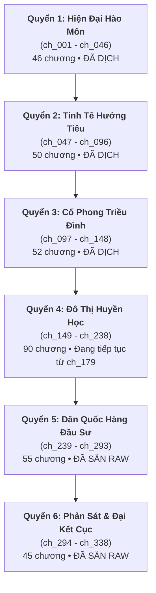

# 📖 DỰ ÁN DỊCH THUẬT: TRÒ CHƠI SĂN TIM [KHOÁI XUYÊN]

> **Tên gốc:** 《狩心游戏》 (Heart-Hunting Game)  
> **Tác giả:** 碉堡堡 (Điêu Bảo Bảo / Bunker)  
> **Thể loại:** Đam mỹ, Khoái xuyên, Hệ thống, Tương ái tương sát, Cứu rỗi, Sảng văn, Cường cường, Chủ công (主攻)  
> **Nguồn Raw chuẩn 100%:** [Trấn Hồn Tiểu Thuyết (Zhenhunxiaoshuo)](https://www.zhenhunxiaoshuo.com/shouxinyouxi/) • [JJWXC Tác Quyền](https://www.jjwxc.net/onebook.php?novelid=3672062)  
> **Quy mô dự án:** 338 chương chính thức (`ch_001` $\rightarrow$ `ch_338`) + các phiên ngoại phúc lợi  
> **Quy chuẩn dịch & QC:** [`AGENTS.md`](AGENTS.md) • [`config.json`](config.json)  
> **Kế hoạch & Quy chuẩn Quyển 6 (Đại Kết Cục):** [`rules_arc_6.md`](rules_arc_6.md) • [`plan_arc_6.md`](plan_arc_6.md)  

---

## 📊 1. BẢNG TỔNG QUAN TIẾN ĐỘ DỰ ÁN

| Hạng mục | Số lượng / Trạng thái | Tỷ lệ | Ghi chú |
| :--- | :---: | :---: | :--- |
| **Tổng số chương chuẩn bị** | **338 chapters** | 100% | Đầy đủ thư mục `ch_001` $\rightarrow$ `ch_338` |
| **Đã hoàn thành dịch (`translation.md`)** | **178 chapters** | **52.7%** | `ch_001` $\rightarrow$ `ch_178` (Nhập Noisy Team) |
| **Raw chuẩn đã tải sẵn (`source.md`)** | **160 chapters** | **47.3%** | `ch_179` $\rightarrow$ `ch_338` (Trấn Hồn TXT chuẩn) |
| **Tổng số Thế giới (Arc)** | **6 Quyển (Arc) + Hồi kết** | - | Hiện đại $\rightarrow$ Hướng Tiêu $\rightarrow$ Cổ phong $\rightarrow$ Đô thị huyền học $\rightarrow$ Dân quốc $\rightarrow$ Đại kết cục |

---

## 🗺️ 2. SƠ ĐỒ PHÂN CHIA CÁC ARC (THẾ GIỚI) THEO CHƯƠNG

---

## 📚 3. CHI TIẾT THIẾT LẬP TỪNG ARC (QUYỂN)

### 🏙️ QUYỂN 1: HIỆN ĐẠI CẨU HUYẾT (现代狗血)
* **Tên nguyên tác:** `重生阴郁攻x霸总金主受（现代狗血）`
* **Phạm vi chương:** [`ch_001`](chapters/ch_001/) $\rightarrow$ [`ch_046`](chapters/ch_046/) (46 chương: Chương 1 $\rightarrow$ Chương 46).
* **Trạng thái:** ✅ **Đã hoàn thành dịch (46/46 chapters)**.
* **Bối cảnh:** Đô thị hiện đại, hào môn thương trường, kim chủ và chim hoàng yến.
* **Cặp đôi chính:**
  - **Công:** **Tạ Phong Dương** (Tạ Chi / 谢风扬) — Ký chủ trọng sinh, chim hoàng yến bề ngoài yếu đuối dịu ngoan nhưng bên trong toan tính sâu xa.
  - **Thụ:** **Lâu Sơ Hàn** (楼疏寒) — Lâu tổng quyền thế ngút trời, thâm trầm, nhìn thấu tâm cơ của Tạ Phong Dương nhưng vẫn dung túng, che chở vô điều kiện.
* **Quy chuẩn xưng hô:**
  - **Trần thuật (Ngôi 3):** Công dùng **"anh / hắn"**; Thụ dùng **"y / hắn / Lâu tổng"**.
  - **Đối thoại:** Tôi — anh / cậu.

---

### 🚀 QUYỂN 2: TINH TẾ HƯỚNG TIÊU (向哨)
* **Tên nguyên tác:** `运筹帷幄野心攻x跌落神坛残疾受（向哨）`
* **Phạm vi chương:** [`ch_047`](chapters/ch_047/) $\rightarrow$ [`ch_096`](chapters/ch_096/) (50 chương: Chương 47 $\rightarrow$ Chương 96).
* **Trạng thái:** ✅ **Đã hoàn thành dịch (50/50 chapters)**.
* **Bối cảnh:** Đế quốc tinh tế, quân đoàn viễn chinh, hệ thống Sentinel & Guide (Lính gác và Dẫn đường).
* **Cặp đôi chính:**
  - **Công:** **Eritu** (Ách Lý Đồ / 厄里图) — Guide cấp SSS duy nhất của Đế quốc, cơ mưu thâm hiểm, tính cách thâm trầm khó dò.
  - **Thụ:** **Inlay** (Ưng Lôi / 因莱) — Đoàn trưởng Quân đoàn Hắc Ưng, Sentinel cấp SS từng là chiến thần nhưng bị tổn thương rơi xuống vực thẳm tàn phế.
* **Quy chuẩn xưng hô:**
  - **Trần thuật (Ngôi 3):** Công dùng **"hắn"**; Thụ dùng **"anh / y"**.
  - **Đối thoại:** Em / tôi — anh.

---

### 👑 QUYỂN 3: CỔ ĐẠI TRIỀU ĐÌNH (古代朝堂)
* **Tên nguyên tác:** `白切黑绿茶美人王爷攻x桀骜护短世子受（古代朝堂）`
* **Phạm vi chương:** [`ch_097`](chapters/ch_097/) $\rightarrow$ [`ch_148`](chapters/ch_148/) (52 chương: Chương 97 $\rightarrow$ Chương 148).
* **Trạng thái:** ✅ **Đã hoàn thành dịch (52/52 chapters)**.
* **Bối cảnh:** Cổ phong quyền mưu triều đình, hoàng tộc tranh vị, xung hỉ kết hôn.
* **Cặp đôi chính:**
  - **Công:** **Trần Thứ** (陈恕) — Thất Vương gia bệnh tật ốm yếu, hình tượng "bạch thiết hắc", trà xanh lương thiện nhưng mưu lược sát phạt vô song.
  - **Thụ:** **Trang Nhất Hàn** (庄一寒) — Thế tử Định Quốc Công phủ, tiểu tướng quân kiệt ngạo bất tuân, bộc trực, tính khí nóng nảy nhưng cực kỳ bênh vực Vương gia.
* **Quy chuẩn xưng hô:**
  - **Trần thuật (Ngôi 3):** Công dùng **"hắn"**; Thụ dùng **"y"**.
  - **Đối thoại:** Ta — ngươi / chàng.

---

### ☯️ QUYỂN 4: ĐÔ THỊ HUYỀN HỌC & YÊU QUA MẠNG (玄学 & 网恋 & IF线)
* **Tên nguyên tác:** `（网恋）超穷冷酷拽哥道士攻x阴郁聋哑富家少爷受`
* **Phạm vi chương:** [`ch_149`](chapters/ch_149/) $\rightarrow$ [`ch_238`](chapters/ch_238/) (90 chương: Chương 149 $\rightarrow$ Chương 238).
* **Trạng thái:** 🔄 **ĐANG TIẾN HÀNH DỊCH THUẬT:**
  - `ch_149` $\rightarrow$ `ch_178`: ✅ Đã dịch (Noisy Team).
  - `ch_179` $\rightarrow$ `ch_238`: ⏳ **Đã có sẵn raw sạch (`source.md`)** — *Đang tiến hành dịch từ Chương 179*.
* **Phân đoạn trong Arc:**
  - **Chương 149 — 234:** Chính văn Arc 4: Thế giới bắt ma, trừ tà diệt quỷ, phá giải nguyền rủa cho nhà họ Bạch.
  - **Chương 235 — 238:** Các phiên ngoại IF Tuyến (Trùng tộc/Tinh tế biến thể của Phong Lẫm x Bạch Mặc Niên).
* **Cặp đôi chính:**
  - **Công:** **Phong Lẫm** (封凛) — Đạo sĩ thiên tài nghèo khó, tính cách ngoài lạnh trong nóng, miệng mồm sắc bén nhưng đặc biệt bảo vệ và cưng chiều bạn đời.
  - **Thụ:** **Bạch Mặc Niên** (白默年) — Phú nhị đại hào môn mắc chứng câm điếc, tính tình u uất, cố chấp, toàn tâm toàn ý ỷ lại vào Phong Lẫm.
* **Quy chuẩn xưng hô:**
  - **Trần thuật (Ngôi 3):** Phong Lẫm dùng **"hắn / anh"**; Bạch Mặc Niên dùng **"y / cậu"**.
  - **Đối thoại:** Tôi / anh — cậu / em.

---

### 🪪 QUYỂN 5: DÂN QUỐC HÀNG ĐẦU SƯ & QUÂN PHIỆT (民国军阀 & 降头师)
* **Tên nguyên tác:** `斯文败类降头师攻x军阀少帅受`
* **Phạm vi chương:** [`ch_239`](chapters/ch_239/) $\rightarrow$ [`ch_293`](chapters/ch_293/) (55 chương: Chương 239 $\rightarrow$ Chương 293).
* **Trạng thái:** ⏳ **Đã tải đủ 100% raw sạch (`source.md` & `meta.json`)**, sẵn sàng dịch.
* **Bối cảnh:** Dân quốc thời loạn lạc, quân phiệt hỗn chiến, bùa chú hàng đầu thuật Nam Dương, gián điệp và âm mưu ám sát.
* **Cặp đôi chính:**
  - **Công:** **Trần Lạc Nhất** (Bác sĩ Trần / 陈落一) — Bác sĩ quân y đeo kính gọng vàng nho nhã, bề ngoài điềm đạm nhưng thân phận thực là Hàng Đầu Sư tà mị mưu mô.
  - **Thụ:** **Lệ Liệt** (Lệ thiếu soái / 厉少帅 / 厉烈) — Thiếu soái quân đội kiêu dũng thiện chiến, tính cách cương liệt, bá đạo, luôn tìm cách kiềm chế bác sĩ Trần nhưng liên tục bị "bắt bài".
* **Quy chuẩn xưng hô:**
  - **Trần thuật (Ngôi 3):** Công dùng **"hắn"**; Thụ dùng **"y / thiếu soái"**.
  - **Đối thoại:** Tôi — ngài / thiếu soái.

---

### ⚔️ QUYỂN 6: KHI BẠN XUYÊN VÀO TRÒ CHƠI CÔNG LƯỢC & HỒI KẾT (当你穿进攻略游戏 & 终卷)
* **Tên nguyên tác:** `当你穿进攻略游戏`
* **Phạm vi chương:** [`ch_294`](chapters/ch_294/) $\rightarrow$ [`ch_338`](chapters/ch_338/) (45 chương: Chương 294 $\rightarrow$ Chương 338).
* **Trạng thái:** ⏳ **Đã tải đủ 100% raw sạch (`source.md` & `meta.json`)**, sẵn sàng dịch.
* **Phân đoạn trong Arc:**
  - **Chương 294 — 335:** **Đại kết cục Chính văn:** Toàn bộ các Ký chủ (Tạ Phong Dương, Phong Lẫm, Eritu, Trần Thứ, Bác sĩ Trần...) liên kết, hợp lực lật đổ trò chơi, đánh bại Ác Quỷ Vĩnh Sinh (永生的魔鬼) và Hệ Thống Săn Tim tà ác.
  - **Chương 336 — 338:** **Phiên ngoại Hậu ký (一 / 二 / 三):** Hậu truyện hạnh phúc của các cặp đôi sau khi trò chơi kết thúc.
* **Cốt lõi:** Tình yêu chân thành vượt qua sự thao túng và bẫy rập của hệ thống; sảng văn cứu rỗi trọn vẹn (HE).

---

## 🛠️ 4. WORKFLOW DỊCH THUẬT & QUẢN TRỊ DỰ ÁN

Mọi hoạt động dịch thuật trong dự án đều do **AI Code Agent (Antigravity IDE)** tự thân thực hiện trực tiếp theo quy định tại [`AGENTS.md`](AGENTS.md):
1. **Pre-scan (`novel-prescan-extractor`):** Rà soát nhân vật mới, danh từ riêng, thuật ngữ bùa chú/tinh tế/quân đội trước khi dịch từng chương.
2. **Biên dịch (`novel-chunk-translator`):** 
   - Đảm bảo **bảo toàn 1:1 số đoạn văn** giữa `source.md` và `translation.md`.
   - Giữ khoảng cách dòng chuẩn `\n\n`.
   - Lời thoại sử dụng ngoặc kép cong `“...”`.
   - Tuân thủ ma trận đại từ chuẩn xác của từng Arc.
3. **Kiểm toán QC (`novel-qc-auditor`):** Rà soát độ mượt, kiểm tra trôi đại từ, speaker attribution và lỗi nhảy dòng trước khi xuất bản.
4. **Cập nhật tri thức (`novel-lorekeeper`):** Đồng bộ các nhân vật mới vào [`memory/characters.json`](memory/characters.json) và [`memory/glossary.json`](memory/glossary.json).
