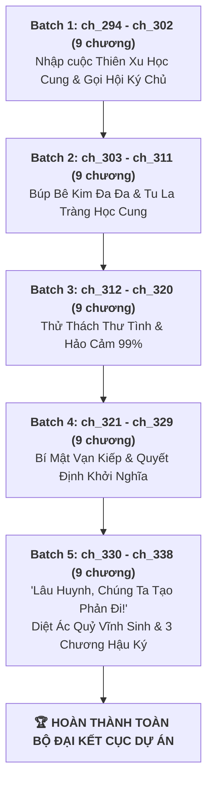
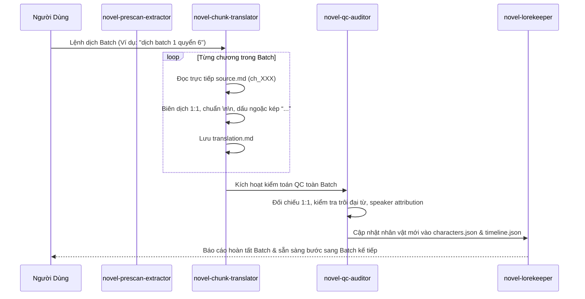

# 📋 KẾ HOẠCH & TIẾN ĐỘ DỊCH THUẬT QUYỂN 6: KHI BẠN XUYÊN VÀO TRÒ CHƠI CÔNG LƯỢC & ĐẠI KẾT CỤC

> **Bộ truyện:** Trò Chơi Săn Tim [Khoái Xuyên] (《狩心游戏》)  
> **Quyển 6:** Khi Bạn Xuyên Vào Trò Chơi Công Lược (《当你穿进攻略游戏》)  
> **Phạm vi chương:** 45 chương — Từ Chương 294 đến Chương 338 ([`ch_294`](chapters/ch_294/) $\rightarrow$ [`ch_338`](chapters/ch_338/))  
> **Quy chuẩn áp dụng:** [`rules_arc_6.md`](rules_arc_6.md) & [`AGENTS.md`](AGENTS.md)  
> **Phương thức thực thi:** Code Agent tự thân biên dịch trực tiếp (Zero Google API Key Mandate), phân theo 5 Batch linh hoạt.  
> **Mục tiêu:** Hoàn thành dịch thuật chuẩn 1:1, kiểm toán QC Pass 100%, bảo toàn trọn vẹn phong vị hào sảng, hài hước và kịch tính của màn phản sát đại kết cục.  

---

## 📊 1. BẢNG TỔNG QUAN TIẾN ĐỘ QUYỂN 6

| Hạng mục | Chỉ số | Tỷ lệ | Ghi chú |
| :--- | :---: | :---: | :--- |
| **Tổng số chương Quyển 6** | **45 chapters** | 100% | `ch_294` $\rightarrow$ `ch_338` |
| **Raw chuẩn bị sẵn (`source.md`)** | **45 / 45 chapters** | **100%** | Đã sẵn sàng toàn bộ bản raw chuẩn Trấn Hồn |
| **Đã dịch (`translation.md`)** | **0 / 45 chapters** | **0%** | Sẵn sàng khởi động Batch 1 |
| **Đã kiểm toán QC (`qc_report.md`)** | **0 / 45 chapters** | **0%** | Kiểm toán tự động sau mỗi Batch |
| **Phân chia Batch thực thi** | **5 Batches** | - | 9 chương / Batch |

---

## 📦 2. SƠ ĐỒ PHÂN CHIA 5 BATCH THỰC THI

---

## 📑 3. CHI TIẾT TỪNG BATCH DỊCH THUẬT

### 🔹 BATCH 1: Nhập Cuộc Thiên Xu Học Cung & Hội Ký Chủ Kéo Bè Cứu Nguy (9 chương: `ch_294` $\rightarrow$ `ch_302`)
* **Trọng tâm cốt truyện:** Tạ Phong Dương bước vào thế giới nhiệm vụ cuối cùng 《Một Ngàn Lẻ Một Đêm: Thiên Xu Học Cung》, kết giao bạn cùng phòng Kim Ngọc Đường; dùng thao tác thần sầu tẩn học tử quý tộc; khi bị hệ thống xử ép thì triệu hồi (摇人) Phong Lẫm, Eritu, Trần Thứ vào màn hình chat quậy tung học cung.
* **Quy chuẩn then chốt:** Tạ Phong Dương = "anh/hắn"; Tiểu Hắc Xà = "chú rắn nhỏ/nó"; thoại chat hội ký chủ chuẩn văn phong hài hước, sắc lẹm.

| Chapter ID | Tên chương | Số đoạn raw | Trạng thái | Tóm tắt sự kiện chính |
| :---: | :--- | :---: | :---: | :--- |
| [`ch_294`](chapters/ch_294/) | Chương 294: Đơn hàng cấp sử thi!! | 108 | ⏳ Sẵn Raw | Tạ Phong Dương nhận đơn hàng tối hậu bước vào Thiên Xu Học Cung; làm quen chú rắn đen trợ thủ. |
| [`ch_295`](chapters/ch_295/) | Chương 295: Thao tác thần sầu | 114 | ⏳ Sẵn Raw | Tạ Phong Dương vừa bước vào cổng đã cho học tử quý tộc ăn bạt tai khiến Tiểu Hắc Xà kinh ngạc. |
| [`ch_296`](chapters/ch_296/) | Chương 296: Gọi người trợ giúp | 105 | ⏳ Sẵn Raw | Chưa hoàn thành mục tiêu công lược đã thu phục 4 đàn em; đối mặt lớp học Vạn Tượng Trai vắng bóng người. |
| [`ch_297`](chapters/ch_297/) | Chương 297: Hố cha | 118 | ⏳ Sẵn Raw | Bắt viết thư tình cho đối tượng công lược; Sở Lăng và các ký chủ bàn bạc cách viết văn hàm súc. |
| [`ch_298`](chapters/ch_298/) | Chương 298: Lại gọi người | 111 | ⏳ Sẵn Raw | Mang 10 bản chép phạt tới Giáp trai nộp bài; chạm mặt kiếm khách Cô Kiếm Lăng. |
| [`ch_299`](chapters/ch_299/) | Chương 299: Dọn nhà | 119 | ⏳ Sẵn Raw | Liễu phu tử cảnh báo Giáp trai là vùng nước xoáy ăn thịt người; Tạ Phong Dương quyết tâm chuyển phòng. |
| [`ch_300`](chapters/ch_300/) | Chương 300: Tôi chết thế này sao? | 118 | ⏳ Sẵn Raw | Tạ Phong Dương ép Kim Ngọc Đường nhường nửa giường; đêm đầu tiên tại Giáp trai đầy sát khí. |
| [`ch_301`](chapters/ch_301/) | Chương 301: Hồi sinh | 120 | ⏳ Sẵn Raw | Bị phán chết đột ngột, Tạ Phong Dương dùng quyền hồi sinh quay vòng quay số phận; thế giới ngưng đọng. |
| [`ch_302`](chapters/ch_302/) | Chương 302: Hai kẻ hố cha | 118 | ⏳ Sẵn Raw | Phong Lẫm vác kiếm đào mộc mở đàn lập pháp; Tạ Phong Dương ngỡ ngàng trước dàn cứu viện của Tiểu Hắc Xà. |

---

### 🔹 BATCH 2: Búp Bê Kim Đa Đa & Vòng Xoáy Tu La Tràng (9 chương: `ch_303` $\rightarrow$ `ch_311`)
* **Trọng tâm cốt truyện:** Trêu chọc thiếu gia nhát gan Kim Ngọc Đường cùng con búp bê vải Kim Đa Đa; đối đầu nhóm Thôi Mông; Tạ Phong Dương dùng bùa chú của Phong Lẫm và độc thuật của Bác sĩ Trần dọa sợ cả học cung; cục diện Tu La tràng dần mở ra.

| Chapter ID | Tên chương | Số đoạn raw | Trạng thái | Tóm tắt sự kiện chính |
| :---: | :--- | :---: | :---: | :--- |
| [`ch_303`](chapters/ch_303/) | Chương 303: Cùng xông lên đi! | 128 | ⏳ Sẵn Raw | Nhóm Thôi Mông định bắt nạt Kim Ngọc Đường giật búp bê vải; Tạ Phong Dương ra mặt bảo bọc. |
| [`ch_304`](chapters/ch_304/) | Chương 304: Siêu cấp hung dữ | 122 | ⏳ Sẵn Raw | Tiểu Hắc Xà xù vảy chửi bới hệ thống; lôi kéo Trần Thứ tham chiến đòi phá nát mã nguồn. |
| [`ch_305`](chapters/ch_305/) | Chương 305: Ta đối tốt với ngươi chứ | 120 | ⏳ Sẵn Raw | Tạ Phong Dương giở trò bắt chẹt Kim Ngọc Đường; màn đối thoại dở khóc dở cười giữa hai người. |
| [`ch_306`](chapters/ch_306/) | Chương 306: Tặng rắn | 116 | ⏳ Sẵn Raw | Tạ Phong Dương dọa nhét rắn vào người kẻ xấu; thiết lập tình cảm ngầm bảo bọc Kim Ngọc Đường. |
| [`ch_307`](chapters/ch_307/) | Chương 307: Tin đồn sinh ra thế nào | 109 | ⏳ Sẵn Raw | Tin đồn phong tình quái dị lan truyền khắp học viện khiến các phu tử đau đầu. |
| [`ch_308`](chapters/ch_308/) | Chương 308: Tấn công ngực | 105 | ⏳ Sẵn Raw | Màn va chạm bất đắc dĩ giữa Tạ Phong Dương và nhân vật trọng yếu tại hành lang học cung. |
| [`ch_309`](chapters/ch_309/) | Chương 309: Cừu nhỏ dũng cảm | 100 | ⏳ Sẵn Raw | Tạ Phong Dương đối đầu áp lực từ các thế gia; khí thế không hề lùi bước. |
| [`ch_310`](chapters/ch_310/) | Chương 310: Tu La tràng | 99 | ⏳ Sẵn Raw | Lâu Sơ Hàn xuất hiện; ánh mắt dò xét thâm trầm; cuộc đụng độ căng thẳng giữa các mục tiêu. |
| [`ch_311`](chapters/ch_311/) | Chương 311: Chết không nhắm mắt | 104 | ⏳ Sẵn Raw | Một vụ án ám sát bí ẩn phát sinh tại học cung; Tạ Phong Dương lần theo dấu vết bẫy rập. |

---

### 🔹 BATCH 3: Thử Thách Thư Tình, Kế Hoạch Đổi Búp Bê & Hảo Cảm 99% (9 chương: `ch_312` $\rightarrow$ `ch_320`)
* **Trọng tâm cốt truyện:** Tạ Phong Dương tráo búp bê giấu bản đồ giả; viết thư tình theo phong cách có 1-0-2 khiến thanh hảo cảm của Lâu Sơ Hàn nhảy vọt lên 99% bất thường.

| Chapter ID | Tên chương | Số đoạn raw | Trạng thái | Tóm tắt sự kiện chính |
| :---: | :--- | :---: | :---: | :--- |
| [`ch_312`](chapters/ch_312/) | Chương 312: Lâu huynh, ta có lỗi với huynh | 107 | ⏳ Sẵn Raw | Tạ Phong Dương tạ lỗi Lâu Sơ Hàn nhưng trong lòng toàn mưu toan tính toán. |
| [`ch_313`](chapters/ch_313/) | Chương 313: Ta không phải kẻ chê nghèo yêu giàu | 112 | ⏳ Sẵn Raw | Những lời giải thích đầy thâm ý làm chao đảo cảm xúc của đối phương. |
| [`ch_314`](chapters/ch_314/) | Chương 314: Nghiệm minh chính thân | 169 | ⏳ Sẵn Raw | Màn kiểm tra thân phận căng thẳng dưới sự chứng kiến của giám sát học cung. |
| [`ch_315`](chapters/ch_315/) | Chương 315: Chung giường chung gối | 123 | ⏳ Sẵn Raw | Tạ Phong Dương và Lâu Sơ Hàn lần đầu nằm chung một sập; thăm dò lẫn nhau trong đêm tối. |
| [`ch_316`](chapters/ch_316/) | Chương 316: Sát cơ | 89 | ⏳ Sẵn Raw | Tạ Phong Dương giấu búp bê sau lưng, thân thủ nhanh nhẹn tránh né đòn ám toán. |
| [`ch_317`](chapters/ch_317/) | Chương 317: Kế liên hoàn | 182 | ⏳ Sẵn Raw | Hai chiếc phi tiêu dưới gốc cổ thụ; Tạ Phong Dương sắp đặt thế trận lừa toàn bộ sát thủ vào tròng. |
| [`ch_318`](chapters/ch_318/) | Chương 318: Bốc trúng hắn rồi?! | 135 | ⏳ Sẵn Raw | Bản đồ trong búp bê đã bị tráo thành bản vẽ nhảm; Tạ Phong Dương đắc thắng giải thích mưu mẹo. |
| [`ch_319`](chapters/ch_319/) | Chương 319: Bức thư tình | 110 | ⏳ Sẵn Raw | Thử thách công lược Lâu Sơ Hàn; bức thư tình kỳ quặc làm tụt rồi tăng vọt điểm số. |
| [`ch_320`](chapters/ch_320/) | Chương 320: Kéo người tiếp | 105 | ⏳ Sẵn Raw | Hảo cảm của Lâu Sơ Hàn chạm mốc 99%; Tạ Phong Dương ngơ ngác không tin vào mắt mình. |

---

### 🔹 BATCH 4: Bí Mật Luân Hồi Ngàn Kiếp & Quyết Định Vấn Thiên (9 chương: `ch_321` $\rightarrow$ `ch_329`)
* **Trọng tâm cốt truyện:** Tiểu Hắc Xà mất tích rồi trở lại; Eritu và các ký chủ suy đoán ra bản chất tàn độc của thế giới trò chơi; Lâu Sơ Hàn không hề là NPC thông thường mà là tri kỷ vạn kiếp; quyết định đập vỡ thiên mệnh.

| Chapter ID | Tên chương | Số đoạn raw | Trạng thái | Tóm tắt sự kiện chính |
| :---: | :--- | :---: | :---: | :--- |
| [`ch_321`](chapters/ch_321/) | Chương 321: Mỗi người ôm một bụng dạ | 117 | ⏳ Sẵn Raw | Tiểu Hắc Xà bất ngờ trở lại sau chuỗi ngày vắng bóng; mang theo tin tức chấn động. |
| [`ch_322`](chapters/ch_322/) | Chương 322: Thế này khác gì giở trò lưu manh | 134 | ⏳ Sẵn Raw | Ý tưởng táo bạo của Eritu khiến Tạ Phong Dương giãy nảy cự tuyệt. |
| [`ch_323`](chapters/ch_323/) | Chương 323: Chết đi cho rồi | 111 | ⏳ Sẵn Raw | Thông báo hảo cảm lại vang lên rền vang; những màn đấu khẩu hài hước giữa các ký chủ. |
| [`ch_324`](chapters/ch_324/) | Chương 324: Vận mệnh chúng sinh | 107 | ⏳ Sẵn Raw | Tạ Phong Dương chất vấn sự phi lý của cái chết và định mệnh bị hệ thống sắp đặt. |
| [`ch_325`](chapters/ch_325/) | Chương 325: Huynh hối hận rồi đúng không? | 155 | ⏳ Sẵn Raw | Cái chết của Thôi Mông làm kinh động cả triều đình; các đại thế gia gây sức ép. |
| [`ch_326`](chapters/ch_326/) | Chương 326: Không hối hận | 151 | ⏳ Sẵn Raw | Lời bộc bạch sâu lắng trong đêm: "Không ai sinh ra là đáng phải chết cả, huynh không đáng, Kim Ngọc Đường không đáng..." |
| [`ch_327`](chapters/ch_327/) | Chương 327: Ý của ngươi là gì? | 124 | ⏳ Sẵn Raw | Eritu tung ra suy luận mang tính cốt lõi về nguồn năng lượng và bản chất của trò chơi. |
| [`ch_328`](chapters/ch_328/) | Chương 328: Tranh bát cơm ăn | 216 | ⏳ Sẵn Raw | Chạm trán Cô Kiếm Lăng bên đường cổ hoang vu; những bước chuẩn bị đầu tiên cho cuộc chiến. |
| [`ch_329`](chapters/ch_329/) | Chương 329: Gõ cửa vấn Thiên Xu | 88 | ⏳ Sẵn Raw | Trò chơi tái khởi động, Tạ Phong Dương mài sắc đoản đao, quyết định không tuân theo kịch bản cũ nữa. |

---

### 🔹 BATCH 5: "Lâu Huynh, Tạo Phản Đi!", Tiêu Diệt Ác Quỷ & 3 Chương Hậu Ký (9 chương: `ch_330` $\rightarrow$ `ch_338`)
* **Trọng tâm cốt truyện:** Khởi binh tại Liêu Đông, đánh sập triều đình phong kiến mục nát; đánh bại Ác Quỷ Vĩnh Sinh tiêu diệt trò chơi săn tim; 3 chương Phiên ngoại Hậu ký về cuộc sống hạnh phúc của tân đế Lâu Sơ Hàn và Tạ Phong Dương cùng các cặp đôi.

| Chapter ID | Tên chương | Số đoạn raw | Trạng thái | Tóm tắt sự kiện chính |
| :---: | :--- | :---: | :---: | :--- |
| [`ch_330`](chapters/ch_330/) | Chương 330: Lâu huynh, chúng ta tạo phản đi! | 120 | ⏳ Sẵn Raw | Tạ Phong Dương chính thức rủ rê Lâu Sơ Hàn dấy binh khởi nghĩa lật đổ vương triều thối nát. |
| [`ch_331`](chapters/ch_331/) | Chương 331: Mấy người phát điên hết rồi sao | 95 | ⏳ Sẵn Raw | Tin tức khởi binh Liêu Đông lan truyền; bước đi điên cuồng phá vỡ mọi toan tính của trò chơi. |
| [`ch_332`](chapters/ch_332/) | Chương 332: Tương phùng | 95 | ⏳ Sẵn Raw | Mùa thu năm Cảnh Long thứ 27, thiết kỵ Liêu Đông khởi binh, quân báo khẩn cấp 800 dặm truyền về kinh. |
| [`ch_333`](chapters/ch_333/) | Chương 333: Mấy người đúng là khóa mạnh nhất ta từng dẫn dắt | 104 | ⏳ Sẵn Raw | Lâu Sơ Hàn chạm vào gò má Tạ Phong Dương; lời khen ngợi dành cho sự đoàn kết của các ký chủ. |
| [`ch_334`](chapters/ch_334/) | Chương 334: Trò chơi kết thúc | 317 | ⏳ Sẵn Raw | Trường đoạn hào sảng: Hoàng thành sụp đổ, phá tan lồng giam ảo ảnh của trò chơi săn tim. |
| [`ch_335`](chapters/ch_335/) | Chương 335: Ác quỷ vĩnh sinh | 72 | ⏳ Sẵn Raw | Đòn kết liễu Ác Quỷ Vĩnh Sinh; giải phóng vĩnh viễn linh hồn của tất cả các ký chủ và mục tiêu. |
| [`ch_336`](chapters/ch_336/) | Chương 336: Phiên ngoại Hậu ký (Một) | 128 | ⏳ Sẵn Raw | Năm Cảnh Long thứ 28, định quốc hiệu "Lam", niên hiệu "Vĩnh Hoài"; mở ra trang sử mới thái bình. |
| [`ch_337`](chapters/ch_337/) | Chương 337: Phiên ngoại Hậu ký (Hai) | 214 | ⏳ Sẵn Raw | Tâm tư giằng xé và sự cứu rỗi của Lâu Sơ Hàn khi được Tạ Phong Dương chân thành bao dung. |
| [`ch_338`](chapters/ch_338/) | Chương 338: Phiên ngoại Hậu ký (Ba) | 121 | ⏳ Sẵn Raw | Lời tác giả kết thúc toàn bộ thiên truyện; cuộc sống ngọt ngào, viên mãn trọn đời trọn kiếp. |

---

## 🚀 4. QUY TRÌNH THỰC THI CHUẨN HOÁ (AGENT SKILLS WORKFLOW)

