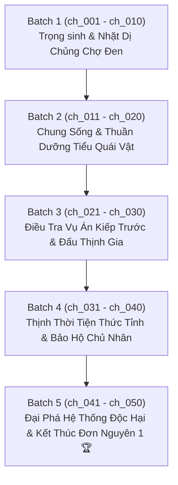

# 📋 KẾ HOẠCH & TIẾN ĐỘ DỊCH THUẬT & QC ARC 1: CHẾT ĐUỐI (PUA) & DỊ CHỦNG CHỢ ĐEN

> **Bộ truyện:** Trọng Sinh! Phối Giác Tự Cứu Chỉ Nam (《重生！配角自救指南》)  
> **Tên phụ / Raw:** 《打倒系统！亲吻我的小怪物》 *(Đánh Bại Hệ Thống! Hôn Lấy Tiểu Quái Vật Của Ta)*  
> **Đơn nguyên 1 (Quyển 1):** 溺亡 / PUA (Nam phụ cây ATM Bùi Độ $\times$ Nam chính dị chủng Thịnh Thời Tiện)  
> **Phạm vi chương:** Chương 1 đến Chương 50 (`ch_001` $\rightarrow$ `ch_050`)  
> **Quy chuẩn áp dụng:** [`rules_arc_1.md`](rules_arc_1.md) & [`AGENTS.md`](AGENTS.md)  
> **Chế độ thực thi:** **Fast Batch Mode** (Dịch 1:1, Auto QC Audit, Auto Lorekeeper theo từng đợt)  
> **Mục tiêu cốt lõi:** Dịch chuẩn xác 1:1, khóa chặt đại từ Công = "cậu", Thụ = "y/hắn", giữ đúng độ hài hước, phản sáo lộ và ngọt sủng của truyện.

---

## 📊 1. BẢNG TỔNG QUAN TIẾN ĐỘ ARC 1

| Chỉ số | Giá trị | Ghi chú |
| :--- | :---: | :--- |
| **Tổng số chương Arc 1** | **50 chapters** | `ch_001` $\rightarrow$ `ch_050` |
| **Đã hoàn thành (QC_PASSED)** | **0 / 50** | Sẵn sàng triển khai dịch |
| **Đang chờ xử lý** | **50 chapters** | 5 Batch (mỗi Batch 10 chương) |
| **Tiến độ tổng thể** | **0%** | Bắt đầu khởi động Batch 1 |
| **Quy chuẩn đại từ bắt buộc** | **100% Locked** | **Công (Bùi Độ) = "cậu / hắn"** **Thụ (Thịnh Thời Tiện) = "y / hắn / tiểu quái vật"** **Đối thoại: Công xưng "tôi" - gọi "cậu/Thịnh Thời Tiện"; Thụ xưng "tôi/em" - gọi "anh"** |

---

## 📦 2. PHÂN CHIA CÁC BATCH CHI TIẾT

---

### 🔹 BATCH 1: Trọng Sinh & Nhặt Dị Chủng Chợ Đen (`ch_001` $\rightarrow$ `ch_010`)
* **Mục tiêu:**
  - Bùi Độ trọng sinh sau cái chết đuối oan ức kiếp trước, gặp Hệ Thống Cẩu Thả Cầu Sinh và nhận cuốn "Cẩm nang tự cứu" dày cộp.
  - Theo chỉ dẫn kỳ quặc đến chợ đen, phát hiện nam chính nguyên tác Thịnh Thời Tiện bị nhiễm virus biến dị thành dị chủng, bị giam trong lồng sắt.
  - Bùi Độ thuần phục dị chủng hung dữ, trói miệng bằng cà vạt và cõng về nhà chăm sóc.

| Chapter ID | Tên chương (Hán Việt / Dịch nghĩa) | Trạng thái QC | Tiến độ | Tóm tắt sự kiện chính |
| :---: | :--- | :---: | :---: | :--- |
| `ch_001` | Chương 1: Cẩu Thả Cầu Sinh (苟且偷生) | ⏳ Chờ xử lý | 0% | Bùi Độ tỉnh lại sau cái chết đuối kiếp trước; Hệ thống Cẩu Thả Cầu Sinh xuất hiện trao cuốn tự truyện kỳ quặc |
| `ch_002` | Chương 2: Cuốn Tự Truyện Điên Rồ (自传体书) | ⏳ Chờ xử lý | 0% | Đọc những dòng chỉ nam trớ trêu; Bùi Độ quyết định tìm kiếm manh mối để tránh lặp lại bi kịch |
| `ch_003` | Chương 3: Tung Tích Chợ Đen (黑市踪迹) | ⏳ Chờ xử lý | 0% | Lần theo dấu vết miếng ngọc bội và chỉ dẫn của hệ thống tìm đến khu chợ đen ngầm |
| `ch_004` | Chương 4: Nam Chủ Gặp Nạn (落难男主) | ⏳ Chờ xử lý | 0% | Phát hiện Thịnh Thời Tiện bị biến dị thành dị chủng trong lồng sắt, khắp người đầy vết bầm tím và gân đỏ |
| `ch_005` | Chương 5: Biến Cố Bất Thường (起伏无常) | ⏳ Chờ xử lý | 0% | Dị chủng phát cuồng cắn người; Bùi Độ áp sát chế ngự, lấy cà vạt buộc miệng dị chủng rồi cõng đi |
| `ch_006` | Chương 6: Không Hiểu Ra Sao (不明所以) | ⏳ Chờ xử lý | 0% | Cõng Thịnh Thời Tiện rời khỏi chợ đen; dị chủng bị trói miệng phát ra âm thanh mơ hồ kháng cự |
| `ch_007` | Chương 7: Đưa Về Nhà An Toàn | ⏳ Chờ xử lý | 0% | Đưa dị chủng về căn hộ của Bùi Độ; xử lý vết thương và quan sát quá trình dị hóa |
| `ch_008` | Chương 8: Đôi Mắt Nhìn Chằm Chằm | ⏳ Chờ xử lý | 0% | Thịnh Thời Tiện tỉnh lại, đứng nhìn chằm chằm trước giường Bùi Độ; Bùi Độ giấu dao phòng thủ |
| `ch_009` | Chương 9: Lời Nhờ Vả Ngượng Ngùng | ⏳ Chờ xử lý | 0% | Thịnh Thời Tiện kéo vạt áo nhờ Bùi Độ xem vết ngứa ở xương cụt; Bùi Độ ngỡ ngàng trước độ tương phản |
| `ch_010` | Chương 10: Quy Tắc Sinh Tồn Cùng Dị Chủng | ⏳ Chờ xử lý | 0% | Bắt đầu thiết lập quy củ chung sống; hệ thống đưa ra chỉ nam sinh tồn tiếp theo |

---

### 🔹 BATCH 2: Chung Sống & Thuần Dưỡng Tiểu Quái Vật (`ch_011` $\rightarrow$ `ch_020`)
* **Mục tiêu:**
  - Bùi Độ từng bước thuần dưỡng dị chủng Thịnh Thời Tiện; tiểu quái vật bắt đầu bộc lộ sự ỷ lại và dính người.
  - Bắt đầu lần ra manh mối nữ chính nguyên tác và những kẻ đã PUA, lừa gạt tiền bạc của Bùi Độ ở kiếp trước.
  - Bùi Độ dứt khoát chặt đứt nguồn viện trợ tài chính, từ chối tiếp tục làm "cây ATM" cho người khác.

| Chapter ID | Phạm vi sự kiện | Trạng thái QC | Tiến độ |
| :---: | :--- | :---: | :---: |
| `ch_011` $\rightarrow$ `ch_015` | Bùi Độ cự tuyệt cuộc gọi đòi tiền của nữ chính; Thịnh Thời Tiện ghen tuông âm thầm và bám dính lấy Bùi Độ | ⏳ Chờ xử lý | 0% |
| `ch_016` $\rightarrow$ `ch_020` | Bùi Độ chăm sóc dị chủng hồi phục; phát hiện thân thế thật sự của Thịnh Thời Tiện là con rơi nhà họ Thịnh | ⏳ Chờ xử lý | 0% |

---

### 🔹 BATCH 3: Điều Tra Vụ Án Kiếp Trước & Đấu Thịnh Gia (`ch_021` $\rightarrow$ `ch_030`)
* **Mục tiêu:**
  - Nhà họ Thịnh và thế lực chợ đen phát hiện Thịnh Thời Tiện còn sống, tìm cách truy bắt và bịt miệng.
  - Bùi Độ dùng trí tuệ và sự chuẩn bị trước để che giấu và bảo vệ Thịnh Thời Tiện.
  - Dị chủng bắt đầu kiểm soát được năng lực, ra tay tàn nhẫn với kẻ thù nhưng ngoan ngoãn tuyệt đối trước Bùi Độ.

| Chapter ID | Phạm vi sự kiện | Trạng thái QC | Tiến độ |
| :---: | :--- | :---: | :---: |
| `ch_021` $\rightarrow$ `ch_025` | Người của Thịnh gia tìm tới cửa; Bùi Độ bình tĩnh đối đáp và vạch ranh giới rõ ràng | ⏳ Chờ xử lý | 0% |
| `ch_026` $\rightarrow$ `ch_030` | Thịnh Thời Tiện phơi bày móng vuốt dị chủng giải vây cho Bùi Độ; hai người xác định liên minh tin tưởng tuyệt đối | ⏳ Chờ xử lý | 0% |

---

### 🔹 BATCH 4: Thịnh Thời Tiện Thức Tỉnh & Bảo Hộ Chủ Nhân (`ch_031` $\rightarrow$ `ch_040`)
* **Mục tiêu:**
  - Thịnh Thời Tiện dần khôi phục lý trí và hình hài con người, nhưng vẫn giữ những đặc tính dị chủng khi ở cạnh Bùi Độ.
  - Tình cảm đôi bên tiến triển vượt bậc: sự chở che của Bùi Độ khiến Thịnh Thời Tiện rung động sâu sắc.
  - Vạch trần chân tướng hệ thống độc hại từng thao túng vận mệnh của Thịnh Thời Tiện và hại chết Bùi Độ.

| Chapter ID | Phạm vi sự kiện | Trạng thái QC | Tiến độ |
| :---: | :--- | :---: | :---: |
| `ch_031` $\rightarrow$ `ch_035` | Thịnh Thời Tiện bày tỏ tình cảm; các tình huống dở khóc dở cười theo chỉ nam của Hệ Thống Cẩu Thả Cầu Sinh | ⏳ Chờ xử lý | 0% |
| `ch_036` $\rightarrow$ `ch_040` | Phối hợp giăng bẫy bắt kẻ chủ mưu sau màn; công khai vạch mặt nhóm người bòn rút tiền của Bùi Độ kiếp trước | ⏳ Chờ xử lý | 0% |

---

### 🔹 BATCH 5: Đại Phá Hệ Thống Độc Hại & Kết Thúc Đơn Nguyên 1 (`ch_041` $\rightarrow$ `ch_050`)
* **Mục tiêu:**
  - Bắt giữ kẻ thủ ác trực tiếp dìm chết Bùi Độ trong bồn tắm; tống giam toàn bộ những kẻ liên quan.
  - Thịnh Thời Tiện lật đổ Thịnh gia, nắm quyền khống chế và trở thành chỗ dựa vững chắc cho Bùi Độ.
  - Hoàn tất nhiệm vụ tự cứu của Đơn nguyên 1, giải trừ số mệnh pháo hôi, đạt kết cục HE ngọt ngào trọn vẹn.

| Chapter ID | Phạm vi sự kiện | Trạng thái QC | Tiến độ |
| :---: | :--- | :---: | :---: |
| `ch_041` $\rightarrow$ `ch_045` | Đòn trừng phạt sấm sét dành cho kẻ thủ ác; phá tan ảnh hưởng của hệ thống tẩy não nguyên tác | ⏳ Chờ xử lý | 0% |
| `ch_046` $\rightarrow$ `ch_050` | Thịnh Thời Tiện thổ lộ và kết duyên cùng Bùi Độ; đại viên mãn Đơn nguyên 1; chuẩn bị bước sang Đơn nguyên 2 | ⏳ Chờ xử lý | 0% |

---

## 🛠️ 3. NGUYÊN TẮC THỰC THI & QC AUDIT
1. **Paragraph Alignment 1:1:** Mỗi đoạn văn trong bản dịch phải khớp chính xác với bản gốc `source.md`.
2. **Khoảng cách dòng chuẩn:** Sử dụng chuẩn `\n\n` giữa các đoạn văn.
3. **Thoại ngoặc kép chuẩn tiếng Việt:** Toàn bộ lời thoại trực tiếp nằm trong ngoặc kép `“...”`.
4. **Giữ nghiêm đại từ:** Bùi Độ = **cậu / hắn**; Thịnh Thời Tiện = **y / hắn / tiểu quái vật**; không đảo chiều công - thụ.
