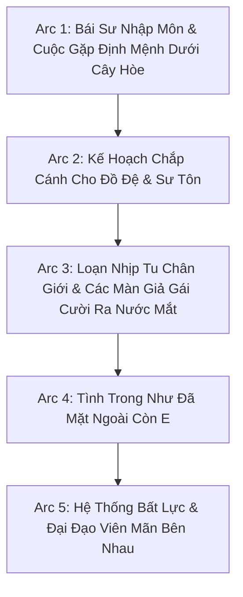

# 🗺️ KẾ HOẠCH TRIỂN KHAI DỊCH THUẬT TOÀN DỰ ÁN (PROJECT TRANSLATION PLAN)
## TÚC CHỦ, NHẬM VỤ MỘT NHƯỢNG NHĨ ĐÀM LUYẾN ÁI (《宿主，任务没让你谈恋爱》)

> **Tác giả:** Mặc Ngư Bồ Đào (墨鱼葡萄)  
> **Slug:** `túc-chủ-nhậm-vụ-một-nhượng-nhĩ-đàm-luyến-ái`  
> **Thể loại:** Đam mỹ, Cổ trang Tiên hiệp, Xuyên thư, Hệ thống, Chủ công, Hài hước sa điêu, Quần tượng, Song khiết, 1v1, HE.  
> **Cặp đôi chính:** Giản Tri (Công) × Ân Trường Tư (Thụ)

---

## 🎯 I. MỤC TIÊU CỐT LÕI

1. **Văn phong Tiên hiệp sa điêu đặc sắc:** Thể hiện rõ nét sự châm biếm, diễn xuất mặt dày của Giản Tri và nét phong lưu tà mị của Ân Trường Tư.
2. **Kỷ luật định dạng 100%:**
   - Khớp đoạn 1:1 (`source.md` ↔ `translation.md`).
   - Đúng khoảng cách `\n\n` giữa các đoạn văn và lời thoại.
   - Chuẩn hóa ngoặc kép hội thoại `“...”`.
   - Phân biệt đại từ ngôi 3: Giản Tri = **“hắn”**, Ân Trường Tư = **“y”**.
3. **Quy tắc Universal Zero Google API Key:** Agent tự thân xử lý toàn bộ quy trình, không gọi API ngoài.
4. **Cơ chế vận hành Subagent linh hoạt:** Phân luồng Worker Subagent chạy song song độc lập khi triển khai batch lớn.

---

## 📦 II. LỘ TRÌNH NỘI DUNG CHÍNH (KEY MILESTONES)

---

### 🔹 GIAI ĐOẠN 1: THIẾT LẬP NỀN TẢNG VÀ CHUẨN HÓA MEMORY
- Thiết lập hồ sơ nhân vật, môn phái và thuật ngữ tu chân tiên hiệp.
- Sẵn sàng nạp raw `source.md` cho các chương đầu tiên khi có yêu cầu.

### 🔹 GIAI ĐOẠN 2: THỰC THI BATCH DỊCH THUẬT & LIÊN HOÀN
- Áp dụng kỹ thuật liên hoàn không điểm dừng (Zero Conversational Pause).
- Tự động cập nhật `timeline.json` ghi chép các biến cố bẻ cong kịch bản của Giản Tri.
