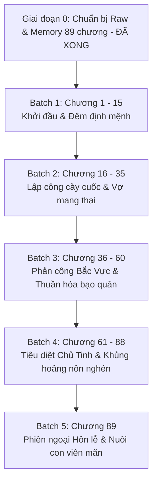

# 🗺️ KẾ HOẠCH TRIỂN KHAI DỊCH THUẬT (PLAN)
## VỢ TÔI SAO LẠI LÀ BẠO QUÂN PHẢN DIỆN (《我老婆怎么是反派暴君》)

> **Tác giả:** Sơn Xuyên Thiên Dã (山川千野)  
> **Quy mô dự án:** 89 chương (Chương 1 - Chương 89, gồm 88 chương Chính văn + 1 chương Phiên ngoại hoàn kết)  
> **Độ dài raw:** ~576.676 ký tự / 16.257 đoạn văn  
> **Chủ đề chính:** Chủ công, niên hạ sát thủ mỹ cún con x S-grade Alpha bạo quân cường thụ, xuyên không tinh tế ABO, song Alpha, sinh tử văn, ngọt sủng hài hước, vả mặt nghịch tập, HE.

---

## 🎯 MỤC TIÊU CỐT LÕI

1. **Văn phong chuẩn xác, sắc sảo & Hài hước duyên dáng:**
   - Thể hiện trọn vẹn nét tính cách của Tạ Trì: Sát thủ tương lai ra tay dứt khoát tàn nhẫn nhưng mạch não kỳ lạ ("điện ba hệ"), thẳng nam tự bẻ cong, hết mực cưng chiều bảo bọc vợ nhỏ.
   - Thể hiện sự biến chuyển tâm lý sâu sắc của Yến Vãn Thu: Từ vị bạo quân lạnh lùng, tàn bạo, đa nghi vì chứng rối loạn pheromone dần bị sự ấm áp vô điều kiện và mùi hương của Tạ Trì thuần hóa, trở thành đế vương yêu sâu đậm bạn đời.
2. **Quy chuẩn kỹ thuật nghiêm ngặt (Zero Compromise):**
   - **Zero Google API Key Mandate:** AI Code Agent tự thân đọc raw, phân tích và dịch trực tiếp. Tuyệt đối không dùng API ngoài.
   - **Khớp 1:1 Paragraph Alignment:** Đảm bảo chính xác từng đoạn văn tiếng Việt khớp với nguyên tác trong `source.md`.
   - **Chuẩn định dạng:** Khoảng cách đoạn văn `\n\n`, ngoặc thoại tiếng Việt `“...”`.
   - **Đại từ ngôi 3:** Tạ Trì = **“cậu”**, Yến Vãn Thu = **“hắn”**. (Phản diện/kẻ địch dùng “gã / y”).
3. **Quản lý ký ức & Đồng bộ hệ thống:**
   - Cập nhật định kỳ các mốc quan hệ và thuật ngữ vào `memory/`.
   - Đồng bộ trạng thái tiến độ chương tự động qua `scripts/sync_novel_toc.py`.

---

## 📦 PHÂN CHIA LỘ TRÌNH DỊCH THUẬT THEO BATCH

---

### 🔹 GIAI ĐOẠN 0: CHUẨN BỊ RAW & HỒ SƠ DỰ ÁN (ĐÃ HOÀN THÀNH 100%)
- [x] Đã cào sạch và phân tách toàn bộ 89 chương tại [`chapters/ch_001/`](file:///d:/Nhung/RIDI/trans-assistant/novel_projects/vợ-tôi-sao-lại-là-bạo-quân-phản-diện/chapters/ch_001) đến [`chapters/ch_089/`](file:///d:/Nhung/RIDI/trans-assistant/novel_projects/vợ-tôi-sao-lại-là-bạo-quân-phản-diện/chapters/ch_089).
- [x] Đã tạo file tổng hợp [`raw_full.txt`](file:///d:/Nhung/RIDI/trans-assistant/novel_projects/vợ-tôi-sao-lại-là-bạo-quân-phản-diện/raw_full.txt) và [`raw_full.md`](file:///d:/Nhung/RIDI/trans-assistant/novel_projects/vợ-tôi-sao-lại-là-bạo-quân-phản-diện/raw_full.md).
- [x] Đã thiết lập cấu hình [`config.json`](file:///d:/Nhung/RIDI/trans-assistant/novel_projects/vợ-tôi-sao-lại-là-bạo-quân-phản-diện/config.json), nguyên tắc [`AGENTS.md`](file:///d:/Nhung/RIDI/trans-assistant/novel_projects/vợ-tôi-sao-lại-là-bạo-quân-phản-diện/AGENTS.md) và bộ nhớ [`memory/`](file:///d:/Nhung/RIDI/trans-assistant/novel_projects/vợ-tôi-sao-lại-là-bạo-quân-phản-diện/memory).
- [x] Đã tạo và đồng bộ [`TOC.md`](file:///d:/Nhung/RIDI/trans-assistant/novel_projects/vợ-tôi-sao-lại-là-bạo-quân-phản-diện/TOC.md) và [`chapters_index.json`](file:///d:/Nhung/RIDI/trans-assistant/novel_projects/vợ-tôi-sao-lại-là-bạo-quân-phản-diện/chapters_index.json).

---

### 🔹 BATCH 1: KHỞI ĐẦU XUYÊN KHÔNG & ĐÊM ĐỊNH MỆNH (CHƯƠNG 1 - 15) - [x] HOÀN THÀNH 100%
- **Quy mô:** 15 chương (`ch_001` -> `ch_015`).
- **Nội dung cốt truyện:**
  - Tạ Trì xuyên từ Tinh lịch năm 3000 về quá khứ thành ám vệ của Yến Vãn Thu tại Bạo Tuyết Thành.
  - Vừa xuyên đến đã bị bạo quân bắt quả tang với Tam hoàng tử, Tạ Trì nhanh trí tuyên bố mình là "A đồng".
  - Đêm định mệnh: Alpha trúng thuốc được đưa vào phòng, hương tuyết tùng lan tỏa, Tạ Trì nhất kiến chung tình và ra tay giúp đỡ.
  - Hôm sau "vợ" biến mất, bạo quân ra điều kiện lấy đầu Dạ lão đại đổi lấy tung tích vợ; Tạ Trì lập tức thi hành nhiệm vụ.
  - Tạ Trì dùng kế diệt Dạ Kiêu Hội, san phẳng thôn Phong Nhai, giải cứu thợ cơ khí Thời Bùi Quyết, mang thủ cấp và vũ khí về nộp mạng.
  - Yến Vãn Thu đích thân dẫn quân y đạp cửa kiểm tra vết thương Tạ Trì; tặng thưởng gấp đôi và bí mật gửi cơm cho Tạ Trì.
  - Tam hoàng tử Yến Bạch Nguyệt và Thành chủ Hàn Băng Du Phù Châu đến; Yến Vãn Thu phát tác rối loạn pheromone xông vào phòng Tạ Trì.
  - Đêm mặn nồng thứ hai: Yến Vãn Thu gọi "ông xã nhỏ", quấn quýt tới sáng; Tạ Trì đưa thuốc phục hồi và gom tiền nuôi vợ; sáng ra Yến Vãn Thu nhảy cửa sổ chạy trốn.
- **Tiến độ chi tiết (15/15 chapters PASS 1:1):**
  - [x] `ch_001`: Khởi đầu xuyên không & Tuyên bố A đồng (113/113 paras)
  - [x] `ch_002`: Đêm đầu tiên định mệnh & Nhất kiến chung tình (211/211 paras)
  - [x] `ch_003`: Sát thủ bỡ ngỡ & Bạo quân uy hiếp (146/146 paras)
  - [x] `ch_004`: Lời nói dối chân thành & Đổi nửa bản đồ quặng (150/150 paras)
  - [x] `ch_005`: Dịch dung tái ngộ & Quà tặng áo giữ nhiệt (143/143 paras)
  - [x] `ch_006`: Tin tình báo ngầm & Dạ Kiêu Hội giăng bẫy (143/143 paras)
  - [x] `ch_007`: Cơm hộp ẩn danh & Đàm phán đêm (122/122 paras)
  - [x] `ch_008`: Súng điện từ & Bão tuyết rình rập (156/156 paras)
  - [x] `ch_009`: Thôn Phong Nhai huyết chiến & Thợ cơ khí đầu hàng (206/206 paras)
  - [x] `ch_010`: Nước cờ hiểm & Lời nhắn khẩn (129/129 paras)
  - [x] `ch_011`: Đêm giết chóc & Thôn Phong Nhai nổ tung (203/203 paras)
  - [x] `ch_012`: Trở về nhà & Bạo quân đạp cửa (116/116 paras)
  - [x] `ch_013`: Yến Bạch Nguyệt ghé thăm & Bánh kem dâu oan nghiệt (363/363 paras)
  - [x] `ch_014`: Ông xã nhỏ & Bịt mắt hôn sâu (139/139 paras)
  - [x] `ch_015`: Đánh dấu & Chạy trốn trong đêm tuyết (165/165 paras)

---

### 🔹 BATCH 2: LẬP CÔNG CÀY CUỐC & VỢ NHỎ MANG THAI (CHƯƠNG 16 - 35) - [x] HOÀN THÀNH 100%
- **Quy mô:** 20 chương (`ch_016` -> `ch_035`).
- **Nội dung cốt truyện:**
  - Tạ Trì giao dịch dịch phục hồi để đổi lấy 15 phút gặp Quý Thù; mua sắm giường đôi 2m và đồ nội thất; kết giao ngài Ngải (Omega cầm tẩu thuốc chợ đen).
  - Trận chiến mỏ quặng: Tạ Trì cắt cổ Yến Bạch Nguyệt, nhường phát súng ân huệ cho Yến Vãn Thu; nổ mìn sạt lở mỏ, Tạ Trì dùng súng lượng tử nã pháo điện từ, che chắn cho Yến Vãn Thu bị gãy xương và mất máu.
  - Yến Vãn Thu bới băng cõng Tạ Trì ra ngoài, dỗ Tạ Trì đánh dấu tạm thời mình để ngăn phát điên.
  - Đêm thứ ba trong phòng bệnh: Yến Vãn Thu đeo mặt nạ nhảy qua cửa sổ dâng tận miệng cho Tạ Trì, khai mở khoang sinh sản; bách khoa toàn thư ABO xác nhận Alpha có thể mang thai nếu khoang sinh sản được khai mở.
  - Lệnh truy nã đặc cấp từ Chủ tinh: Tạ Trì thành chủ mưu số 1 (30 tỷ), Yến Vãn Thu thành tòng phạm (10 tỷ); Yến Vãn Thu thưởng 60 triệu tiền mặt và hứa tặng nhà 3 phòng ngủ 1 phòng khách.
  - Vụ cúp điện toàn Bạo Tuyết Thành: Hàn Băng thành cắt điện giữa đợt rét cực hạn; Yến Vãn Thu mượn thân phận Quý Thù soạn thảo kế hoạch cứu trợ thiên tai chia 5 phân khu xây trạm nhiệt năng thâu tóm thị trường; Tạ Trì sùng bái vợ, đem hết công lao nhường cho Quý Thù; bạo quân xúc động hứa phong Tạ Trì làm Phó thành chủ.
  - Ngài Ngải tiết lộ nguồn gốc súng điện từ đến từ nền văn minh cơ giới (sinh mệnh gốc silicon) cấu kết với Yến Hồi Thời; Yến Vãn Thu vạch trần âm mưu hãm hại năm 16 tuổi; Yến Vãn Thu lên kế hoạch mua nhẫn đôi.
  - Tạ Trì đột nhập Hàn Băng thành giúp đỡ người già nghèo khổ; đặt xác Yến Bạch Nguyệt và chụp ảnh kho vũ khí 20 khẩu súng điện từ để vu oan cho Du Phù Châu; vơ vét của cải sảnh phụ; ném phi đao đính huyết thư răn đe Du Phù Châu và dọa ngất xỉu tên thành chủ mới Băng Xuyên dám sỉ nhục Yến Vãn Thu.
- **Tiến độ chi tiết (20/20 chapters PASS 1:1):**
  - [x] `ch_016`: Tạ Trì đưa dịch phục hồi, hẹn gặp Quý Thù 15 phút, vạch trần âm mưu (123/123 paras)
  - [x] `ch_017`: Khảo sát mỏ nhiệt năng, nhận bom quang học, đụng độ bạo quân ở chợ đen (172/172 paras)
  - [x] `ch_018`: Bẻ gãy giò Harrison đòi tiền mua cây, bạo quân đùa "ta bồi táng cùng ngươi" (192/192 paras)
  - [x] `ch_019`: Ngài Ngải dàn xếp, Tạ Trì thức trắng đêm lắp giường 2m, hỏi mua nhà (130/130 paras)
  - [x] `ch_020`: Bắt Thời Bùi Quyết sửa súng lượng tử, bạo quân xách cơm đến thì Tạ Trì ngủ say (135/135 paras)
  - [x] `ch_021`: Khoe giường mới, ôm ngủ trọn đêm, Yến Vãn Thu hôn trán gọi "ông xã nhỏ" (149/149 paras)
  - [x] `ch_022`: Yến Vãn Thu lấy cớ bắt nộp dịch dinh dưỡng, Tạ Trì đòi kết bạn quang não (212/212 paras)
  - [x] `ch_023`: Nhắn tin quy định 5 tin/ngày, đi nhầm dép hồng xanh, Du Phù Châu rình cướp súng (154/154 paras)
  - [x] `ch_024`: Diệt Yến Bạch Nguyệt, sạt lở mỏ, 2000 quân vây kín, Yến Hồi Thời hiện hình (152/152 paras)
  - [x] `ch_025`: Phục kích súng điện từ nhái, pháo điện từ nã rát, Tạ Trì liều mình che chắn bạo quân (115/115 paras)
  - [x] `ch_026`: Tạ Trì nã súng lượng tử, tỏ tình lý do yêu Quý Thù; Yến Vãn Thu bới băng cõng về (186/186 paras)
  - [x] `ch_027`: Tạ Trì ép bạo quân uống thuốc; Yến Vãn Thu nghiện pheromone nhảy cửa sổ phòng bệnh (169/169 paras)
  - [x] `ch_028`: Đêm phòng bệnh hoang đường, khai mở khoang sinh sản; bạo quân ngóng chờ ngày mai (173/173 paras)
  - [x] `ch_029`: Xuất viện, kiểm tra Ám vệ doanh; bạo quân nhận lỗi và hứa thưởng nhà 3 phòng ngủ (184/184 paras)
  - [x] `ch_030`: Lệnh truy nã 30 tỷ; bạo quân trả thưởng 60 triệu; Quý Thù thừa nhận Tạ Trì là "ông xã" (220/220 paras)
  - [x] `ch_031`: Mất điện toàn thành trước đợt rét cực hạn; Quý Thù thảo kế sách cứu trợ đỉnh cao (190/190 paras)
  - [x] `ch_032`: Quý Thù dạy dỗ quản lý quân doanh; Du Phù Châu nhận vũ khí; Tạ Trì gặp bạo quân (220/220 paras)
  - [x] `ch_033`: Tạ Trì trả bài trôi chảy; nhường công lao cho vợ; bạo quân hứa phong Phó thành chủ (170/170 paras)
  - [x] `ch_034`: Gỡ giới hạn tin nhắn; Andre đưa cơm bò kho; ngài Ngải tặng túi không gian chứa xác (181/181 paras)
  - [x] `ch_035`: Ngài Ngải hé lộ âm mưu người ngoài hành tinh; Yến Vãn Thu tính mua nhẫn đôi; Tạ Trì phóng đao huyết thư đại náo Hàn Băng thành (226/226 paras)

---

### 🔹 BATCH 3: PHẢN CÔNG BẮC VỰC & THUẦN HÓA BẠO QUÂN (CHƯƠNG 36 - 60)
- **Quy mô:** 25 chương (`ch_036` -> `ch_060`).
- **Nội dung cốt truyện:**
  - Bụng của Yến Vãn Thu bắt đầu nhô lên, chứng rối loạn tin tức tố giảm dần nhờ pheromone tương thích của Tạ Trì.
  - Tạ Trì trở thành cánh tay đắc lực số một ("chó săn của bạo quân"), danh tiếng sát thủ vang dội khắp các tinh hệ khiến phe Chủ Tinh khiếp vía.
  - Mối quan hệ dần vượt qua ranh giới chủ - tớ, Yến Vãn Thu ngày càng dung túng và dựa dẫm vào Tạ Trì; những nụ hôn và sự che chở ngọt ngào ngày càng nhiều.
- **Yêu cầu biên dịch & QC:**
  - Giữ vững tính nhất quán thuật ngữ tinh tế, chiến hạm, pheromone.
  - Tăng độ mượt mà cho các phân cảnh tình cảm gia đình ấm áp giữa vùng băng tuyết.

---

### 🔹 BATCH 4: TIÊU DIỆT CHỦ TINH & KHỦNG HOẢNG NÔN NGHÉN (CHƯƠNG 61 - 88)
- **Quy mô:** 28 chương (`ch_061` -> `ch_088`).
- **Nội dung cốt truyện:**
  - Tổng tiến công giải phóng và tiêu diệt bè lũ Đại hoàng tử Yến Triêu Khải, rửa sạch mối oan lưu đày năm xưa.
  - Yến Vãn Thu lên ngôi Hoàng đế, nhất thống đế quốc, nắm tay Tạ Trì phong làm Hoàng hậu trước sự ngỡ ngàng của muôn dân.
  - Phân cảnh cao trào hài hước: Tạ Trì hoang mang lo sợ có lỗi với người vợ ở nhà thì bạo quân đột nhiên nôn nghén dữ dội -> Bí mật vỡ lở, bạo quân chính là người vợ bấy lâu nay!
  - Cả hai đón chào cặp sinh đôi bình an ra đời, chính văn khép lại trong hạnh phúc viên mãn.
- **Yêu cầu biên dịch & QC:**
  - Đẩy mạnh sự bùng nổ cảm xúc ở các chương cuối: từ trận chiến đỉnh cao đến màn nhận người thân "cười ra nước mắt".

---

### 🔹 BATCH 5: PHIÊN NGOẠI HÔN LỄ & NUÔI CON VIÊN MÃN (CHƯƠNG 89)
- **Quy mô:** 1 chương phiên ngoại hoàn kết (`ch_089`).
- **Nội dung cốt truyện:**
  - Lễ cưới thế kỷ bù đắp hoành tráng, Yến Vãn Thu mang nguyên vẹn ngôi nhà ấm áp từ Bạo Tuyết Thành về Chủ Tinh tặng cho Tạ Trì.
  - Cuộc sống nuôi dưỡng hai tiểu điện hạ ngập tràn tiếng cười và tình yêu thương vô bờ.
- **Yêu cầu biên dịch & QC:**
  - Khép lại trọn vẹn dự án với văn phong ngọt ngào, ấm áp nhất.

---

## 🛠️ QUY TRÌNH THỰC HIỆN TỪNG CHƯƠNG (WORKFLOW)

Mỗi chương khi dịch sẽ tuần tự trải qua 4 bước khép kín do Agent thực thi trực tiếp:

1. **Step 1 - Pre-scan Context:** Đọc `source.md`, kiểm tra danh tính nhân vật xuất hiện, đối chiếu `memory/characters.json` và quy chuẩn xưng hô.
2. **Step 2 - Translation Execution:** Biên dịch trực tiếp sang `translation.md` tuân thủ 1:1 Paragraph Alignment, `\n\n` và `“...”`, giữ đại từ Tạ Trì = `cậu`, Yến Vãn Thu = `anh`.
3. **Step 3 - QC Audit:** Đối chiếu song song `source.md` và `translation.md`, kiểm tra lỗi sót đoạn, đá ngôi trần thuật, thuật ngữ ABO.
4. **Step 4 - Sync TOC & Index:** Chạy `python scripts/sync_novel_toc.py --slug vợ-tôi-sao-lại-là-bạo-quân-phản-diện` để cập nhật tiến độ tự động trên hệ thống.
