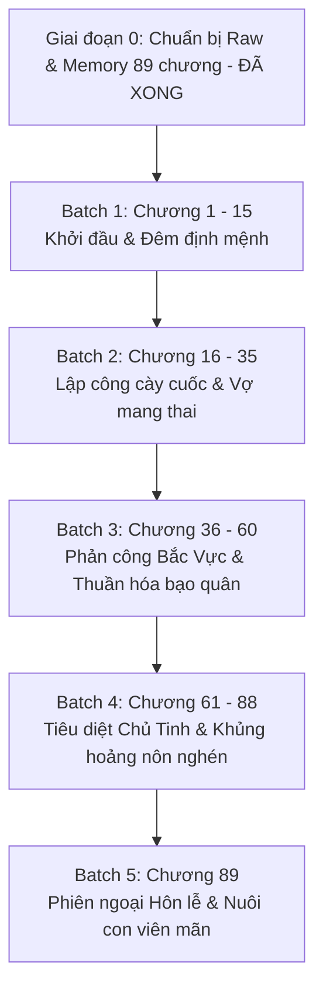

# 🗺️ KẾ HOẠCH TRIỂN KHAI DỊCH THUẬT (PLAN)
## VỢ TÔI SAO LẠI LÀ BẠO QUÂN PHẢN DIỆN (《我老婆怎么是反派暴君》)

> **Tác giả:** Sơn Xuyên Thiên Dã (山川千野)  
> **Quy mô dự án:** 89 chương (Chương 1 - Chương 89, gồm 88 chương Chính văn + 1 chương Phiên ngoại hoàn kết)  
> **Độ dài raw:** ~576.676 ký tự / 16.257 đoạn văn  
> **Chủ đề chính:** Chủ công, niên hạ sát thủ mỹ cún con x S-grade Alpha bạo quân cường thụ, xuyên không tinh tế ABO, song Alpha, sinh tử văn, ngọt sủng hài hước, vả mặt nghịch tập, HE.

---

## 🎯 MỤC TIÊU CỐT LÕI

1. **Văn phong chuẩn xác, sắc sảo & Hài hước duyên dáng:**
   - Thể hiện trọn vẹn nét tính cách của Tạ Trì: Sát thủ tương lai ra tay dứt khoát tàn nhẫn nhưng mạch não kỳ lạ ("điện ba hệ"), thẳng nam tự bẻ cong, hết mực cưng chiều bảo bọc vợ nhỏ.
   - Thể hiện sự biến chuyển tâm lý sâu sắc của Yến Vãn Thu: Từ vị bạo quân lạnh lùng, tàn bạo, đa nghi vì chứng rối loạn pheromone dần bị sự ấm áp vô điều kiện và mùi hương của Tạ Trì thuần hóa, trở thành đế vương yêu sâu đậm bạn đời.
2. **Quy chuẩn kỹ thuật nghiêm ngặt (Zero Compromise):**
   - **Zero Google API Key Mandate:** AI Code Agent tự thân đọc raw, phân tích và dịch trực tiếp. Tuyệt đối không dùng API ngoài.
   - **Khớp 1:1 Paragraph Alignment:** Đảm bảo chính xác từng đoạn văn tiếng Việt khớp với nguyên tác trong `source.md`.
   - **Chuẩn định dạng:** Khoảng cách đoạn văn `\n\n`, ngoặc thoại tiếng Việt `“...”`.
   - **Đại từ ngôi 3:** Tạ Trì = **“cậu”**, Yến Vãn Thu = **“anh”**.
3. **Quản lý ký ức & Đồng bộ hệ thống:**
   - Cập nhật định kỳ các mốc quan hệ và thuật ngữ vào `memory/`.
   - Đồng bộ trạng thái tiến độ chương tự động qua `scripts/sync_novel_toc.py`.

---

## 📦 PHÂN CHIA LỘ TRÌNH DỊCH THUẬT THEO BATCH

---

### 🔹 GIAI ĐOẠN 0: CHUẨN BỊ RAW & HỒ SƠ DỰ ÁN (ĐÃ HOÀN THÀNH 100%)
- [x] Đã cào sạch và phân tách toàn bộ 89 chương tại [`chapters/ch_001/`](file:///d:/Nhung/RIDI/trans-assistant/novel_projects/vợ-tôi-sao-lại-là-bạo-quân-phản-diện/chapters/ch_001) đến [`chapters/ch_089/`](file:///d:/Nhung/RIDI/trans-assistant/novel_projects/vợ-tôi-sao-lại-là-bạo-quân-phản-diện/chapters/ch_089).
- [x] Đã tạo file tổng hợp [`raw_full.txt`](file:///d:/Nhung/RIDI/trans-assistant/novel_projects/vợ-tôi-sao-lại-là-bạo-quân-phản-diện/raw_full.txt) và [`raw_full.md`](file:///d:/Nhung/RIDI/trans-assistant/novel_projects/vợ-tôi-sao-lại-là-bạo-quân-phản-diện/raw_full.md).
- [x] Đã thiết lập cấu hình [`config.json`](file:///d:/Nhung/RIDI/trans-assistant/novel_projects/vợ-tôi-sao-lại-là-bạo-quân-phản-diện/config.json), nguyên tắc [`AGENTS.md`](file:///d:/Nhung/RIDI/trans-assistant/novel_projects/vợ-tôi-sao-lại-là-bạo-quân-phản-diện/AGENTS.md) và bộ nhớ [`memory/`](file:///d:/Nhung/RIDI/trans-assistant/novel_projects/vợ-tôi-sao-lại-là-bạo-quân-phản-diện/memory).
- [x] Đã tạo và đồng bộ [`TOC.md`](file:///d:/Nhung/RIDI/trans-assistant/novel_projects/vợ-tôi-sao-lại-là-bạo-quân-phản-diện/TOC.md) và [`chapters_index.json`](file:///d:/Nhung/RIDI/trans-assistant/novel_projects/vợ-tôi-sao-lại-là-bạo-quân-phản-diện/chapters_index.json).

---

### 🔹 BATCH 1: KHỞI ĐẦU XUYÊN KHÔNG & ĐÊM ĐỊNH MỆNH (CHƯƠNG 1 - 15)
- **Quy mô:** 15 chương (`ch_001` -> `ch_015`).
- **Nội dung cốt truyện:**
  - Tạ Trì xuyên từ Tinh lịch năm 3000 về quá khứ thành ám vệ của Yến Vãn Thu tại Bạo Tuyết Thành.
  - Vừa xuyên đến đã bị bạo quân bắt quả tang với Tam hoàng tử, Tạ Trì nhanh trí tuyên bố mình là "A đồng".
  - Đêm định mệnh: Alpha trúng thuốc được đưa vào phòng, hương tuyết tùng lan tỏa, Tạ Trì nhất kiến chung tình và ra tay giúp đỡ.
  - Hôm sau "vợ" biến mất, bạo quân ra điều kiện lấy đầu Tam hoàng tử đổi lấy tung tích vợ; Tạ Trì lập tức thi hành nhiệm vụ.
- **Yêu cầu biên dịch & QC:**
  - Kiểm soát chuẩn ngôi 3: Tạ Trì = `cậu`, Yến Vãn Thu = `anh`.
  - Khắc họa nét hài hước độc thoại của Tạ Trì khi nhận mình là A đồng và cú bẻ lái tính dục ngọt ngào.

---

### 🔹 BATCH 2: LẬP CÔNG CÀY CUỐC & VỢ NHỎ MANG THAI (CHƯƠNG 16 - 35)
- **Quy mô:** 20 chương (`ch_016` -> `ch_035`).
- **Nội dung cốt truyện:**
  - Tạ Trì tận dụng tối đa kính terminal tương lai và vũ khí hiện đại thực hiện liên tiếp các nhiệm vụ nguy hiểm cho bạo quân.
  - Nhận thưởng hậu hĩnh, Tạ Trì mua một căn hộ nhỏ ấm áp tại Bạo Tuyết Thành, sắm lò sưởi quặng nhiệt năng, lén giấu tiền tiêu vặt cho vợ mỗi lần tái ngộ.
  - Yến Vãn Thu phát hiện mình mang thai đôi (kết quả ngoài ý muốn do buồng sinh dục bị kích thích), cảm xúc mâu thuẫn, vừa ngỡ ngàng vừa rung động trước sự chăm sóc ngốc nghếch nhưng chân thành của Tạ Trì.
- **Yêu cầu biên dịch & QC:**
  - Thể hiện sự tương phản thú vị giữa việc Tạ Trì tưởng mình đang bao nuôi "cô vợ yếu đuối nghèo khó" và sự thật là bạo quân hung bạo.

---

### 🔹 BATCH 3: PHẢN CÔNG BẮC VỰC & THUẦN HÓA BẠO QUÂN (CHƯƠNG 36 - 60)
- **Quy mô:** 25 chương (`ch_036` -> `ch_060`).
- **Nội dung cốt truyện:**
  - Bụng của Yến Vãn Thu bắt đầu nhô lên, chứng rối loạn tin tức tố giảm dần nhờ pheromone tương thích của Tạ Trì.
  - Tạ Trì trở thành cánh tay đắc lực số một ("chó săn của bạo quân"), danh tiếng sát thủ vang dội khắp các tinh hệ khiến phe Chủ Tinh khiếp vía.
  - Mối quan hệ dần vượt qua ranh giới chủ - tớ, Yến Vãn Thu ngày càng dung túng và dựa dẫm vào Tạ Trì; những nụ hôn và sự che chở ngọt ngào ngày càng nhiều.
- **Yêu cầu biên dịch & QC:**
  - Giữ vững tính nhất quán thuật ngữ tinh tế, chiến hạm, pheromone.
  - Tăng độ mượt mà cho các phân cảnh tình cảm gia đình ấm áp giữa vùng băng tuyết.

---

### 🔹 BATCH 4: TIÊU DIỆT CHỦ TINH & KHỦNG HOẢNG NÔN NGHÉN (CHƯƠNG 61 - 88)
- **Quy mô:** 28 chương (`ch_061` -> `ch_088`).
- **Nội dung cốt truyện:**
  - Tổng tiến công giải phóng và tiêu diệt bè lũ Đại hoàng tử Yến Triêu Khải, rửa sạch mối oan lưu đày năm xưa.
  - Yến Vãn Thu lên ngôi Hoàng đế, nhất thống đế quốc, nắm tay Tạ Trì phong làm Hoàng hậu trước sự ngỡ ngàng của muôn dân.
  - Phân cảnh cao trào hài hước: Tạ Trì hoang mang lo sợ có lỗi với người vợ ở nhà thì bạo quân đột nhiên nôn nghén dữ dội -> Bí mật vỡ lở, bạo quân chính là người vợ bấy lâu nay!
  - Cả hai đón chào cặp sinh đôi bình an ra đời, chính văn khép lại trong hạnh phúc viên mãn.
- **Yêu cầu biên dịch & QC:**
  - Đẩy mạnh sự bùng nổ cảm xúc ở các chương cuối: từ trận chiến đỉnh cao đến màn nhận người thân "cười ra nước mắt".

---

### 🔹 BATCH 5: PHIÊN NGOẠI HÔN LỄ & NUÔI CON VIÊN MÃN (CHƯƠNG 89)
- **Quy mô:** 1 chương phiên ngoại hoàn kết (`ch_089`).
- **Nội dung cốt truyện:**
  - Lễ cưới thế kỷ bù đắp hoành tráng, Yến Vãn Thu mang nguyên vẹn ngôi nhà ấm áp từ Bạo Tuyết Thành về Chủ Tinh tặng cho Tạ Trì.
  - Cuộc sống nuôi dưỡng hai tiểu điện hạ ngập tràn tiếng cười và tình yêu thương vô bờ.
- **Yêu cầu biên dịch & QC:**
  - Khép lại trọn vẹn dự án với văn phong ngọt ngào, ấm áp nhất.

---

## 🛠️ QUY TRÌNH THỰC HIỆN TỪNG CHƯƠNG (WORKFLOW)

Mỗi chương khi dịch sẽ tuần tự trải qua 4 bước khép kín do Agent thực thi trực tiếp:

1. **Step 1 - Pre-scan Context:** Đọc `source.md`, kiểm tra danh tính nhân vật xuất hiện, đối chiếu `memory/characters.json` và quy chuẩn xưng hô.
2. **Step 2 - Translation Execution:** Biên dịch trực tiếp sang `translation.md` tuân thủ 1:1 Paragraph Alignment, `\n\n` và `“...”`, giữ đại từ Tạ Trì = `cậu`, Yến Vãn Thu = `anh`.
3. **Step 3 - QC Audit:** Đối chiếu song song `source.md` và `translation.md`, kiểm tra lỗi sót đoạn, đá ngôi trần thuật, thuật ngữ ABO.
4. **Step 4 - Sync TOC & Index:** Chạy `python scripts/sync_novel_toc.py --slug vợ-tôi-sao-lại-là-bạo-quân-phản-diện` để cập nhật tiến độ tự động trên hệ thống.
