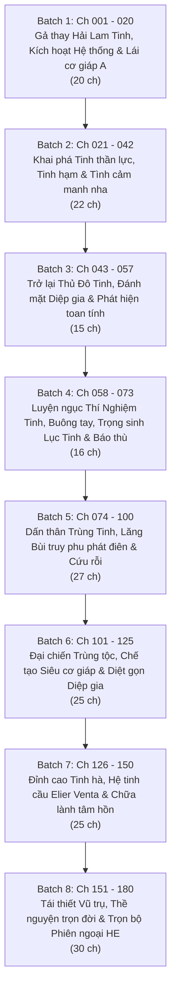

# 🗺️ KẾ HOẠCH TRIỂN KHAI DỊCH THUẬT (PLAN)
## XUYÊN ĐẾN TINH TẾ LÀM CƠ GIÁP SƯ ĐỘC QUYỀN (《穿越星际之专属机甲师》)

> **Tác giả:** Tất Tu Khoa Mục (必修科目)  
> **Quy mô dự án:** 180 chương (Chương 1 - Chương 176 Chính văn + Chương 177 - 180 Phiên ngoại, Hoàn kết)  
> **Độ dài raw:** 17.739 đoạn văn (~650.000 chữ Trung)  
> **Chủ đề chính:** Đam mỹ, Chủ công, Niên hạ, Xuyên việt tinh tế, Cơ giáp chiến đấu, Hệ thống, Cường cường, Ngược luyến tình thâm, Thụ truy phu hỏa táng tràng, Tương hỗ cứu rỗi, 1v1, HE.  
> **Trạng thái hiện tại:** Đã cào 180/180 chương raw (100% RAW_READY). Cấu trúc dự án và memory đã khởi tạo hoàn tất. Sẵn sàng vận hành dịch thuật liên hoàn.

---

## 🎯 1. MỤC TIÊU CỐT LÕI (CORE OBJECTIVES)

1. **Văn phong chuẩn xác, sắc bén & Đậm chất tinh tế cơ giáp:**
   - Thể hiện trọn vẹn sự quyết đoán, cơ trí, bản lĩnh kỹ nghệ cơ giáp siêu phàm và khí chất bất khuất của Công Diệp Kiêu An.
   - Lột tả chiều sâu tâm lý phức tạp của Thụ Lăng Bùi: từ một vị Thượng tướng quyền uy, tâm cơ thâm trầm nhưng tàn phế, chuyển sang đau đớn hối hận tột cùng, rơi vào trầm cảm và cuồng si truy phu chuộc lỗi nơi sào huyệt Trùng tộc.
2. **Quy chuẩn kỹ thuật nghiêm ngặt (Zero Compromise):**
   - **Zero Google API Key Mandate:** AI Code Agent trực tiếp đọc raw, tự thân phân tích ngữ cảnh và biên dịch trực tiếp. Tuyệt đối không dùng API ngoài để bảo vệ quota.
   - **Bảo toàn 1:1 Paragraph Alignment:** Số đoạn văn tiếng Việt trong `translation.md` phải khớp chính xác 1:1 với nguyên tác trong `source.md`.
   - **Chuẩn khoảng cách & ngoặc thoại:** Mỗi đoạn văn cách nhau đúng 1 dòng trống `\n\n`, thoại nhân vật đặt trong ngoặc kép cong `“...”`.
   - **Đại từ đơn tôn - đơn nghĩa:** Không nhảy xưng hô tùy tiện trong cùng một giai đoạn. Bám sát ma trận 4 giai đoạn quan hệ.
   - **Quy tắc chửi nhau / đối đầu căng thẳng:** Xưng **"ta"** - gọi **"ngươi"**, **TUYỆT ĐỐI CẤM "tao - mày"**.
   - **Trần thuật ngôi thứ 3:** Diệp Kiêu An (Công - Niên hạ) chốt cứng dùng **"cậu"**; Lăng Bùi (Thụ - Niên thượng) chốt cứng **"hắn"** (tuyệt đối không dùng từ cổ phong "y").
3. **Quản lý ký ức & Cơ chế tự hành liên hoàn:**
   - Duy trì và cập nhật `memory/` (nhân vật, thuật ngữ, quan hệ, dòng thời gian) xuyên suốt dự án.
   - Vận hành theo cơ chế Continuous Batch (tự hành không gián đoạn), đồng bộ hóa tự động `chapters_index.json`, `TOC.md`, `timeline.json`.

---

## 📦 2. PHÂN CHIA LỘ TRÌNH DỊCH THUẬT THEO 8 BATCH

---

### 🔹 BATCH 1: GẢ THAY HẢI LAM TINH & KHỞI ĐẦU QUẬT KHỞI (CHƯƠNG 001 - 020)
- **Quy mô:** 20 chương (`ch_001` -> `ch_020`) | ~2.000 đoạn văn raw.
- **Bối cảnh:** Hải Lam Tinh (Tinh cầu biên cảnh hoang vu, khí hậu khắc nghiệt, dị thú hoành hành).
- **Trọng tâm cốt truyện:**
  - `ch_001` - `ch_005`: Diệp Kiêu An xuyên không vào thân xác con riêng phế vật bị Diệp gia ruồng bỏ, bị ép gả thay cho Lăng Bùi – vị cựu Thượng tướng tàn phế hai chân đang bị lưu đày. Diệp Kiêu An kích hoạt hệ thống với số dư 2 đồng Thiện Ý, bộc lộ tính cách cứng cỏi dằn mặt kẻ hầu.
  - `ch_006` - `ch_010`: Nhờ hệ thống, Diệp Kiêu An trồng sống hoa màu cổ đại, nuôi sống gia cầm, luyện chế dược tề thần kỳ và giấu kín thực lực.
  - `ch_011` - `ch_015`: Dị thú tập kích, Diệp Kiêu An lái thử cơ giáp cấp A chấn động mọi người; tình cảm giữa anh và Lăng Bùi bắt đầu manh nha những rung động đầu tiên.
  - `ch_016` - `ch_020`: Sự phòng bị thăm dò lẫn nhau, nghị viên Thủ Đô Tinh đến kiểm tra, hàng không mẫu hạm tinh không xuất hiện.

---

### 🔹 BATCH 2: TINH THẦN LỰC ĐỘT PHÁ & TÌNH CẢM NẢY NỞ (CHƯƠNG 021 - 042)
- **Quy mô:** 22 chương (`ch_021` -> `ch_042`) | ~2.200 đoạn văn raw.
- **Bối cảnh:** Hải Lam Tinh -> Tiền tuyến phòng thủ biên cương.
- **Trọng tâm cốt truyện:**
  - `ch_021` - `ch_025`: Trêu chọc dưới ánh trăng, giải quyết xung đột với cấp dưới An Lê; ai là người thực sự "hành hạ" ai.
  - `ch_026` - `ch_030`: Diệp Kiêu An bộc lộ tiềm năng tinh thần lực dị thường, đột phá kỹ nghệ cơ giáp, thân phận thế thân dần sáng tỏ.
  - `ch_031` - `ch_036`: Tâm cơ sâu kín của Lăng Bùi; hai người lần đầu kề vai sát cánh nơi tiền tuyến, cảm nhận hơi ấm hiếm hoi giữa vũ trụ băng giá.
  - `ch_037` - `ch_042`: Tung tích tinh đạo và dấu hiệu Trùng tộc xuất hiện tại biên cảnh; Diệp Kiêu An bảo vệ Lăng Bùi, chuẩn bị lộ trình trở về Thủ Đô Tinh.

---

### 🔹 BATCH 3: TRỞ VỀ THỦ ĐÔ TINH & NGUY CƠ RẠN NỨT (CHƯƠNG 043 - 057)
- **Quy mô:** 15 chương (`ch_043` -> `ch_057`) | ~1.500 đoạn văn raw.
- **Bối cảnh:** Thủ Đô Tinh (Đại bản doanh nhân loại, thế gia tranh đoạt, công nghệ đỉnh cao).
- **Trọng tâm cốt truyện:**
  - `ch_043` - `ch_047`: Trở về Thủ Đô Tinh, vung tay vả mặt gia tộc Diệp thị và những kẻ từng khinh thường; danh tiếng thiên tài cơ giáp sư của Diệp Kiêu An chấn động giới thượng lưu.
  - `ch_048` - `ch_052`: Diệp Kiêu An hết lòng vì Lăng Bùi, nhưng dần phát hiện những điểm đáng ngờ: Lăng Bùi âm thầm liên hệ với tinh đạo, không hề thiếu thốn quyền lực như vẻ bề ngoài.
  - `ch_053` - `ch_057`: Sự thật tàn khốc hé lộ: Lăng Bùi vì mục tiêu báo thù đã toan tính biến Diệp Kiêu An thành quân cờ; cạm bẫy đẫm máu đẩy mối quan hệ đến bờ vực sụp đổ.

---

### 🔹 BATCH 4: LUYỆN NGỤC THÍ NGHIỆM TINH, BUÔNG TAY & TRỌNG SINH LỤC TINH (CHƯƠNG 058 - 073)
- **Quy mô:** 16 chương (`ch_058` -> `ch_073`) | ~1.600 đoạn văn raw.
- **Bối cảnh:** Thí Nghiệm Tinh (Luyện ngục Trùng tộc) -> Lục Tinh (Rừng cổ thụ cấm địa).
- **Trọng tâm cốt truyện:**
  - `ch_058` - `ch_061`: Diệp Kiêu An bị đưa lên Thí Nghiệm Tinh – nơi Trùng tộc thực hiện các thí nghiệm tàn bạo trên cơ thể con người. Diệp Kiêu An tâm tàn ý lạnh, nhận ra sự tàn nhẫn trong tính toán của Lăng Bùi và dứt khoát chặt đứt sợi dây tình cảm.
  - `ch_062` - `ch_067`: Diệp Kiêu An thoát hiểm đến Lục Tinh (hậu hoa viên bí mật), nâng cấp hệ thống toàn diện, chế tạo siêu cơ giáp, âm thầm gây dựng lực lượng báo thù.
  - `ch_068` - `ch_073`: Lăng Bùi bàng hoàng nhận ra mình đã vĩnh viễn mất đi người chân thành nhất; sự hối hận tột cùng giày vò tâm can, vị Thượng tướng rơi vào trạng thái phát điên và tuyệt vọng tìm kiếm.

---

### 🔹 BATCH 5: DẤN THÂN TRÙNG TINH, TRUY PHU HỎA TÁNG TRÀNG & CỨU RỖI (CHƯƠNG 074 - 100)
- **Quy mô:** 27 chương (`ch_074` -> `ch_100`) | ~2.600 đoạn văn raw.
- **Bối cảnh:** Trùng Tinh (Sào huyệt Trùng tộc u ám) -> Hành trình chuộc lỗi đẫm nước mắt.
- **Trọng tâm cốt truyện:**
  - `ch_074` - `ch_081`: Lăng Bùi một thân một mình xông vào Trùng Tinh tìm Diệp Kiêu An; tinh thần lực bị phá hủy, đôi chân gãy gập tái phát, bị tra tấn trong hang tối, thần trí phân liệt chỉ còn chấp niệm mang tên Diệp Kiêu An.
  - `ch_082` - `ch_087`: Diệp Kiêu An xuất hiện, đối diện với một Lăng Bùi tàn tạ, điên loạn và hèn mọn quỳ gối cầu xin tha thứ; sự lạnh lùng của công đối lập với sự cố chấp truy phu của thụ.
  - `ch_088` - `ch_093`: Diệp Kiêu An chữa trị đôi chân và tinh thần vực cho Lăng Bùi; lời thú nhận xé lòng và hành động chuộc lỗi chân thành dần làm tan chảy lớp băng phòng bị.
  - `ch_094` - `ch_100`: Bí mật thân thế hé lộ; hai người xác lập lại liên kết linh hồn, trao nhau ấn ký trọn đời.

---

### 🔹 BATCH 6: ĐẠI CHIẾN TRÙNG TỘC, CƠ GIÁP ĐỘC QUYỀN & BÁO THÙ (CHƯƠNG 101 - 125)
- **Quy mô:** 25 chương (`ch_101` -> `ch_125`) | ~2.500 đoạn văn raw.
- **Bối cảnh:** Tiền tuyến liên minh nhân loại x Không gian vũ trụ.
- **Trọng tâm cốt truyện:**
  - `ch_101` - `ch_108`: Liên minh chống Trùng tộc thành lập; Lăng Bùi hồi phục đỉnh cao phong độ, trở lại ngai vị Thượng tướng tối cao dưới sự yểm trợ của Diệp Kiêu An.
  - `ch_109` - `ch_115`: Diệp Kiêu An ra mắt cơ giáp độc quyền dành riêng cho Lăng Bùi; thẳng tay quét sạch gia tộc Diệp thị, trả thù trọn vẹn mọi bất công; công khai tuyên bố tình yêu với toàn tinh tế.
  - `ch_116` - `ch_125`: Trận quyết chiến thần cấp với Trùng tộc; tinh thần lực của hai người cộng hưởng tuyệt đối, đánh tan sào huyệt trung ương, lập lại nền hòa bình vĩnh cửu.

---

### 🔹 BATCH 7: ĐỈNH CAO TINH HÀ, HỆ TINH CẦU ELIER VENTA (CHƯƠNG 126 - 150)
- **Quy mô:** 25 chương (`ch_126` -> `ch_150`) | ~2.400 đoạn văn raw.
- **Bối cảnh:** Hệ tinh cầu Elier Venta (Nền văn minh trí tuệ nhân tạo đỉnh cao).
- **Trọng tâm cốt truyện:**
  - `ch_126` - `ch_135`: Cuộc sống ngọt ngào bù đắp sau chiến tranh; hành trình thám hiểm nền văn minh ngoài hành tinh Elier Venta.
  - `ch_136` - `ch_143`: Khám phá bí mật cội nguồn sinh mệnh và không gian hệ thống; xây dựng đế chế tự do mới và mở học viện cơ giáp.
  - `ch_144` - `ch_150`: Gặp lại cố nhân, giải tỏa mọi gút mắc quá khứ; những đêm không ngủ nơi chiến hạm tinh không, gắn kết tình yêu son sắt.

---

### 🔹 BATCH 8: TÁI THIẾT VŨ TRỤ, VIÊN MÃN HE & TOÀN BỘ PHIÊN NGOẠI (CHƯƠNG 151 - 180)
- **Quy mô:** 30 chương (`ch_151` -> `ch_180`) | ~2.900 đoạn văn raw.
- **Bối cảnh:** Toàn vũ trụ hòa bình -> Cuộc sống điền viên thường nhật ngọt ngào.
- **Trọng tâm cốt truyện:**
  - `ch_151` - `ch_158`: Xâm nhập bộ não Trùng Đế, giải cứu những sinh mệnh bị thao túng; hoàn toàn chữa lành tổn thương tinh thần cho Lăng Bùi; lời thề nguyện vĩnh cửu.
  - `ch_159` - `ch_176`: Tuần du vũ trụ, ghé thăm Hải Lam Tinh nơi tình yêu bắt đầu; kết thúc chính văn ở chương 176 với tiêu đề đầy xúc động: *Cả Đời Này Bên Em*.
  - `ch_177` - `ch_180`: Trọn bộ 4 chương phiên ngoại (Cuộc sống thường nhật ngọt ngào, Hồi ức năm ấy, Du ngoạn tinh hà, và Kết cục của Trùng Đế).

---

## 🛠️ 3. QUY TRÌNH THỰC THI & KIỂM SOÁT CHẤT LƯỢNG (QC PIPELINE)

1. **Pha 1 - Đọc Raw & Phân Tích Ký Ức:** Đọc `source.md`, kiểm tra danh sách nhân vật xuất hiện, tra cứu thuật ngữ trong `memory/glossary.json`.
2. **Pha 2 - Trực Tiếp Biên Dịch (Zero API Key):** Dịch trực tiếp sang `translation.md` đảm bảo 1:1 số đoạn văn, chuẩn ngắt dòng `\n\n`, đúng dấu ngoặc kép cong `“...”`.
3. **Pha 3 - Kiểm Toán Độc Lập (QC Audit):** Kiểm tra độ dài, đối chiếu pronoun drift, kiểm tra quy tắc chửi nhau (cấm tao-mày), đảm bảo không sót câu thoại nào.
4. **Pha 4 - Đồng Bộ Hóa Dự Án:** Cập nhật `chapters_index.json`, `TOC.md`, `memory/timeline.json` sau mỗi batch hoàn thành.
5. **Pha 5 - Đóng Gói EPUB:** Đóng gói file EPUB sau mỗi mốc batch hoàn chỉnh để người dùng dễ dàng lưu trữ và đọc thử nghiệm.
