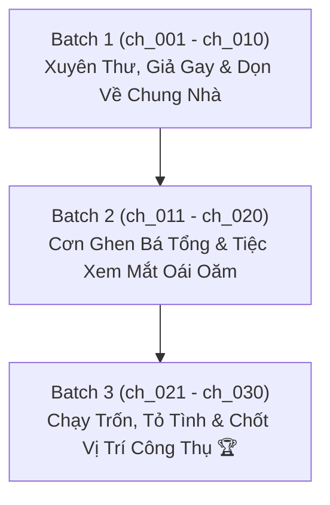

# 📋 KẾ HOẠCH & TIẾN ĐỘ DỊCH THUẬT & QC ARC 1: BÁ TỔNG CẨU HUYẾT & BÁC SĨ GIẢ GAY

> **Bộ truyện:** Xuyên Thư Xong Tôi Giả Gay Trong Truyện Bá Tổng [Khoái Xuyên] (《装弯后霸总自我攻略了[快穿]》)  
> **Thế giới 1 (Arc 1):** Hào Môn Bá Tổng (Bác sĩ nam phụ pháo hôi Lận Duy $\times$ Bá tổng tự não bổ Hoắc Kỳ Quân)  
> **Phạm vi chương:** Chương 1 đến Chương 30 (`ch_001` $\rightarrow$ `ch_030`)  
> **Quy chuẩn áp dụng:** [`rules_arc_1.md`](rules_arc_1.md) & [`AGENTS.md`](AGENTS.md)  
> **Chế độ thực thi:** **Fast Batch Mode** (Dịch 1:1, Auto QC Audit, Auto Lorekeeper theo từng đợt)  
> **Mục tiêu cốt lõi:** Dịch chuẩn xác 1:1, khóa chặt đại từ Công (Lận Duy) = "hắn / anh", Thụ (Hoắc Kỳ Quân) = "anh / y", giữ nguyên vẹn độ hài hước, phản sáo lộ, màn "tự công lược" và ngọt sủng của truyện.

---

## 📊 1. BẢNG TỔNG QUAN TIẾN ĐỘ ARC 1

| Chỉ số | Giá trị | Ghi chú |
| :--- | :---: | :--- |
| **Tổng số chương Arc 1** | **30 chapters** | `ch_001` $\rightarrow$ `ch_030` (Toàn bộ thế giới 1) |
| **Đã hoàn thành (QC_PASSED)** | **0 / 30** | Sẵn sàng triển khai dịch |
| **Đang chờ xử lý** | **30 chapters** | 3 Batch (mỗi Batch 10 chương) |
| **Tiến độ tổng thể** | **0%** | Bắt đầu khởi động Batch 1 |
| **Quy chuẩn đại từ bắt buộc** | **100% Locked** | **Công (Lận Duy) = "hắn / anh"** **Thụ (Hoắc Kỳ Quân) = "anh / y"** **Nữ chính (Phó Tiểu Thanh) = "cô"** **Đối thoại: Công xưng "tôi/anh" - gọi "cậu/em"; Thụ xưng "tôi/em" - gọi "cậu/anh"** |

---

## 📦 2. PHÂN CHIA CÁC BATCH CHI TIẾT

---

### 🔹 BATCH 1: Xuyên Thư, Giả Gay & Dọn Về Chung Nhà Bá Tổng (`ch_001` $\rightarrow$ `ch_010`)
* **Mục tiêu:**
  - Lận Duy xuyên đến trúng lúc Phó Tiểu Thanh ngất xỉu, bị Hoắc Kỳ Quân xem là tình địch. Lập tức tung chiêu nói dối: "Tôi thích đàn ông!".
  - Giải cứu Phó Tiểu Thanh khỏi cảnh ngặt nghèo, đưa em trai cô đi điều trị ở nước ngoài.
  - Hoắc Kỳ Quân bứt rứt, ghen ngầm nên ép Lận Duy dọn qua ở chung biệt thự của mình.
  - Lận Duy đối phó và lấy lòng mẹ của Hoắc Kỳ Quân (Hoắc lão phu nhân).
  - Tình huống dở khóc dở cười chiếc nhẫn đính hôn của bố mẹ Lận Duy gửi nhầm đến tay Hoắc Kỳ Quân, khiến bá tổng tưởng bở được cầu hôn.

| Chapter ID | Tên chương (Hán Việt / Tóm tắt) | Trạng thái QC | Tiến độ | Tóm tắt sự kiện chính |
| :---: | :--- | :---: | :---: | :--- |
| `ch_001` | Chương 1: Hiện Trường Tu La Tràng & Tuyệt Chiêu Giả Gay | ⏳ Chờ xử lý | 0% | Lận Duy xuyên tới trễ, đối mặt với Hoắc Kỳ Quân ghen bóng ghen gió; tuyên bố chấn động: "Tôi là gay, tôi thích đàn ông!" |
| `ch_002` | Chương 2: Quả Bom Nổ Chậm Của Bá Tổng | ⏳ Chờ xử lý | 0% | Hoắc Kỳ Quân sững sờ không kịp chất vấn; Lận Duy rời đi, để lại nam chính tự suy diễn và bối rối |
| `ch_003` | Chương 3: Quán Bar & Trợ Giúp Nữ Chính | ⏳ Chờ xử lý | 0% | Lận Duy đến quán bar bảo vệ Phó Tiểu Thanh khỏi khách say quấy rối; đứng ra giải quyết rắc rối một cách văn minh |
| `ch_004` | Chương 4: Hai Người Cùng Không Có Miệng | ⏳ Chờ xử lý | 0% | Hoắc Kỳ Quân và Phó Tiểu Thanh gặp nhau nhưng tính cách bướng bỉnh không ai chịu nói mềm; Lận Duy đứng giữa điều hòa |
| `ch_005` | Chương 5: Sắp Xếp Trị Liệu & Lời Đề Nghị Sống Chung | ⏳ Chờ xử lý | 0% | Lận Duy lo xong việc chuyển viện cho em trai nữ chính; Hoắc Kỳ Quân bất an ghen tị nên bắt Lận Duy dọn về nhà mình ở |
| `ch_006` | Chương 6: Dọn Vào Biệt Thự & Cuộc Chạm Trán Với Mẹ Chồng | ⏳ Chờ xử lý | 0% | Lận Duy chuyển đến ở cùng Hoắc Kỳ Quân; khéo léo dùng lời nói 9 phần thật 1 phần giả dỗ ngọt Hoắc lão phu nhân |
| `ch_007` | Chương 7: Lấy Lòng Hoắc Lão Phu Nhân | ⏳ Chờ xử lý | 0% | Hoắc lão phu nhân nguôi giận; Lận Duy nhớ về chú mèo "Kem Ly" kiếp trước và quyết định không nuôi con nào khác |
| `ch_008` | Chương 8: Đưa Cơm Trưa Cho Tổng Tài | ⏳ Chờ xử lý | 0% | Lận Duy mang đồ ăn trưa thanh đạm đến Hoắc thị cho Hoắc Kỳ Quân; xuất hiện bưu phẩm chứa chiếc nhẫn gia truyền |
| `ch_009` | Chương 9: Chiếc Hộp Nhẫn Nóng Bỏng Tay | ⏳ Chờ xử lý | 0% | Hoắc Kỳ Quân tưởng Lận Duy mua nhẫn cầu hôn mình, hoảng loạn tìm cách từ chối khéo; dạ dày Hoắc Kỳ Quân lại phát tác |
| `ch_010` | Chương 10: Xoa Bụng Cho Mèo Chủ Tử & Cơn Ghen Mới | ⏳ Chờ xử lý | 0% | Lận Duy chăm sóc Hoắc Kỳ Quân nằm xoa bụng như xoa mèo; Hoắc Kỳ Quân bất ngờ ghen khi nghe nhắc tới "đàn em khóa dưới" |

---

### 🔹 BATCH 2: Cơn Ghen Bá Tổng & Tiệc Xem Mắt Oái Oăm (`ch_011` $\rightarrow$ `ch_020`)
* **Mục tiêu:**
  - Đàn em Đường Viễn xuất hiện khiến Hoắc Kỳ Quân ăn dấm chua ngút trời.
  - Hoắc Kỳ Quân say rượu gọi điện cho Lận Duy, bị Phó Tiểu Thanh "bắt bài" tâm lý thích Lận Duy mà không dám nhận.
  - Tiệc xem mắt với thiên kim Phương Duyệt Duyệt: Hoắc Kỳ Quân bốc đồng nhận Lận Duy là bạn trai.
  - Phương Duyệt Duyệt nhiệt tình đẩy thuyền, Hoắc Kỳ Quân và Lận Duy đi siêu thị mua sắm cọ mùi hoa, nắm tay mập mờ.

| Chapter ID | Tên chương (Hán Việt / Tóm tắt) | Trạng thái QC | Tiến độ | Tóm tắt sự kiện chính |
| :---: | :--- | :---: | :---: | :--- |
| `ch_011` | Chương 11: Góc Độ Ăn Dấm Hiểm Hóc | ⏳ Chờ xử lý | 0% | Hoắc Kỳ Quân tra hỏi nguồn gốc đàn em Đường Viễn; Lận Duy dở khóc dở cười giải thích |
| `ch_012` | Chương 12: Bữa Trưa Ba Người Đầy Sặc Mùi Thuốc Súng | ⏳ Chờ xử lý | 0% | Đường Viễn ở lại ăn trưa; Hoắc Kỳ Quân làm mặt lạnh bảo vệ lãnh thổ |
| `ch_013` | Chương 13: Căng Thẳng Trong Phòng Khách | ⏳ Chờ xử lý | 0% | Phó Tiểu Thanh tình cờ phát hiện sự khác thường trong cách Hoắc Kỳ Quân để ý từng cử chỉ của Lận Duy |
| `ch_014` | Chương 14: Cuộc Gọi Say Rượu Đêm Muộn | ⏳ Chờ xử lý | 0% | Hoắc Kỳ Quân uống say gọi điện cho Lận Duy; Phó Tiểu Thanh chất vấn: "Thế vừa nãy tôi ôm Lận Duy ca, anh ghen cái gì?" |
| `ch_015` | Chương 15: Phòng Tuyến Tâm Lý Đại Sụp Đổ | ⏳ Chờ xử lý | 0% | Phó Tiểu Thanh vạch trần Hoắc Kỳ Quân: "Anh nên tự hỏi tại sao mình lại sụp đổ phòng tuyến vì Lận Duy ca!" |
| `ch_016` | Chương 16: Tiệc Xem Mắt & Nhận Vơ Bạn Trai | ⏳ Chờ xử lý | 0% | Để né xem mắt, Hoắc Kỳ Quân buột miệng bảo có người yêu; Phương Duyệt Duyệt nhìn thấy Lận Duy liền trầm trồ khen ngợi |
| `ch_017` | Chương 17: Con Thuyền Mới Của Phương Duyệt Duyệt | ⏳ Chờ xử lý | 0% | Phương Duyệt Duyệt tin sái cổ chuyện hai người yêu nhau, Hoắc Kỳ Quân đâm lao đành phải theo lao |
| `ch_018` | Chương 18: Ăn Trưa Cùng "Bạn Trai" Hờ | ⏳ Chờ xử lý | 0% | Lận Duy đến ăn trưa cùng Hoắc Kỳ Quân; tâm trạng đại thiếu gia từ mây mù chuyển sang nắng đẹp |
| `ch_019` | Chương 19: Chờ Tan Làm Đi Siêu Thị | ⏳ Chờ xử lý | 0% | Hoắc Kỳ Quân mong ngóng hết giờ làm để đi siêu thị mua sắm cùng Lận Duy; trải nghiệm cuộc sống đời thường ngọt ngào |
| `ch_020` | Chương 20: Cọ Mùi Hoa Thơm & Nắm Tay Trong Gió | ⏳ Chờ xử lý | 0% | Lận Duy trêu chọc dỗ dành "mèo xù lông"; hai người bốn mắt nhìn nhau, tay nắm chặt không nỡ buông |

---

### 🔹 BATCH 3: Chạy Trốn, Tỏ Tình, Chốt Vị Trí Công Thụ & Hoàn Thành Nhiệm Vụ (`ch_021` $\rightarrow$ `ch_030`)
* **Mục tiêu:**
  - Hoắc Kỳ Quân hoảng loạn chạy trốn đi công tác, bị Phương Duyệt Duyệt mắng tỉnh: "Anh rõ ràng thích người ta đến phát điên!".
  - Trở về đối diện với tình cảm, ngủ chung giường với Lận Duy và chủ động tỏ tình, hôn Lận Duy.
  - Chính thức thành đôi: Lận Duy cưng chiều chăm sóc bạn trai.
  - Kỳ nghỉ dưỡng biệt thự ven biển: Hoắc Kỳ Quân ngượng ngùng hỏi kích cỡ bao, Lận Duy nhẹ nhàng đáp: "Trong kế hoạch của tôi, anh không cần dùng tới cái đó" $\rightarrow$ Hoắc Kỳ Quân nhận ra mình là Thụ!
  - Hoàn thành viên mãn thế giới 1, hệ thống tổng kết nộp nhiệm vụ và chuyển giao sang Thế giới 2.

| Chapter ID | Tên chương (Hán Việt / Tóm tắt) | Trạng thái QC | Tiến độ | Tóm tắt sự kiện chính |
| :---: | :--- | :---: | :---: | :--- |
| `ch_021` | Chương 21: Cuộc Đào Tẩu Của Tổng Tài | ⏳ Chờ xử lý | 0% | Hoắc Kỳ Quân trốn đi công tác, tắt máy; Phương Duyệt Duyệt gửi tin nhắn mắng: "Anh thích người ta chết đi được còn không nhận!" |
| `ch_022` | Chương 22: Ai Thích Ai? | ⏳ Chờ xử lý | 0% | Hoắc Kỳ Quân đấu tranh nội tâm dữ dội; Lận Duy gọi điện tới khiến tim bá tổng đập loạn nhịp |
| `ch_023` | Chương 23: Tiếng Tim Đập Nơi Đầu Dây Bên Kia | ⏳ Chờ xử lý | 0% | Hoắc Kỳ Quân không kiềm chế được nỗi nhớ nhung; nhận ra mình đã hoàn toàn lún sâu vào tay Lận Duy |
| `ch_024` | Chương 24: Chung Giường & Lời Thỉnh Cầu Tỏ Tình | ⏳ Chờ xử lý | 0% | Hoắc Kỳ Quân về nhà ngủ chung giường với Lận Duy; hạ mình ngượng ngùng hỏi: "Kể cả là tôi muốn thử với cậu, cậu cũng không cần sao?" |
| `ch_025` | Chương 25: Nụ Hôn Đầu & Lời Thú Nhận Tình Yêu | ⏳ Chờ xử lý | 0% | Lận Duy hỏi ngược lại; Hoắc Kỳ Quân không kiềm được chủ động hôn Lận Duy, chính thức xác nhận yêu đương |
| `ch_026` | Chương 26: Bắt Đầu Chuỗi Ngày Ngọt Ngào | ⏳ Chờ xử lý | 0% | Lận Duy đón nhận tình cảm và bắt đầu dốc lòng cưng chiều Hoắc Kỳ Quân; hai người chuyển sang trạng thái ngọt ngào |
| `ch_027` | Chương 27: Cảm Giác Thuộc Về Nhau | ⏳ Chờ xử lý | 0% | Tương tác thân mật ngày một tăng; Hoắc Kỳ Quân cảm nhận được sự ấm áp an toàn tuyệt đối bên Lận Duy |
| `ch_028` | Chương 28: Dính Người Như Mèo Lười | ⏳ Chờ xử lý | 0% | Hoắc Kỳ Quân ngày càng quấn quýt Lận Duy như chú mèo dính người; Lận Duy đề xuất một chuyến du lịch nghỉ dưỡng |
| `ch_029` | Chương 29: Kỳ Nghỉ Biển & Bí Mật Vị Trí Nằm Dưới | ⏳ Chờ xử lý | 0% | Biệt thự ven biển; Hoắc Kỳ Quân đỏ mặt hỏi chuyện bao, Lận Duy mỉm cười chốt hạ: "Anh không cần dùng tới cái đó đâu!" |
| `ch_030` | Chương 30: Hoàn Thành Thế Giới 1 & Bước Sang Thế Giới Mới 🏆 | ⏳ Chờ xử lý | 0% | Hệ thống thông báo nộp nhiệm vụ Thế giới 1 thành công; phong ấn ký ức và chuyển tiếp sang Thế giới 2 (Giới giải trí - Hàn Kỳ) |

---

## 🛠️ 3. QUY TRÌNH THỰC THI (TRANSLATION & QC PIPELINE)

1. **Bước 1 (Translate):** Dịch chuẩn 1:1 từng đoạn văn theo quy chuẩn [`rules_arc_1.md`](rules_arc_1.md). Đảm bảo giữ đúng giọng văn phúc hắc của Lận Duy và nét ngạo kiều của Hoắc Kỳ Quân.
2. **Bước 2 (QC Audit):** Chạy kiểm tra đối chiếu nguyên tác:
   - Paragraph count khớp 100%.
   - Không bị trôi đại từ (Lận Duy = hắn/anh, Hoắc Kỳ Quân = anh/y).
   - Kiểm tra định dạng ngoặc kép `“...”` và dấu phân đoạn `\n\n`.
3. **Bước 3 (Lorekeeper update):** Cập nhật dữ liệu quan hệ, mốc thời gian và thuật ngữ mới vào `memory/`.
4. **Bước 4 (Publisher format):** Xuất file bản dịch hoàn chỉnh và cập nhật trạng thái `QC_PASSED`.
