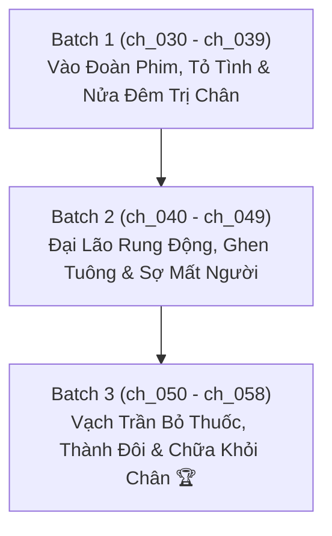

# 📋 KẾ HOẠCH & TIẾN ĐỘ DỊCH THUẬT & QC ARC 2: GIỚI GIẢI TRÍ & ĐẠI LÃO TÀN TẬT

> **Bộ truyện:** Xuyên Thư Xong Tôi Giả Gay Trong Truyện Bá Tổng [Khoái Xuyên] (《装弯后霸总自我攻略了[快穿]》)  
> **Thế giới 2 (Arc 2):** Giới Giải Trí & Showbiz (Cậu ấm phú nhị đại Lận Duy $\times$ Đại lão xe lăn âm u Hàn Kỳ)  
> **Phạm vi chương:** Chương 30 đến Chương 58 (`ch_030` $\rightarrow$ `ch_058`)  
> **Quy chuẩn áp dụng:** [`rules_arc_2.md`](rules_arc_2.md) & [`AGENTS.md`](AGENTS.md)  
> **Chế độ thực thi:** **Fast Batch Mode** (Dịch 1:1, Auto QC Audit, Auto Lorekeeper theo từng đợt)  
> **Mục tiêu cốt lõi:** Dịch chuẩn xác 1:1, khóa chặt đại từ Công (Lận Duy) = "hắn / anh / tiểu thiếu gia", Thụ (Hàn Kỳ) = "anh / y / đại lão", giữ nguyên vẹn độ hài hước, phản sáo lộ, sự tự suy diễn và màn chữa lành đôi chân tàn tật.

---

## 📊 1. BẢNG TỔNG QUAN TIẾN ĐỘ ARC 2

| Chỉ số | Giá trị | Ghi chú |
| :--- | :---: | :--- |
| **Tổng số chương Arc 2** | **29 chapters** | `ch_030` (nửa sau) $\rightarrow$ `ch_058` (Toàn bộ thế giới 2) |
| **Đã hoàn thành (QC_PASSED)** | **3 / 29** | `ch_030`, `ch_031`, `ch_032` hoàn tất 100% |
| **Đang chờ xử lý** | **26 chapters** | Tiếp tục Batch 1 (`ch_033` $\rightarrow$ `ch_039`) |
| **Tiến độ tổng thể** | **10.3%** | Đang triển khai liên tục |
| **Quy chuẩn đại từ bắt buộc** | **100% Locked** | **Công (Lận Duy) = "cậu / tiểu thiếu gia / Lận Duy"** **Thụ (Hàn Kỳ) = "anh / y / đại lão / Hàn Kỳ"** **Nữ chính (Mạnh Tuyết) = "cô"** **Đối thoại: Ban đầu: Công xưng "tôi" - gọi "anh / Hàn tiên sinh"; Thụ xưng "tôi" - gọi "cậu / Lận Duy". Khi yêu đương (niên hạ): Công (Lận Duy) xưng "em" - gọi "anh / A Kỳ"; Thụ (Hàn Kỳ) xưng "anh" - gọi "em / Lận Duy".** |

---

## 📦 2. PHÂN CHIA CÁC BATCH CHI TIẾT

---

### 🔹 BATCH 1: Vào Đoàn Phim, "Tỏ Tình" Đại Lão & Lén Vào Phòng Trị Chân Ban Đêm (`ch_030` $\rightarrow$ `ch_039`)
* **Mục tiêu:**
  - Lận Duy xuyên sang thế giới 2, bắt gặp bạn gái cũ Mạnh Tuyết; xoay chuyển tình thế bằng cách tuyên bố đến đoàn phim vì "thầm mến đại lão Hàn Kỳ".
  - Đại lão ngồi xe lăn Hàn Kỳ ở ngoài cửa nghe thấy, bán tín bán nghi.
  - Ban đêm, Lận Duy dùng tiếng đàn dương cầm kết hợp thôi miên và hương liệu để giảm đau, lén vào phòng cởi quần xoa bóp, châm cứu cho đôi chân teo cơ của Hàn Kỳ.
  - Hệ thống phát hoảng vì Lận Duy "hành động như tên hái hoa". Hàn Kỳ giả vờ ngủ để theo dõi hành tung của Lận Duy và phát hiện sự thật.

| Chapter ID | Tên chương (Hán Việt / Tóm tắt) | Trạng thái QC | Tiến độ | Tóm tắt sự kiện chính |
| :---: | :--- | :---: | :---: | :--- |
| `ch_030` | Chương 30: Chuyển Sang Thế Giới Mới & Màn Đảo Ngược Ngoài Cửa | ✅ QC_PASSED | 100% | Hệ thống nộp nhiệm vụ Thế giới 1; Lận Duy xuyên vào vai phú nhị đại bạn trai cũ; tuyên bố gây sốc: "Tôi đến đoàn phim là vì Hàn tiên sinh!" |
| `ch_031` | Chương 31: Diễn Xuất Bạch Nguyệt Quang & Ly Nước Nóng Bất Ngờ | ✅ QC_PASSED | 100% | Lận Duy diễn vai mối tình đầu của Mạnh Tuyết; Hàn Kỳ quan sát từ xa; ngăn chặn kịp thời ly nước sôi của Cao Hàm nhắm vào Hàn Kỳ |
| `ch_032` | Chương 32: Đuổi Kẻ Thủ Đoạn Đi & Tiếng Đàn Dương Cầm Xoa Dịu Nỗi Đau | ✅ QC_PASSED | 100% | Cao Hàm muối mặt rời đoàn phim; Hàn Kỳ đau chân không chịu đi viện; Lận Duy được dẫn vào phòng đàn piano và dịu dàng mỉm cười |
| `ch_033` | Chương 33: Tiếng Đàn Thôi Miên & "Tên Hái Hoa" Nửa Đêm | ⏳ Chờ xử lý | 0% | Lận Duy đàn piano kết hợp thôi miên giúp Hàn Kỳ bớt đau đớn; hệ thống kêu la thảm thiết ví Lận Duy như kẻ hái hoa |
| `ch_034` | Chương 34: Xoa Bóp Hai Chân & Sự Giận Dỗi Vô Cớ | ⏳ Chờ xử lý | 0% | Lận Duy đắp chăn mỏng, kiểm tra và xoa bóp cơ chân cho Hàn Kỳ; Hàn Kỳ thức giấc thấy Lận Duy thu tay thì lại khó chịu trong lòng |
| `ch_035` | Chương 35: Kẻ Bề Trên Thất Thế & Quyết Định Theo Dõi | ⏳ Chờ xử lý | 0% | Hàn Kỳ quen thói上位 giả vờ không biết chuyện bị chăm sóc ban đêm, nhưng muốn tận mắt xem Lận Duy làm những gì |
| `ch_036` | Chương 36: Cài Đặt Camera & Lệnh Đuổi Khách | ⏳ Chờ xử lý | 0% | Hàn Kỳ yêu cầu Uông Dương kiểm tra phòng; lúng túng sợ trợ lý phát hiện manh mối riêng tư |
| `ch_037` | Chương 37: Lời Đề Nghị Chữa Trị Bị Từ Chối | ⏳ Chờ xử lý | 0% | Hàn Kỳ ra lệnh đuổi khách; Lận Duy kiên nhẫn thuyết phục đại lão tiếp tục điều trị bằng phương pháp đông y kết hợp |
| `ch_038` | Chương 38: Cố Tình Không Ngủ & Mặt Đỏ Tai Hồng | ⏳ Chờ xử lý | 0% | Hàn Kỳ cố gắng chống lại cơn buồn ngủ từ tiếng đàn; cảm nhận bàn tay ấm áp của Lận Duy xoa bóp chân khiến mặt đỏ tía tai |
| `ch_039` | Chương 39: Bữa Cơm Khách Sạn & Cảm Giác Xót Xa | ⏳ Chờ xử lý | 0% | Uông Dương đổi hợp đồng cho Mạnh Tuyết; Hàn Kỳ chứng kiến Lận Duy chịu thiệt thòi vì mình mà thấy cay cay nơi đáy mắt |

---

### 🔹 BATCH 2: Đại Lão Tự Não Bổ, Rung Động & Sợ Bị Hết Yêu (`ch_040` $\rightarrow$ `ch_049`)
* **Mục tiêu:**
  - Hàn Kỳ tự dằn vặt: "Có phải mình đối xử quá tàn nhẫn với cậu ấy không?".
  - Lận Duy không xuất hiện đúng giờ khiến đại lão bồn chồn mất ăn mất ngủ.
  - Hàn Kỳ tự mình làm lộ chuyện đã biết Lận Duy "thích mình"; bắt Lận Duy không được gọi khách sáo là "Hàn tiên sinh".
  - Nụ hôn bất ngờ rơi trên gò má; Hàn Kỳ cho phép Lận Duy dọn đến chăm sóc mình hàng ngày.
  - Hàn Kỳ phát sinh tâm lý ghen tuông, liên tục hỏi dồn: "Cậu còn thích tôi không?".

| Chapter ID | Tên chương (Hán Việt / Tóm tắt) | Trạng thái QC | Tiến độ | Tóm tắt sự kiện chính |
| :---: | :--- | :---: | :---: | :--- |
| `ch_040` | Chương 40: Bữa Ăn Buffet & Tự Vấn Lương Tâm | ⏳ Chờ xử lý | 0% | Lận Duy hẹn gặp Hàn Kỳ ở góc nhà hàng buffet; Hàn Kỳ tự hỏi có phải mình đã quá độc đoán và tàn nhẫn với Lận Duy |
| `ch_041` | Chương 41: Vắng Mặt Bữa Trưa & Cơn Giận Của Đại Lão | ⏳ Chờ xử lý | 0% | Lận Duy bận việc không đến báo cáo; Hàn Kỳ mất kiềm chế véo má Lận Duy hỏi: "Thế cậu còn dám thích tôi không?!" |
| `ch_042` | Chương 42: Tự Mình Vạch Áo & Bỏ Rơi Lớp Ngụy Trang | ⏳ Chờ xử lý | 0% | Hàn Kỳ tự phá vỡ vỏ bọc giả vờ ngây ngô; yêu cầu Lận Duy không được gọi mình bằng đại từ xa cách "Hàn tiên sinh" |
| `ch_043` | Chương 43: Nỗi Ngập Ngừng Của Danh Xưng Mới | ⏳ Chờ xử lý | 0% | Lận Duy chưa kịp gọi tên thân mật; hai người bất chợt rơi vào khoảng lặng ngượng ngùng |
| `ch_044` | Chương 44: Nụ Hôn Lệch Trên Gò Má | ⏳ Chờ xử lý | 0% | Trong lúc sơ ý, nụ hôn khẽ lướt qua gò má Lận Duy; Hàn Kỳ bối rối tìm lý do bào chữa với trợ lý Uông Dương |
| `ch_045` | Chương 45: Chuyển Về Ở Cạnh & Kế Hoạch Thực Dưỡng | ⏳ Chờ xử lý | 0% | Lận Duy đồng ý ở gần để nấu đồ ăn dinh dưỡng hồi phục chân cho Hàn Kỳ; Hàn Kỳ lo lắng Lận Duy sẽ dễ dàng từ bỏ |
| `ch_046` | Chương 46: Chú Mèo Nhỏ & Sự Cố Nhạy Cảm | ⏳ Chờ xử lý | 0% | Uông Dương mang mèo lên phòng; xảy ra sự cố đỏ mặt khi Lận Duy hỗ trợ Hàn Kỳ giải quyết vấn đề cá nhân |
| `ch_047` | Chương 47: Nỗi Xấu Hổ Tột Cùng Của Kẻ Quyền Uy | ⏳ Chờ xử lý | 0% | Hàn Kỳ xấu hổ không dám nhìn mặt Lận Duy; giận dỗi mắng Lận Duy là khúc gỗ không chịu hiểu lòng người |
| `ch_048` | Chương 48: Câu Hỏi Bất An Nơi Đáy Lòng | ⏳ Chờ xử lý | 0% | Uông Dương mang tài liệu điều tra đến; Hàn Kỳ buột miệng hỏi Lận Duy: "Em còn thích tôi không?" |
| `ch_049` | Chương 49: Đừng Hỏi Những Câu Như Thế Nữa | ⏳ Chờ xử lý | 0% | Lận Duy mỉm cười cảnh cáo: "Anh hỏi nữa là tôi tưởng anh hối hận vì đã từ chối tôi đấy"; Hàn Kỳ càng thêm cuống cuồng |

---

### 🔹 BATCH 3: Vạch Trần Kẻ Bỏ Thuốc, Xác Lập Quan Hệ & Chữa Lành Đôi Chân (`ch_050` $\rightarrow$ `ch_058`)
* **Mục tiêu:**
  - Lận Duy buột miệng gọi "A Kỳ", Hàn Kỳ chấn động tóm lấy cổ áo hỏi: "Em đang gọi ai?!".
  - Buổi tiệc rượu: An Trần Dật lén bỏ thuốc kích dục vào ly sâm panh của Hàn Kỳ; Lận Duy kịp thời tráo đổi và vạch trần âm mưu.
  - Hàn Kỳ say rượu đùa giỡn, Lận Duy bảo vệ nghiêm khắc; Hàn Kỳ tuyên bố: "Vậy thì làm bạn trai của em đi!".
  - Hai người xác lập quan hệ chính thức, Lận Duy dốc toàn lực chữa trị giúp đôi chân Hàn Kỳ hồi phục cảm giác và đứng dậy được.
  - Hoàn thành trọn vẹn nhiệm vụ Thế giới 2; Hàn Kỳ cắn yêu Lận Duy và chìm đắm trong hạnh phúc.

| Chapter ID | Tên chương (Hán Việt / Tóm tắt) | Trạng thái QC | Tiến độ | Tóm tắt sự kiện chính |
| :---: | :--- | :---: | :---: | :--- |
| `ch_050` | Chương 50: Tiếng Gọi "A Kỳ" Làm Chấn Động Đại Lão | ⏳ Chờ xử lý | 0% | Lận Duy bất giác gọi "A Kỳ"; cái tên xuyên thế giới làm Hàn Kỳ sững sờ chộp lấy cổ áo truy vấn |
| `ch_051` | Chương 51: Uông Dương Mắt Tròn Mắt Dẹt | ⏳ Chờ xử lý | 0% | Trợ lý Uông Dương chết lặng trước màn ghen tuông so đo quá mức của sếp; bầu không khí giữa hai người ngập tràn thuốc súng ngọt ngào |
| `ch_052` | Chương 52: Tiệc Rượu & Ly Sâm Panh Bị Bỏ Thuốc | ⏳ Chờ xử lý | 0% | Bữa tiệc của giới giải trí; An Trần Dật âm mưu hạ thuốc; Hàn Kỳ nghịch ngợm lắc ly rượu hỏi có phải xuân dược |
| `ch_053` | Chương 53: Cấm Uống & Lời Tỏ Tình: "Làm Bạn Trai Của Em Đi" | ⏳ Chờ xử lý | 0% | Lận Duy nghiêm mặt giật lại ly rượu; Hàn Kỳ không kiềm lòng được chủ động tỏ tình nhận làm bạn trai của Lận Duy |
| `ch_054` | Chương 54: Vạch Trần Bằng Chứng & Bảo Vệ Nữ Chính | ⏳ Chờ xử lý | 0% | Gửi video bằng chứng hạ thuốc cho Mạnh Tuyết; Hàn Kỳ ra lệnh trừng trị và thanh lọc kẻ xấu trong giới |
| `ch_055` | Chương 55: Mượn Người Cho Mạnh Tuyết & Tình Cảm Thăng Hoa | ⏳ Chờ xử lý | 0% | Mạnh Tuyết an toàn rời đi; Lận Duy và Hàn Kỳ chuyển về dinh thự riêng sống chung |
| `ch_056` | Chương 56: Sự Thật Tâm Tư & Màn Khống Chế Của Lận Duy | ⏳ Chờ xử lý | 0% | Lận Duy thẳng thắn thừa nhận mình "tâm tư không thuần"; đại lão nhận ra mình đã bị Lận Duy khống chế trọn vẹn |
| `ch_057` | Chương 57: Theo Đại Lão Về Nhà & Hệ Thống Chống Đỡ Cơm Chó | ⏳ Chờ xử lý | 0% | Lận Duy chính thức dọn về nhà lớn của Hàn Kỳ; hệ thống than trời vì phải liên tục nuốt "cơm chó" |
| `ch_058` | Chương 58: Vết Cắn Ghen Tuông & Đôi Chân Hồi Sinh 🏆 | ⏳ Chờ xử lý | 0% | Hàn Kỳ ghen cắn một vết trên vai Lận Duy; đôi chân dần hồi phục đi lại được; khép lại viên mãn Thế giới 2 |

---

## 🛠️ 3. QUY TRÌNH THỰC THI (FAST BATCH PIPELINE)

1. **Chuẩn bị dữ liệu:** Cập nhật các nhân vật mới của Arc 2 (Hàn Kỳ, Mạnh Tuyết, Uông Dương, An Trần Dật) vào `memory/characters.json`.
2. **Batch Translation:** Dịch 1:1, bám sát các đoạn đối thoại thể hiện vị thế "đại lão ngoài mặt lạnh lùng bên trong ngạo kiều".
3. **Automated QC:** Kiểm tra đối soát paragraph alignment (1:1), đại từ không bị đảo lộn, ngoặc kép chuẩn `“...”`.
4. **Lorekeeper:** Ghi nhận tiến trình hồi phục chân của Hàn Kỳ và mốc tình cảm vào `memory/timeline.json`.
