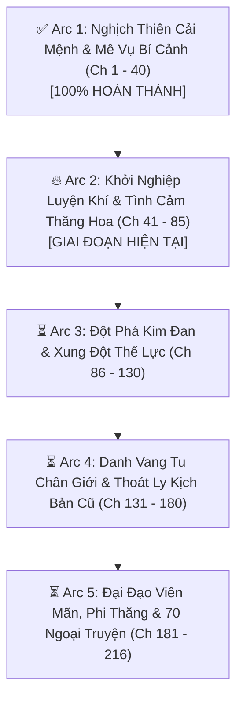
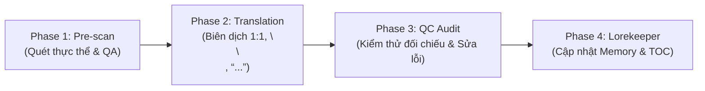

# 🗺️ KẾ HOẠCH TRIỂN KHAI DỊCH THUẬT TOÀN DỰ ÁN (PROJECT TRANSLATION PLAN)
## XUYÊN VÀO PHÁO HÔI CỦA TRUYỆN TỔNG THỤ VÀ CHÍNH BÀI CÔNG 1V1 (《穿进总受文的炮灰和正牌攻1v1了》)

> **Tác giả:** 哼哼 (Hanh Hanh) / 哼哼爱吃家常菜  
> **Quy mô dự án:** **216 chương** (146 chương Chính văn + 70 chương Ngoại truyện)  
> **Slug:** `xuyên-vào-pháo-hôi-của-truyện-tổng-thụ-và-chính-bài-công-1v1`  
> **Thể loại:** Đam mỹ, Tiên hiệp tu chân, Cổ đại, Xuyên thư, Chủ công, Thăng cấp lưu, Chủng điền làm giàu, Luyện khí, Tiên tố hậu ái, 1v1, HE.  
> **Cặp đôi chính:** Nhiếp Thế Vân (Công) × Địch Bạch Dung (Thụ)  
> **Tình trạng hiện tại:** Đã hoàn thành 100% dịch & QC **Chương 1 – 40** (Arc 1). Toàn bộ raw từ Chương 41 – 216 đã được nạp sẵn vào workspace.

---

## 🎯 I. MỤC TIÊU CỐT LÕI

1. **Văn phong Tiên hiệp chuẩn mực:** Duy trì giọng văn cổ phong trầm tĩnh, mạch lạc, toát lên sự cơ trí, thực tế của Nhiếp Thế Vân và khí chất thiên chi kiêu tử của Địch Bạch Dung.
2. **Kỷ luật định dạng 100%:**
   - 100% khớp đoạn 1:1 (`source.md` ↔ `translation.md`).
   - Đúng khoảng cách `\n\n` giữa tất cả các đoạn văn và lời thoại.
   - Chuẩn hóa ngoặc kép hội thoại `“...”`.
   - Phân biệt tuyệt đối đại từ ngôi 3: Nhiếp Thế Vân = **“hắn”**, Địch Bạch Dung = **“y”**. Không dùng "anh - cậu", không dùng "mày - tao".
3. **Quy tắc Universal Zero Google API Key:** Agent tự thân xử lý toàn bộ quy trình, không gọi API ngoài, triệt tiêu hoàn toàn nguy cơ 429 Resource Exhausted.
4. **Cơ chế vận hành Subagent linh hoạt:** Sẵn sàng phân luồng Worker Subagent chạy song song độc lập khi triển khai batch lớn.

---

## 📦 II. LỘ TRÌNH 5 ĐẠI ARC (5 MAJOR ARCS ROADMAP)

---

### 🔹 ARC 1: NGHỊCH THIÊN CẢI MỆNH & MÊ VỤ BÍ CẢNH (CHƯƠNG 1 - 40)
- **Trạng thái:** ✅ **HOÀN THÀNH 100% (40/40 chương)**
- **Thành quả:**
  - Nhiếp Thế Vân xuyên thư, nghịch chuyển vận mệnh pháo hôi.
  - Vượt qua Mê Vụ Bí Cảnh, lấy được cơ duyên và thiết lập quan hệ định mệnh 1v1 với Địch Bạch Dung.
  - Tranh tài tại Đại hội Tu tiên ở Lăng Thiên Thành, vạch rõ ranh giới với Đoạn Minh Ngọc.
  - 100% đạt chuẩn QC, đã đồng bộ `memory/` và `timeline.json`.

---

### 🔥 ARC 2: KHỞI NGHIỆP LUYỆN KHÍ & TÌNH CẢM THĂNG HOA (CHƯƠNG 41 - 85)
- **Trạng thái:** 🎯 **ĐANG TRIỂN KHAI (45 chương)**
- **Tiêu điểm cốt truyện:**
  - **U hội ban đêm & Chia sẻ bí mật (Ch 41 - 45):** Địch Bạch Dung lén tới gặp Nhiếp Thế Vân tại viện riêng, cả hai thổ lộ tâm tư và dần hé lộ những bí mật lớn về tu luyện, tặng quà pháp bảo riêng.
  - **Bế mạc Đại hội & Rời Lăng Thiên Thành (Ch 46 - 55):** Kết thúc các vòng đấu, các môn phái trở về. Đoạn Minh Ngọc và nhóm công hậu cung cảm thấy hụt hẫng và nghi kỵ khi Địch Bạch Dung ngày càng xa cách.
  - **Mở rộng luyện khí & Thương mại hóa (Ch 56 - 70):** Nhiếp Thế Vân rèn đúc pháp bảo cao cấp, kiếm linh thạch, phát triển thế lực kinh tế ngầm, giúp Địch Bạch Dung tu luyện vượt bậc.
  - **Tình cảm sâu đậm & Đạo lữ bền chặt (Ch 71 - 85):** Từ bạn cùng giường / liên minh chuyển biến thành tình yêu thấu hiểu, đồng cam cộng khổ, sẵn sàng vì nhau đối đầu với sóng gió.
- **Kế hoạch phân bổ Batch:**
  - **Batch 2.1 (Ch 41 – 50):** 10 chương — U hội viện riêng, tiểu biệt trùng phùng, trao đổi bí mật, kết thúc hải tuyển.
  - **Batch 2.2 (Ch 51 – 60):** 10 chương — Trở về tông môn, bố cục luyện khí mới.
  - **Batch 2.3 (Ch 61 – 70):** 10 chương — Thương hội phát triển, pháp bảo danh tiếng.
  - **Batch 2.4 (Ch 71 – 80):** 10 chương — Xung đột kịch bản cũ, tình cảm công khai giữa 2 người.
  - **Batch 2.5 (Ch 81 – 85):** 5 chương — Hoàn tất Arc 2, chuẩn bị kết đan.

---

### 🔹 ARC 3: ĐỘT PHÁ KIM ĐAN & XUNG ĐỘT THẾ LỰC (CHƯƠNG 86 - 130)
- **Quy mô:** 45 chương
- **Tiêu điểm cốt truyện:**
  - Hành trình tích lũy tài nguyên kết đan, vượt lôi kiếp Kim Đan đầy chấn động.
  - Địch gia và các thế lực lớn nhận thấy sự biến chuyển của Địch Bạch Dung.
  - Nhiếp Thế Vân thể hiện thực lực luyện khí chấn động cả giới tu chân.

---

### 🔹 ARC 4: DANH VANG TU CHÂN GIỚI & THOÁT LY KỊCH BẢN (CHƯƠNG 131 - 180)
- **Quy mô:** 50 chương
- **Tiêu điểm cốt truyện:**
  - Thăng cấp Nguyên Anh / Hóa Thần, địa vị vững như bàn thạch.
  - Hào quang vạn nhân mê của Đoạn Minh Ngọc sụp đổ hoàn toàn trước thực lực chân chính.
  - Tái thiết lập trật tự Vân Thanh Các, đập tan mọi âm mưu của các đại phái.

---

### 🔹 ARC 5: ĐẠI ĐẠO VIÊN MÃN, PHI THĂNG & 70 NGOẠI TRUYỆN (CHƯƠNG 181 - 216)
- **Quy mô:** 36 chương
- **Tiêu điểm cốt truyện:**
  - Sửa chữa phi thăng thông đạo, cùng nhau phi thăng Thượng Thiên Giới.
  - Xây dựng tân Vân Thanh Các tại Thượng giới.
  - 70 chương phiên ngoại trọn vẹn: Cuộc sống thường nhật ngọt ngào, du ngoạn hạ giới, ngoại truyện các tuyến nhân vật phụ (Huyền Dương x Thẩm Duyên).
  - Đại kết cục viên mãn.

---

## ⚡ III. QUY TRÌNH THỰC THI 4 PHA (THE 4-PHASE ENGINE)

1. **Phase 1: Pre-scan & Tra cứu Thực thể:**
   - Trích xuất nhân vật, địa danh, đan dược, cảnh giới mới từ `source.md`.
   - Tra cứu trong `memory/characters.json` và `glossary.json`.
2. **Phase 2: Translation (Biên dịch chính thức):**
   - Đọc trực tiếp `source.md`.
   - Áp ma trận đại từ: Nhiếp Thế Vân = **hắn**, Địch Bạch Dung = **y**.
   - Ngoặc kép cong `“...”`, khoảng cách `\n\n`, bảo đảm số đoạn bằng đúng 100% bản gốc.
3. **Phase 3: Strict QC Audit (Kiểm thử đa tầng):**
   - Kiểm tra đoạn: `len(translation.paragraphs) == len(source.paragraphs)`.
   - Quét lỗi đá ngôi, soát đại từ cấm ("anh/cậu", "mày/tao").
   - Ghi nhận `qc_report.md`.
4. **Phase 4: Lorekeeper & Đồng bộ:**
   - Ghi thông tin mới vào `memory/characters.json`, `glossary.json`, `timeline.json`.
   - Cập nhật mục lục `TOC.md` và chỉ số `chapters_index.json`.

---

## 🚀 IV. BƯỚC THỰC HIỆN TIẾP THEO

- Toàn bộ raw `ch_041` đến `ch_216` đã sẵn sàng trong workspace.
- Khởi động **Batch 2.1 (Chương 41 – 50)** theo lệnh điều phối của người dùng.
