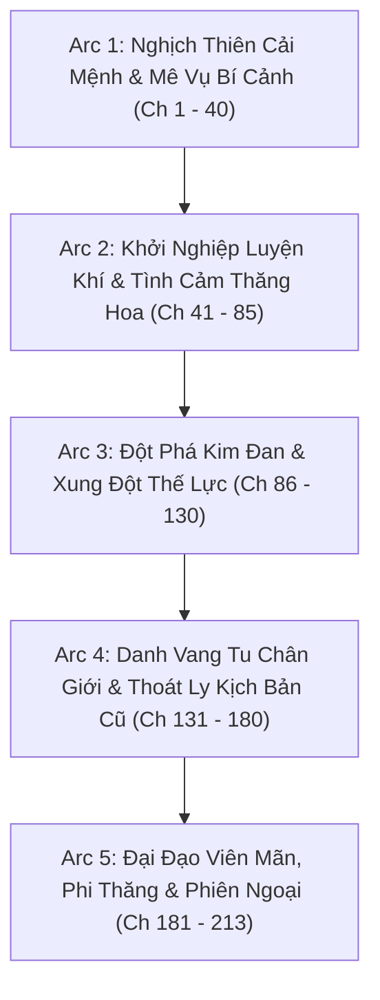
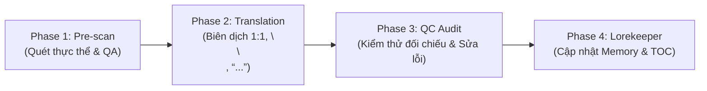

# 🗺️ KẾ HOẠCH TRIỂN KHAI DỊCH THUẬT TOÀN DỰ ÁN (PROJECT TRANSLATION PLAN)
## XUYÊN VÀO PHÁO HÔI CỦA TRUYỆN TỔNG THỤ VÀ CHÍNH BÀI CÔNG 1V1 (《穿进总受文的炮灰和正牌攻1v1了》)

> **Tác giả:** 哼哼 (Hanh Hanh) / 哼哼爱吃家常菜  
> **Quy mô dự án:** 213 chương (Chính văn + Ngoại truyện)  
> **Slug:** `xuyên-vào-pháo-hôi-của-truyện-tổng-thụ-và-chính-bài-công-1v1`  
> **Thể loại:** Đam mỹ, Tiên hiệp tu chân, Cổ đại, Xuyên thư, Chủ công, Thăng cấp lưu, Chủng điền làm giàu, Luyện khí, Tiên tố hậu ái, 1v1, HE.  
> **Cặp đôi chính:** Nhiếp Thế Vân (Công) × Địch Bạch Dung (Thụ)

---

## 🎯 I. MỤC TIÊU CỐT LÕI

1. **Văn phong Tiên hiệp chuẩn mực:** Duy trì giọng văn cổ phong trầm tĩnh, mạch lạc, toát lên sự cơ trí, thực tế của Nhiếp Thế Vân và khí chất thiên chi kiêu tử của Địch Bạch Dung.
2. **Kỷ luật định dạng 100%:**
   - 100% khớp đoạn 1:1 (`source.md` ↔ `translation.md`).
   - Đúng khoảng cách `\n\n` giữa tất cả các đoạn văn và lời thoại.
   - Chuẩn hóa ngoặc kép hội thoại `“...”`.
   - Phân biệt tuyệt đối đại từ ngôi 3: Nhiếp Thế Vân = **“hắn”**, Địch Bạch Dung = **“y”**. Không dùng "anh - cậu", không dùng "mày - tao".
3. **Quy tắc Universal Zero Google API Key:** Agent tự thân xử lý toàn bộ quy trình, không gọi API ngoài, triệt tiêu nguy cơ 429 Resource Exhausted.
4. **Cơ chế vận hành Subagent linh hoạt:** Sẵn sàng phân luồng Worker Subagent chạy song song độc lập khi triển khai batch lớn.

---

## 📦 II. PHÂN CHIA CÁC ARC VÀ GIAI ĐOẠN (5 MAJOR ARCS)

---

### 🔹 ARC 1: NGHỊCH THIÊN CẢI MỆNH & MÊ VỤ BÍ CẢNH (CHƯƠNG 1 - 40)
- **Tiêu điểm cốt truyện:**
  - Nhiếp Thế Vân xuyên vào thân xác tu nhị đại pháo hôi, tìm hiểu hiện trạng Vân Thanh Các.
  - Khắc phục nhược điểm tam linh căn, vận dụng không gian bí mật và tài năng luyện khí.
  - Tiến vào **Mê Vụ Bí Cảnh**: Chủ động nẫng trước cơ duyên của nguyên tác, va chạm định mệnh với Địch Bạch Dung.
  - Sự kiện "Tiên tố hậu ái" (phát sinh quan hệ vì biến cố cơ duyên) và bước đầu thiết lập liên minh cùng có lợi.
- **Mục tiêu kỹ thuật & Dịch thuật:**
  - Định hình chuẩn mực toàn bộ hệ thống đại từ ("hắn" vs "y"), thuật ngữ luyện khí, linh thạch, đan dược.
  - Hoàn thiện bộ khung `memory/` gốc (nhân vật, môn phái, cảnh giới Luyện Khí -> Trúc Cơ).

---

### 🔹 ARC 2: KHỞI NGHIỆP LUYỆN KHÍ & TÌNH CẢM THĂNG HOA (CHƯƠNG 41 - 85)
- **Tiêu điểm cốt truyện:**
  - Cả hai cùng rời khỏi bí cảnh, đối diện với phản ứng từ gia tộc và các phe phái.
  - Nhiếp Thế Vân mở rộng chế tạo pháp bảo, kiếm linh thạch, phát triển sự nghiệp thương hội / luyện khí độc lập.
  - Mối quan hệ giữa Nhiếp Thế Vân và Địch Bạch Dung chuyển từ "bạn cùng giường / đối tác" sang tình cảm chân thành, thấu hiểu và tin cậy lẫn nhau.
  - Tuyến cốt truyện của Đoạn Minh Ngọc và các công khác trong nguyên tác bắt đầu chệch hướng do thiếu vắng Địch Bạch Dung.
- **Mục tiêu kỹ thuật & Dịch thuật:**
  - Xử lý các màn đối đáp tinh tế, ấm áp của cặp đôi chính.
  - Kiểm định QC nghiêm ngặt tính nhất quán tên gọi các loại pháp bảo và vật liệu luyện khí.

---

### 🔹 ARC 3: ĐỘT PHÁ KIM ĐAN & XUNG ĐỘT THẾ LỰC (CHƯƠNG 86 - 130)
- **Tiêu điểm cốt truyện:**
  - Hành trình tích lũy tài nguyên để kết đan, vượt qua lôi kiếp Kim Đan.
  - Âm mưu từ các thế gia và phản diện phụ nhắm vào bí mật luyện khí và thực lực của Nhiếp Thế Vân.
  - Địch Bạch Dung kiên quyết đứng về phía Nhiếp Thế Vân, chính thức rạn nứt với các ràng buộc cũ.
- **Mục tiêu kỹ thuật & Dịch thuật:**
  - Tăng cường chất lượng miêu tả các trận chiến pháp thuật, lôi kiếp và thao tác rèn đúc pháp bảo cao cấp.
  - Kiểm soát tuyệt đối không để lẫn lộn danh xưng trong các cảnh giao tranh đông người.

---

### 🔹 ARC 4: DANH VANG TU CHÂN GIỚI & THOÁT LY KỊCH BẢN CŨ (CHƯƠNG 131 - 180)
- **Tiêu điểm cốt truyện:**
  - Thăng cấp Nguyên Anh / Hóa Thần, địa vị của Nhiếp Thế Vân và Địch Bạch Dung trở nên vững chắc tột đỉnh.
  - Hào quang của tổng thụ Đoạn Minh Ngọc suy giảm nghiêm trọng khi thế giới vận hành theo thực lực chân chính.
  - Hóa giải triệt để các ân oán môn phái, bảo vệ Vân Thanh Các và xây dựng thế lực riêng của hai người.
- **Mục tiêu kỹ thuật & Dịch thuật:**
  - Duy trì sự gãy gọn của văn phong, tránh sa đà vào từ ngữ hoa mỹ rườm rà.
  - Cập nhật liên tục `timeline.json` theo các sự kiện lớn của tu chân giới.

---

### 🔹 ARC 5: ĐẠI ĐẠO VIÊN MÃN, PHI THĂNG & NGOẠI TRUYỆN (CHƯƠNG 181 - 213)
- **Tiêu điểm cốt truyện:**
  - Cùng nhau trải qua đại kiếp, đắc đạo thành tiên, kết thành đạo lữ vĩnh cửu.
  - Các chương ngoại truyện ngọt ngào: Cuộc sống thường nhật viên mãn, du ngoạn hồng trần, góc nhìn của các nhân vật phụ đối với cặp đôi 1v1 huyền thoại.
- **Mục tiêu kỹ thuật & Dịch thuật:**
  - Tổng kết toàn diện `memory/`, hoàn tất ấn bản dịch thuật đầy đủ 213 chương.
  - Đóng gói xuất bản và xuất báo cáo hoàn thành toàn dự án.

---

## ⚡ III. QUY TRÌNH THỰC THI 4 PHA (THE 4-PHASE ENGINE)

1. **Phase 1: Pre-scan & Tra cứu Thực thể:**
   - Trích xuất tự động danh sách nhân vật, địa danh, đan dược, cảnh giới mới.
   - Đối chiếu quy chuẩn tên gọi đã ghi nhận trong `memory/characters.json` và `glossary.json`.
2. **Phase 2: Translation (Biên dịch chính thức):**
   - Đọc từng đoạn `source.md`.
   - Áp ma trận đại từ: Nhiếp Thế Vân = **hắn**, Địch Bạch Dung = **y**.
   - Ngoặc kép cong `“...”`, khoảng cách `\n\n`, bảo đảm số đoạn bằng đúng 100% bản gốc.
3. **Phase 3: Strict QC Audit (Kiểm thử đa tầng):**
   - Soát số lượng đoạn: `len(translation.paragraphs) == len(source.paragraphs)`.
   - Quét lỗi đá ngôi trần thuật, lỗi dùng từ hiện đại ("anh - cậu", "mày - tao").
   - Ghi kết quả vào `qc_report.md`.
4. **Phase 4: Lorekeeper & Đồng bộ:**
   - Cập nhật thông tin mới vào `memory/characters.json`, `glossary.json`, `timeline.json`.
   - Cập nhật mục lục `TOC.md` và chỉ số `chapters_index.json`.

---

## 🚀 IV. BƯỚC TIẾP THEO

- Nạp văn bản gốc `source.md` cho các chương bắt đầu từ **Chương 1** (hoặc theo từng Batch 10 chương: `ch_001` -> `ch_010`).
- Khởi động quy trình tự hành 4 pha để thực hiện biên dịch trực tiếp.
