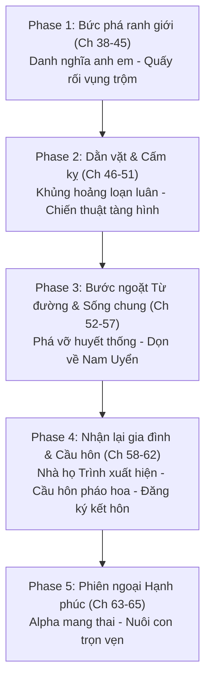

# 📜 QUY CHUẨN DỊCH THUẬT & XƯNG HÔ THẾ GIỚI 2 (ARC 2)
## ĐÃ KÍCH HOẠT HỆ THỐNG ĐỔI THỤ (换受系统已绑定)
> **Tên đơn nguyên:** Thiếu gia giả Beta x Thụ Alpha gia trưởng phong kiến (Chương 38 – Chương 65)  
> **Cặp đôi chính:** Mẫn Tòng Khiêm (Công - Beta nghiên cứu cơ giáp) × Tiết Cảnh Minh (Thụ - Alpha gia trưởng phong kiến)  
> **Phạm vi chương:** `ch_038` đến `ch_065` (gồm cả 3 chương phiên ngoại 63, 64, 65).

---

## 1. BẢNG THỰC THỂ & NHÂN VẬT TOÀN DIỆN THẾ GIỚI 2

| Tên nhân vật | Chữ Hán | Đại từ ngôi 3 | Thân phận & Đặc điểm nhận diện cốt lõi |
| :--- | :--- | :--- | :--- |
| **Mẫn Tòng Khiêm** | 闵从谦 | **cậu** *(hoặc "Mẫn Tòng Khiêm", "chàng Beta")* | **Công chính Arc 2** (24 tuổi, Beta nghiên cứu cơ giáp). Con ruột Thượng tướng Trình Mục bị bế nhầm sang nhà họ Tiết từ nhỏ; năm 16 tuổi bị Tiết Sơn Thanh trục xuất cho họ hàng nhà họ Mẫn dưới quê nuôi. Cao lớn, mắt hoa đào lẳng lơ, bên ngoài giả lầm lì chịu đòn, bên trong thâm sâu, miệng lưỡi cay độc, trả thù gã anh cả gia trưởng. |
| **Tiết Cảnh Minh** | 薛景明 | **anh** *(hoặc "Tiết Cảnh Minh", "gã Alpha", "hắn")* | **Thụ chính Arc 2** (28 tuổi, Alpha gia trưởng phong kiến, người thừa kế tập đoàn nhà họ Tiết). Độc đoán, cổ hủ, coi trọng tôn ti trật tự gia tộc. Có vết bớt đỏ hình bướm ở gốc đùi. Từng nhảy lầu tầng 3 suýt chết để đón Mẫn Tòng Khiêm năm 16 tuổi. Bị Mẫn Tòng Khiêm cưỡng hôn, trêu đùa hạ bộ, quất mông và thuần phục nằm dưới. |
| **Tiết Tòng Nhiên** | 薛从然 | **cậu ta / nó** | **Em trai út Omega** nhà họ Tiết (diễn viên nổi tiếng). Tính tình nông nổi kiêu kỳ, nhưng bản tính lương thiện; sau khi biết Mẫn Tòng Khiêm không phải anh ruột vẫn hết lòng ủng hộ và gọi "anh hai". |
| **Tiết Sơn Thanh** | 薛山青 | **ông / ông Tiết** | **Cha gia trưởng nhà họ Tiết** (Alpha độc tài, trọng thể diện, tàn nhẫn dùng gia quy từ đường và đòn roi trừng phạt con cái). |
| **Ninh Lệ Trân** | 宁丽珍 | **bà / bà Tiết** | **Mẹ nhà họ Tiết** (Omega quý tộc, coi trọng hư vinh, thiên vị con út Tiết Tòng Nhiên, coi rẻ Mẫn Tòng Khiêm). |
| **Trình Mục** | 程牧 | **ông / Thượng tướng Trình** | **Ba ruột thật sự của Mẫn Tòng Khiêm** (Đại tướng quân / Thượng tướng Alpha uy nghiêm của quân đội, cực kỳ yêu thương và bảo vệ con trai). |
| **Văn Cẩm Tâm** | 文锦心 | **bà / bà Văn** | **Mẹ ruột thật sự của Mẫn Tòng Khiêm** (Nhà ngoại giao Omega cao cấp, dịu dàng, quý phái, xót xa cho con trai ruột phải chịu khổ). |
| **Trình Tích** | 程惜 | **anh ta / Trình Tích** | **Người bị bế nhầm với Mẫn Tòng Khiêm** (Thực chất là con ruột nhà họ Tiết nhưng lớn lên ở nhà họ Trình, là quân nhân cơ giáp cấp cao). Khí phách chính trực, từ chối nhận lại nhà họ Tiết, hết lòng giúp đỡ Mẫn Tòng Khiêm. |
| **Đàn Kỳ** | 檀麒 | **anh ta / Đàn Kỳ** | **Bạn của Tiết Cảnh Minh** (Thiếu gia nhà họ Đàn, người Tiết Sơn Thanh định ép gả Mẫn Tòng Khiêm cho). Có tình cảm mờ ám và gây mâu thuẫn giữa hai anh em. |
| **Mẫn Khải & Hàn Hiểu Mai** | 闵凯 & 韩晓梅 | **ông / bà** | **Cha mẹ nuôi ở quê miền Nam** (Họ hàng nhà họ Mẫn nhận nuôi Mẫn Tòng Khiêm năm 16 tuổi khi cậu bị Tiết Sơn Thanh tống đi; tính tình chân chất ấm áp). |
| **Bàng Tranh** | 庞峥 | **anh ta / Bàng Tranh** | Đồng nghiệp thân thiết tại Viện nghiên cứu cơ giáp, tính tình hài hước, hay rủ đi ăn trưa. |
| **Hà Tuệ** | 何慧 | **cô ấy / Hà Tuệ** | Đồng nghiệp nữ tại Viện nghiên cứu cơ giáp. |
| **Lục Lục** | 六六 | **nó / Lục Lục** | **Hệ thống Đổi Thụ** trong tâm trí Mẫn Tòng Khiêm, thích hóng chuyện đổi thụ của ký chủ. |
| **Ôn Ngọc** | 温玉 | **cậu ta / Ôn Ngọc** | **Nguyên thụ phản bội** (Bạn trai cũ tham phú phụ bần cắm sừng Mẫn Tòng Khiêm ở chương đầu). |

---

## 2. PHÂN ĐỊNH 5 GIAI ĐOẠN (PHASES) & BIẾN CHUYỂN QUAN HỆ

Arc 2 được chia thành **5 Phase** rạch ròi theo sự thay đổi bước ngoặt về nhận thức, huyết thống và tình cảm:

---

## 3. MA TRẬN XƯNG HÔ ĐỐI THOẠI CHI TIẾT THEO TỪNG PHASE

> 🚨 **QUY TẮC CỐT LÕI (MỆNH LỆNH NGƯỜI DÙNG):**  
> **TỪ CHƯƠNG 45 TRỞ ĐI (CH 45 – CH 65): CÔNG - THỤ (MẪN TÒNG KHIÊM & TIẾT CẢNH MINH) BẮT BUỘC GỌI NHAU LÀ "ANH - EM" NHƯ ANH EM TRONG GIA ĐÌNH!**  
> - **Tiết Cảnh Minh:** Luôn xưng **"anh"**, gọi **"em"** *(hoặc gọi tên "Tòng Khiêm")*.  
> - **Mẫn Tòng Khiêm:** Luôn xưng **"em"**, gọi **"anh"** *(hoặc "anh trai")*.  
> - ❌ **TUYỆT ĐỐI CẤM:** Không xưng **"tôi - cậu"**, không xưng **"tôi - anh"** giữa hai người từ chap 45 trở đi (kể cả khi tức giận, cãi nhau, quấy rối hay dằn vặt).

---

### 🔹 GIAI ĐOẠN ĐẦU (CH 38 – CH 44): BƯỚC ĐẦU THĂM DÒ & ĐỤNG ĐỘ
* **Trước mặt gia đình họ Tiết (Tiết Sơn Thanh, Ninh Lệ Trân, Tiết Tòng Nhiên):**
  - Tiết Cảnh Minh với cha mẹ: BẮT BUỘC xưng **"con"**, gọi **"ba - mẹ"** *(Tuyệt đối cấm xưng "tôi" với cha mẹ!)*.
  - Mẫn Tòng Khiêm với cha mẹ họ Tiết: BẮT BUỘC xưng **"con"**, gọi **"ba - mẹ"** *(Tuyệt đối cấm xưng "em" hoặc "tôi" với cha mẹ!)*.
  - Tiết Cảnh Minh với Mẫn Tòng Khiêm: Xưng **"anh"**, gọi **"cậu / em / Mẫn Tòng Khiêm"**.
  - Mẫn Tòng Khiêm với Tiết Cảnh Minh: Xưng **"em"**, gọi **"anh"**.
* **Khi ở riêng (Ch 38 - 44):**
  - Mẫn Tòng Khiêm có thể xưng **"tôi"**, gọi **"anh"** khi khiêu khích, nắm thóp.
  - Tiết Cảnh Minh xưng **"tôi / anh"**, gọi **"cậu"**.

---

### 🔹 BƯỚC NGOẶT TỪ CHƯƠNG 45 TRỞ ĐI (CH 45 – CH 65): TOÀN BỘ XƯNG "ANH - EM"
* **Quy chuẩn duy nhất giữa Công và Thụ:**
  - Tiết Cảnh Minh xưng **"anh"**, gọi **"em / Tòng Khiêm"**.
  - Mẫn Tòng Khiêm xưng **"em"**, gọi **"anh / anh trai"**.
  - **Sự chuyển biến theo từng chặng:**
    + **Ch 45 – Ch 51 (Dưới bàn ăn, Cãi nhau, Cấm kỵ, Tàng hình, Nằm mơ):** Dù Mẫn Tòng Khiêm quấy rối dưới bàn hay trong phòng ngủ, dù Tiết Cảnh Minh tức giận cảnh cáo, cả hai vẫn bám chặt lấy vỏ bọc xưng hô gia đình **"anh - em"** để tạo sự kích thích, cấm kỵ và trói buộc tâm lý.
    + **Ch 52 – Ch 53 (Từ đường & Phá vỡ huyết thống):** Mẫn Tòng Khiêm khóc nấc che chắn đòn roi: *“Anh ơi... Anh có sao không...”*; Tiết Cảnh Minh dỗ: *“Ngoan, không khóc, có anh ở đây...”*.
    + **Ch 54 – Ch 57 (Sống chung Nam Uyển):** Sống chung như vợ chồng dưới danh nghĩa anh em: gọi **"anh / anh trai"**, xưng **"em"**.
    + **Ch 58 – Ch 62 (Tỏ tình, Cầu hôn, Kết hôn):** Tiết Cảnh Minh: *“Tòng Khiêm! Anh yêu em! Gả cho anh trai có được không?”*. Mẫn Tòng Khiêm ngọt ngào xưng **"em"**, gọi **"anh / anh trai"**.
    + **Ch 63 – Ch 65 (Phiên ngoại mang thai):** Vợ chồng son xưng **"anh - em"** âu yếm, bền chặt.

---

### 🔹 GIAI ĐOẠN 4 (CH 58 – CH 62): CAO TRÀO TÌNH CẢM, CẦU HÔN & KẾT HÔN
* **Nhận lại ba mẹ ruột họ Trình (Ch 58, 60):**
  - Mẫn Tòng Khiêm với Trình Mục & Văn Cẩm Tâm: Xưng **"con"**, gọi **"ba - mẹ"**.
  - Tiết Cảnh Minh với Trình Mục & Văn Cẩm Tâm: Xưng **"cháu / con"**, gọi **"chú Trình - cô Văn"** hoặc **"ba Trình - mẹ Văn"**.
* **Tiết Cảnh Minh và Mẫn Tòng Khiêm:**
  - Tiết Cảnh Minh: Xưng **"anh"**, gọi **"em / Tòng Khiêm"** (chủ động cầu hôn: *“Tòng Khiêm! Anh yêu em! Gả cho anh trai có được không?”*).
  - Mẫn Tòng Khiêm: Gọi **"anh / anh trai"**, xưng **"em"** (vẫn giữ nét trêu chọc bá đạo của Công).
* **Đăng ký kết hôn & Động phòng hoa chúc (Ch 61 - 62):**
  - Vị trí: **Mẫn Tòng Khiêm (Công / Kèo trên)** × **Tiết Cảnh Minh (Thụ / Kèo dưới)**.

---

### 🔹 GIAI ĐOẠN 5 (CH 63 – CH 65): PHIÊN NGOẠI MANG THAI & HẠNH PHÚC GIA ĐÌNH
* **Mối quan hệ:** Vợ chồng hợp pháp, Alpha mang thai con của Beta.
* **Xưng hô:**
  - Tiết Cảnh Minh xưng **"anh"**, gọi **"em / Tòng Khiêm"**.
  - Mẫn Tòng Khiêm xưng **"em / anh"** (khi làm chồng/bảo bọc), gọi Tiết Cảnh Minh là **"anh / anh trai / bà xã"**.

---

## 4. QUY TẮC ĐẠI TỪ NGÔI KỂ THỨ 3 (TRÁNH LẪN LỘN TUYỆT ĐỐI)

1. **Phân định rõ ranh giới:**
   - **Mẫn Tòng Khiêm:** Luôn dùng **"cậu"**, **"chàng Beta"**, hoặc tên riêng **"Mẫn Tòng Khiêm"**.
   - **Tiết Cảnh Minh:** Dùng **"anh"**, **"gã Alpha"**, **"hắn"**, hoặc tên riêng **"Tiết Cảnh Minh"**.
2. ⚠️ **NGHIÊM CẤM TRÙNG LẶP CHỮ "ANH":**
   - Trong cùng một câu văn trần thuật có cả hai người, TUYỆT ĐỐI KHÔNG dùng từ "anh" để chỉ Mẫn Tòng Khiêm. Từ "anh" trong ngôi kể thứ 3 chỉ được dành riêng cho Tiết Cảnh Minh (người lớn tuổi hơn). Nếu nói về Mẫn Tòng Khiêm, bắt buộc dùng "cậu" hoặc "chàng Beta".
3. **Phân biệt Lời thoại vs Trần thuật:**
   - Trong thoại, Mẫn Tòng Khiêm gọi Tiết Cảnh Minh là "anh" / "anh trai".
   - Trong trần thuật, người kể chuyện gọi Mẫn Tòng Khiêm là "cậu", gọi Tiết Cảnh Minh là "anh".

---

## 5. ĐỊNH DẠNG & QUY TẮC BẢO TOÀN NGUYÊN TÁC
- **Cách đoạn 1:1 chuẩn `\n\n`:** Đúng một dòng trống ngăn cách, không dính dòng.
- **Ngoặc kép cong `“...”` cho lời thoại.**
- **Zero Google API Key Policy:** 100% AI Code Agent tự thân biên dịch trực tiếp.
