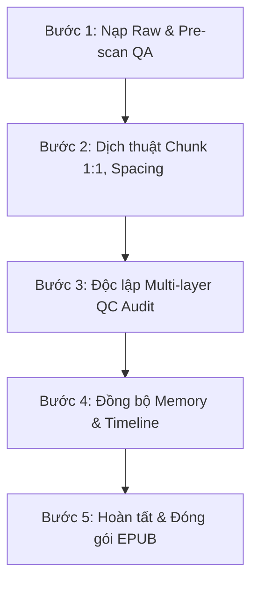

# 📋 KẾ HOẠCH DỊCH THUẬT: ĐÈ CÁC TRA CÔNG (攻了渣攻们)

> **Dự án:** `đè-các-tra-công`  
> **Mục tiêu đợt 1:** Dịch trọn vẹn **Đơn nguyên 1 (Chương 1 -> Chương 5)** — Thế giới ABO Vệ sĩ Alpha x Tra Alpha thiếu gia.  
> **Tổng số đoạn văn:** 717 đoạn.  
> **Quy chuẩn thực thi:** Tuân thủ 100% [RULES.md](RULES.md) và [AGENTS.md](../../AGENTS.md).

---

## 🗺️ TỔNG QUAN TIẾN ĐỘ 5 CHƯƠNG ĐƠN NGUYÊN 1

| Chương | Tiêu đề dự kiến | Số đoạn văn | Trọng tâm nội dung | Trạng thái |
|:---:|:---|:---:|:---|:---:|
| **`ch_001`** | **Chương 1: Ông chủ, đã chuẩn bị để bị đè chưa?** | 231 đoạn | Tiêu Hồi làm vệ sĩ xuất chúng, Tiết Hoài Cẩn đố kị lập mưu chuốc thuốc để cướp Tăng Khả; Tiêu Hồi kích hoạt Hệ thống Bong Bóng Đại Vương, phá vỡ bẫy và tuyên bố phản kích. | ⚪ Chưa dịch |
| **`ch_002`** | **Chương 2: Lật ngược thế cờ giữa chủ và tớ** | 100 đoạn | Tiêu Hồi trực tiếp chế ngự Tiết Hoài Cẩn; sự ngỡ ngàng và khiếp sợ của vị thiếu gia ngạo mạn trước uy lực áp đảo của chàng vệ sĩ Alpha. | ⚪ Chưa dịch |
| **`ch_003`** | **Chương 3: Sự thuần phục của Alpha ngạo mạn** | 104 đoạn | Màn đè ngược tra Alpha; Tiết Hoài Cẩn nếm mùi vị thất bại và bị chinh phục, khoảng cách tâm lý bị đảo lộn hoàn toàn. | ⚪ Chưa dịch |
| **`ch_004`** | **Chương 4: Kẻ phản bội nhận quả đắng** | 153 đoạn | Bộ mặt thật của Tăng Khả bị phơi bày; Tiết Hoài Cẩn phát hiện cơ thể biến đổi kỳ lạ (tra Alpha mang thai); Tiêu Hồi nắm quyền chủ động tuyệt đối. | ⚪ Chưa dịch |
| **`ch_005`** | **Chương 5: Kết thúc Đơn nguyên 1 - Đại kết cục viên mãn** | 129 đoạn | Tra Alpha hoàn toàn ngoan ngoãn thần phục dưới thân Tiêu Hồi; khép lại thế giới 1 trọn vẹn HE, sẵn sàng chuyển tiếp sang đơn nguyên mới. | ⚪ Chưa dịch |

---

## ⚙️ QUY TRÌNH THỰC THI 5 BƯỚC CHUẨN HOÁ

### 1. Bước 1: Nạp Raw & Pre-scan QA (`qa_clarifications.md`)
- Rà soát danh sách tên riêng, thuật ngữ ABO, xưng hô đối thoại của chương.
- Đảm bảo ma trận đại từ Tiêu Hồi (ngôi 3: anh) vs Tiết Hoài Cẩn (ngôi 3: hắn) được xác lập rõ ràng trước khi dịch.

### 2. Bước 2: Dịch thuật chuẩn chỉnh (`translation.md`)
- **Bảo toàn 1:1 số đoạn văn:** Khớp tuyệt đối với `source.md`.
- **Khoảng cách dòng:** Luôn có `\n\n` ngăn cách giữa từng đoạn.
- **Dấu ngoặc kép:** Sử dụng ngoặc kép chuẩn `“...”`.
- **Văn phong:** Lạnh lùng, nam tính, dã tính, thoại dứt khoát.

### 3. Bước 3: Soát lỗi chuyên sâu Multi-layer QC (`qc_report.md`)
- Quét các lỗi cấm kỵ: lẫn lộn đại từ trần thuật (đá ngôi sang mày/tao), thiếu dấu ngoặc, dính dòng `\n`.
- Đối chiếu số lượng đoạn văn giữa `source.md` và `translation.md`.

### 4. Bước 4: Cập nhật Lorekeeper & Timeline (`memory/`)
- Ghi nhận diễn biến sự kiện của từng chương vào `timeline.json`.
- Cập nhật các danh xưng, thuật ngữ mới phát sinh vào `glossary.json` và `characters.json`.

### 5. Bước 5: Cập nhật chỉ mục & Đóng gói (`TOC.md`, `chapters_index.json`, `EPUB`)
- Đánh dấu hoàn thành chương trên Web App.
- Xuất file EPUB khi hoàn tất trọn vẹn 5 chương của Đơn nguyên 1.

---

## 🚀 KẾ HOẠCH TRIỂN KHAI TIẾP THEO
- **Đợt 1:** Biên dịch **Chương 1 (`ch_001`)** — 231 đoạn văn (Chương mở màn trọng điểm xác lập giọng điệu của cả bộ truyện).
- **Đợt 2:** Biên dịch liên hoàn **Chương 2 + Chương 3 (`ch_002`, `ch_003`)** — 204 đoạn văn.
- **Đợt 3:** Biên dịch liên hoàn **Chương 4 + Chương 5 (`ch_004`, `ch_005`)** — 282 đoạn văn.
- **Đợt 4:** Đóng gói hoàn chỉnh Đơn nguyên 1 xuất file EPUB tải về máy.
